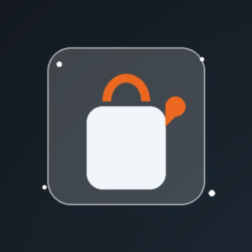
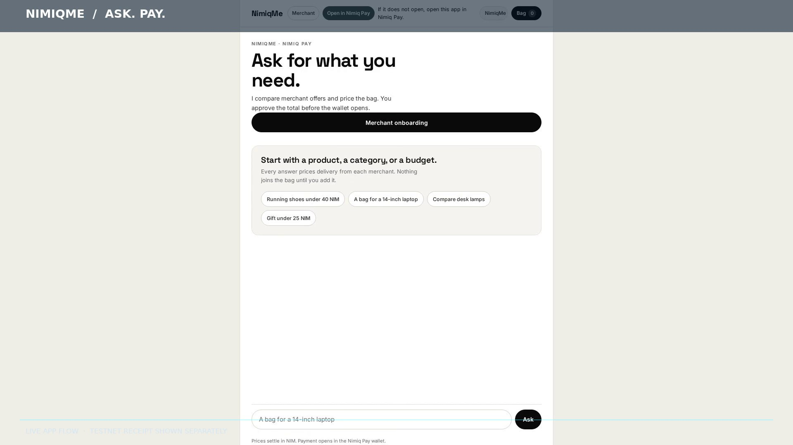
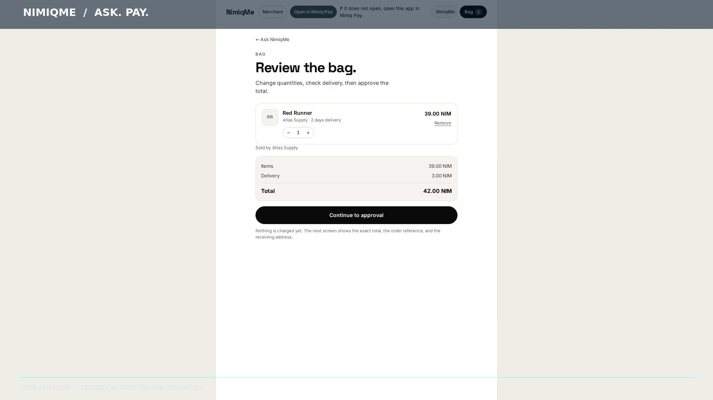
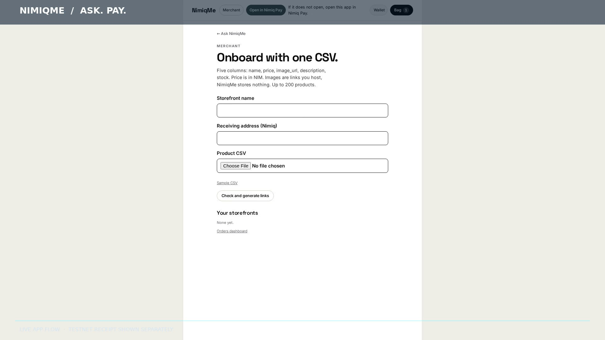

# Nimiqme

> Your AI agent that shops anything, anywhere, and pays in NIM

| Field | Value |
| --- | --- |
| Category | Pay |
| Pricing | Free |
| Team name | _Not provided — optional_ |
| Team members | _Not provided — optional_ |
| X account | 0xDfinity |
| Heard about it via | X |
| Contact email | official.atundess@gmail.com |
| GitHub login | @0xdfinity |
| Submitted at | 2026-10-30T06:31:58.859Z |

## Links

| Link | URL |
| --- | --- |
| Repo | [https://github.com/0xdfinity/nimiqme](<https://github.com/0xdfinity/nimiqme>) |
| Demo | [http://nimiqme.vercel.app](<http://nimiqme.vercel.app>) |
| Video | [https://youtu.be/AwgmhofP25w?si=ZmiQbbT0ENsPsAPM](<https://youtu.be/AwgmhofP25w?si=ZmiQbbT0ENsPsAPM>) |
| Skool post | [https://lnkd.in/p/dJ4Fw8tU](<https://lnkd.in/p/dJ4Fw8tU>) |
| Social post | [https://x.com/0xDfinity/status/2116052721971204452?a=i8FcY37F-0m8CLxlZMc&s=19](<https://x.com/0xDfinity/status/2116052721971204452?a=i8FcY37F-0m8CLxlZMc&s=19>) |

## Description

Nimiqme is an AI shopping agent for Nimiq Pay. Tell it what you want in plain language, it compares merchant offers, builds one cart, and you approve a single NIM payment that's verified on mainnet. Built for anyone who wants the internet to shop for them

## Builder story

I kept abandoning carts because comparing a dozen merchants is exhausting, and crypto checkout made it worse, not better. I wanted the opposite: an agent that does the shopping and only asks you for one thing, one approval. Nimiq Pay's mini app SDK was the first place that flow could actually work end to end, so I built it. Every payment is verified against Nimiq mainnet RPC before the order shows as paid, because a shopping agent has to be honest or it's useless

Ps: skool isn't available in my region, so I use linkdln instead

## Thumbnail

## Screenshots

---

_Generated from the submission form. `submission.yaml` in this folder is the machine-readable source of truth._
