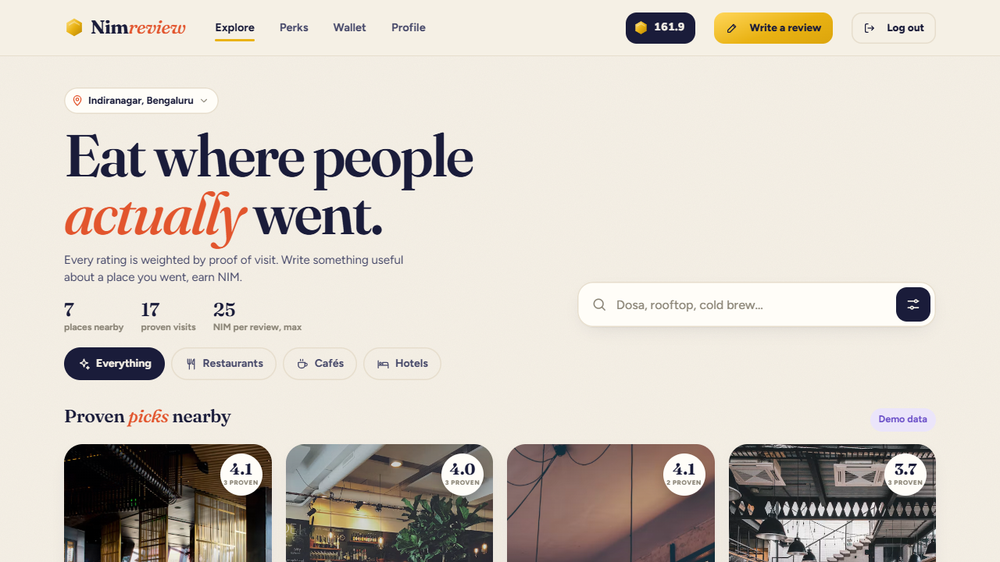

# NimReview

> Prove you went. Earn NIM for an honest review.

| Field | Value |
| --- | --- |
| Category | Earn |
| Pricing | Free |
| Team name | _Not provided — optional_ |
| Team members | _Not provided — optional_ |
| X account | Saroj11862735 |
| Heard about it via | X |
| Contact email | sarojyadav123001@gmail.com |
| GitHub login | @0xsaroj001 |
| Submitted at | 2026-11-11T07:16:41.196Z |

## Links

| Link | URL |
| --- | --- |
| Repo | [https://github.com/0xsaroj001/nimreview](<https://github.com/0xsaroj001/nimreview>) |
| Demo | [https://nimreview.vercel.app/](<https://nimreview.vercel.app/>) |
| Video | [https://www.youtube.com/watch?v=YZyFbMY8CpE](<https://www.youtube.com/watch?v=YZyFbMY8CpE>) |
| Skool post | [https://www.skool.com/miniappscompetition/review-for-nimreview](<https://www.skool.com/miniappscompetition/review-for-nimreview>) |
| Social post | [https://x.com/Saroj11862735/status/2120415294586061273](<https://x.com/Saroj11862735/status/2120415294586061273>) |

## Description

NimReview helps guests at restaurants, cafés, and hotels earn NIM for useful reviews after verifying a visit with a single-use bill code. Guests and owners sign in with Nimiq Pay, and owners pay cash-out requests directly from their own wallets.

## Builder story

A star rating is easy to leave, but the details that help the next guest take time to write. NimReview gives venues a way to reward that effort. A single-use bill code connects a review to a visit, and a critical review can earn just as much as a glowing one. Guests can ask the venue to pay what they’ve earned, and the venue sends NIM directly to the guest’s wallet.

## Thumbnail

## Screenshots

---

_Generated from the submission form. `submission.yaml` in this folder is the machine-readable source of truth._
