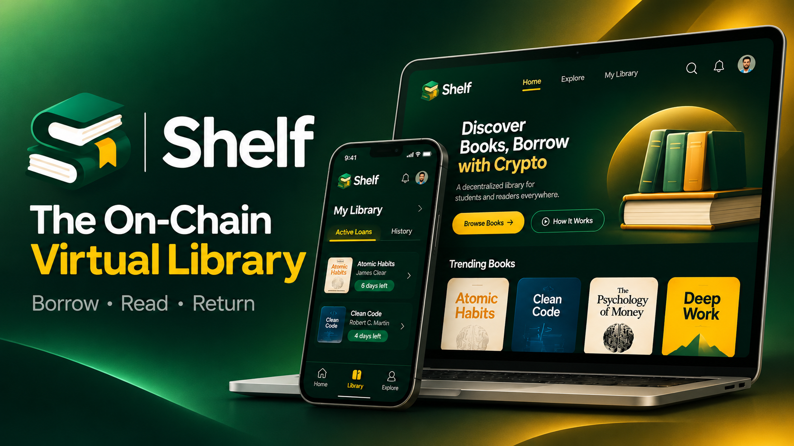
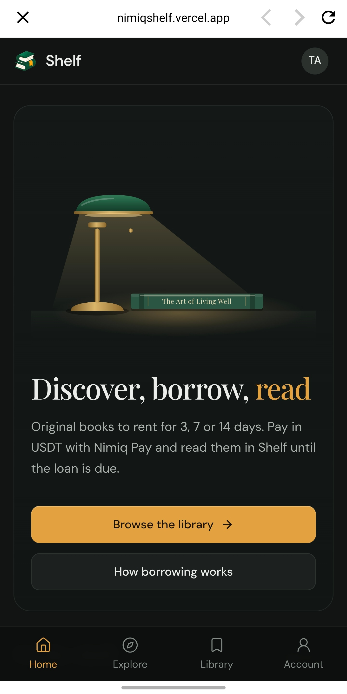
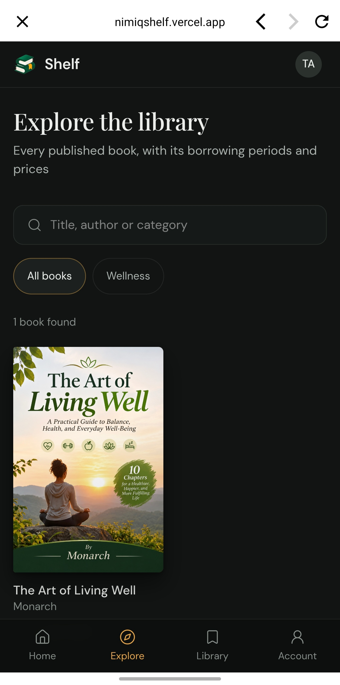
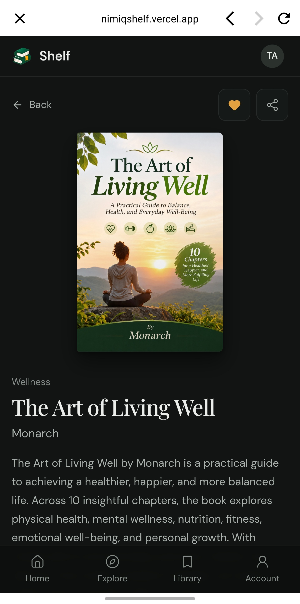

# Shelf

> Your next book read, just a borrow away

| Field | Value |
| --- | --- |
| Category | Pay |
| Pricing | Paid |
| Team name | _Not provided — optional_ |
| Team members | _Not provided — optional_ |
| X account | OxMonarch |
| Heard about it via | X (Formely Twitter) |
| Contact email | talk2monarch77@gmail.com |
| GitHub login | @AGAkodi |
| Submitted at | 2026-11-08T13:24:20.879Z |

## Links

| Link | URL |
| --- | --- |
| Repo | [https://github.com/AGAkodi/shelf](<https://github.com/AGAkodi/shelf>) |
| Demo | [https://x.com/OxMonarch/status/2119415095449079861](<https://x.com/OxMonarch/status/2119415095449079861>) |
| Video | [https://youtu.be/RcHige3dR2M](<https://youtu.be/RcHige3dR2M>) |
| Skool post | _Not provided — optional_ |
| Social post | [https://x.com/OxMonarch/status/2119415095449079861](<https://x.com/OxMonarch/status/2119415095449079861>) |

## Description

Shelf is a digital library where readers can discover, borrow, and read books for a limited time using crypto payments through Nimiq Pay. Built for students, book lovers, and anyone looking for affordable, flexible access to books.

## Builder story

The idea for Shelf came from an experience. I needed to read a particular book, but getting a copy required paying the full purchase price, which I couldn't readily afford at the time. So it came to me what if people could rent digital books for a cut of the full cost and access them for only as long as they needed?

That idea became Shelf, a digital book rental platform designed to make reading more affordable and accessible. Beyond helping readers, Shelf also gives authors and publishers a place to launch their books, reach new audiences, and earn a commission whenever someone borrows their work. The goal is simple: make books easier to access while creating another way for authors to earn from their content.

## Thumbnail

## Screenshots

---

_Generated from the submission form. `submission.yaml` in this folder is the machine-readable source of truth._
