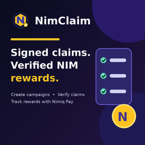
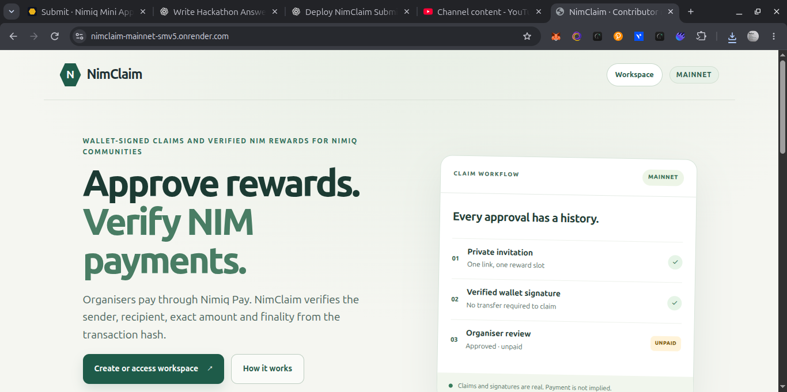
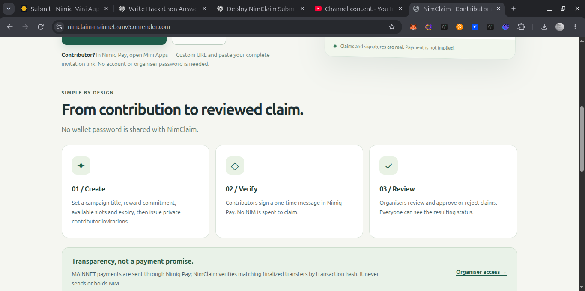
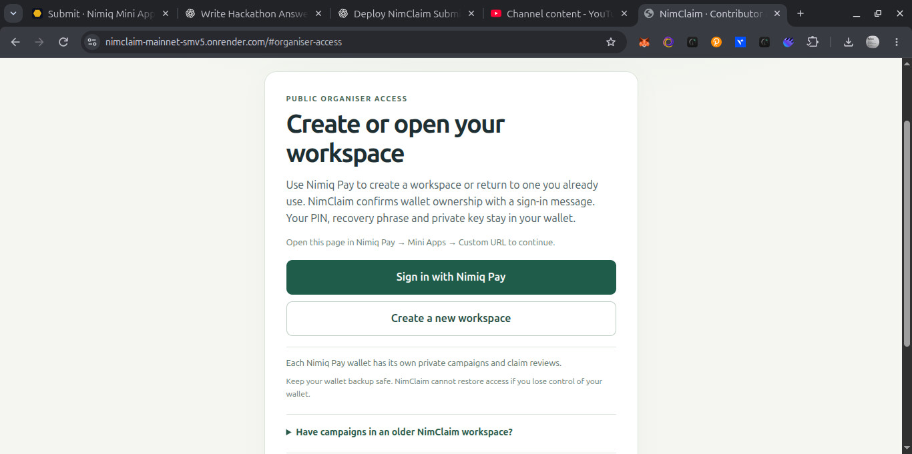

# NimClaim

> Signed claims. Verified NIM rewards.

| Field | Value |
| --- | --- |
| Category | Pay |
| Pricing | Free |
| Team name | _Not provided — optional_ |
| Team members | _Not provided — optional_ |
| X account | IamAlikeX |
| Heard about it via | _Not provided — optional_ |
| Contact email | hammedoye10@gmail.com |
| GitHub login | @Alike001 |
| Submitted at | 2026-11-11T23:48:40.846Z |

## Links

| Link | URL |
| --- | --- |
| Repo | [https://github.com/Alike001/nimclaim](<https://github.com/Alike001/nimclaim>) |
| Demo | [https://nimclaim-mainnet-smv5.onrender.com/](<https://nimclaim-mainnet-smv5.onrender.com/>) |
| Video | [https://youtu.be/NF4i5qoZNiU](<https://youtu.be/NF4i5qoZNiU>) |
| Skool post | _Not provided — optional_ |
| Social post | _Not provided — optional_ |

## Description

Manage NIM contributor rewards with wallet-signed claims, organiser approvals and on-chain payment verification. Send rewards through Nimiq Pay without giving up custody of your funds.

## Builder story

_Not provided — optional_

## Thumbnail

## Screenshots

---

_Generated from the submission form. `submission.yaml` in this folder is the machine-readable source of truth._
