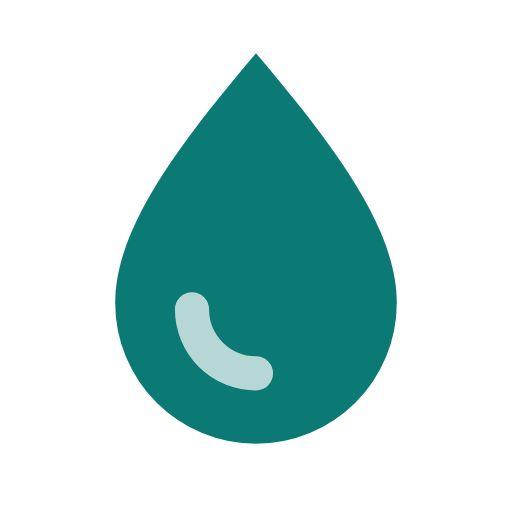
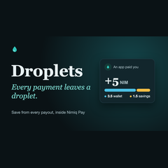
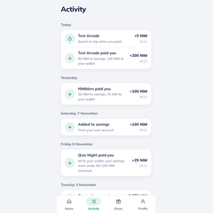
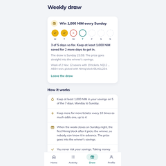
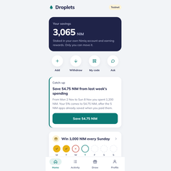
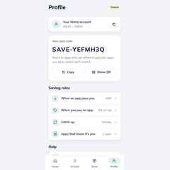

# Droplets

> Every payment leaves a droplet.

| Field | Value |
| --- | --- |
| Category | Save |
| Pricing | Free |
| Team name | Catalyst |
| Team members | _Not provided — optional_ |
| X account | catalyst_hub_ |
| Heard about it via | Nimiq Community |
| Contact email | etimpaul22@gmail.com |
| GitHub login | @ETIM-PAUL |
| Submitted at | 2026-11-11T23:39:13.624Z |

## Links

| Link | URL |
| --- | --- |
| Repo | [https://github.com/ETIM-PAUL/droplets](<https://github.com/ETIM-PAUL/droplets>) |
| Demo | [https://droplets-app.onrender.com/](<https://droplets-app.onrender.com/>) |
| Video | [https://youtu.be/JFgrKskTW-I](<https://youtu.be/JFgrKskTW-I>) |
| Skool post | [https://www.skool.com/miniappscompetition/droplets](<https://www.skool.com/miniappscompetition/droplets>) |
| Social post | [https://x.com/catalyst_hub_/status/2120615171756359766](<https://x.com/catalyst_hub_/status/2120615171756359766>) |

## Description

Droplets is a savings app for Nimiq Pay. When an app pays you NIM, your chosen share goes straight into savings, staked from your own account, and the rest goes to your wallet. Only you can move your savings.

## Builder story

Droplets grew out of Nimiq's Mini Apps Competition (Cycle III), Save track. Nimiq defines Save as "extend what users can hold". Most other Save entries only label part of a spendable wallet as savings, or keep the money in a pool the app controls. The goal was a savings app that lasts beyond the competition, with savings the user really owns.

The problem it solves is that saving is a decision people have to keep making, and it loses to spending. Money in a wallet is easy to spend. Droplets takes the decision out of the moment. When an app pays you NIM, your chosen share goes straight into savings before you can spend it. Apps you pay can add a little on top, and a catch-up button saves part of what you spend elsewhere.

The savings are NIM staked from your own Nimiq account. Inside Nimiq Pay, that is the only place savings sit apart from spending money without someone else holding them. They earn staking rewards, only you can move them, and Droplets never holds your money.

Most Mini Apps pay the address Nimiq Pay gives them and never ask for a code. Droplets lets you allow apps by address, so they can save for you without changing how they pay. Goals with dates keep money for a purpose, and breaking one early costs 10% and a 24-hour wait. A weekly draw gives savers a chance at 1,000 NIM without putting their savings at risk.

In one line: Droplets makes saving a side effect of money you were already receiving or spending.

## Thumbnail

## Screenshots

---

_Generated from the submission form. `submission.yaml` in this folder is the machine-readable source of truth._
