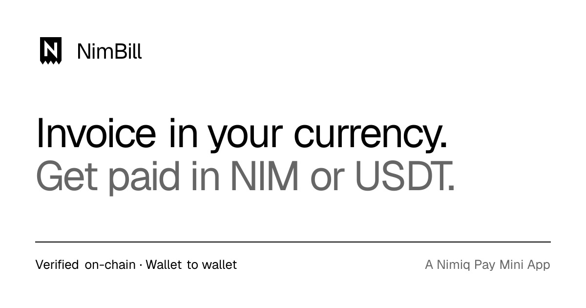
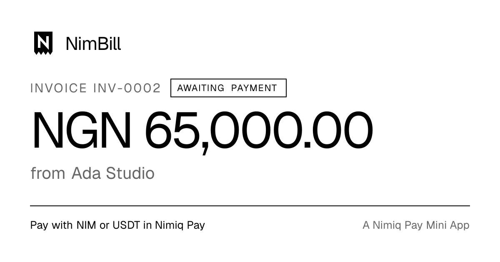
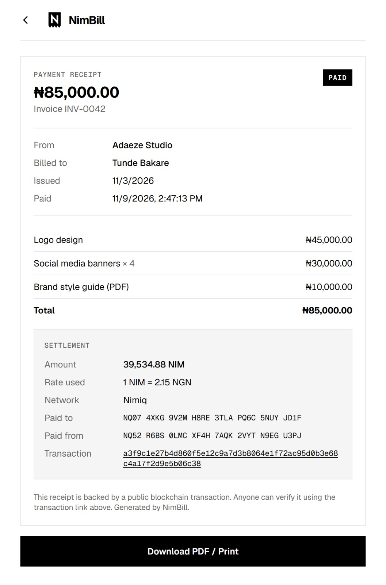

# Nimbill

> Invoice in your local currency. Get paid globally in crypto.

| Field | Value |
| --- | --- |
| Category | Pay |
| Pricing | Free |
| Team name | 404 Founders |
| Team members | Ogowole Covenant, Daniel Chidi |
| X account | mercichidi |
| Heard about it via | Nimiq Community. |
| Contact email | chidiemmanuel2005@gmail.com |
| GitHub login | @Emmanuelmelvin |
| Submitted at | 2026-11-11T07:01:43.281Z |

## Links

| Link | URL |
| --- | --- |
| Repo | [https://github.com/Emmanuelmelvin/nimbill](<https://github.com/Emmanuelmelvin/nimbill>) |
| Demo | [https://nimbill.mblob.me](<https://nimbill.mblob.me>) |
| Video | [https://vimeo.com/1246025219](<https://vimeo.com/1246025219>) |
| Skool post | _Not provided — optional_ |
| Social post | [https://x.com/mercichidi/status/2120411275691733151](<https://x.com/mercichidi/status/2120411275691733151>) |

## Description

Nimbill makes invoicing and crypto payments simple for freelancers and small businesses. Create invoices in your local currency and receive payments in NIM or USDT, with on-chain payment verification.

## Builder story

As a freelancer, getting paid across borders shouldn't be harder than doing the actual work. Between payment restrictions, currency conversions, and the complexity of international transfers, receiving money can be unnecessarily frustrating.

We built Nimbill to make that easier. It lets freelancers and small businesses invoice in their local currency and receive payments in NIM or USDT, with on-chain verification. And we're thinking beyond payments: in future updates, you'll be able to stack your earnings and save them directly within Nimbill. The idea is simple: make getting paid globally as seamless as sending an invoice.

## Thumbnail

## Screenshots

---

_Generated from the submission form. `submission.yaml` in this folder is the machine-readable source of truth._
