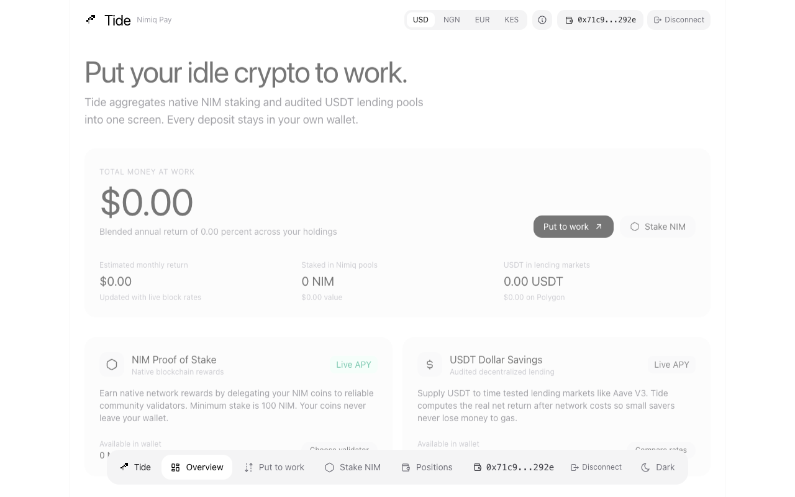
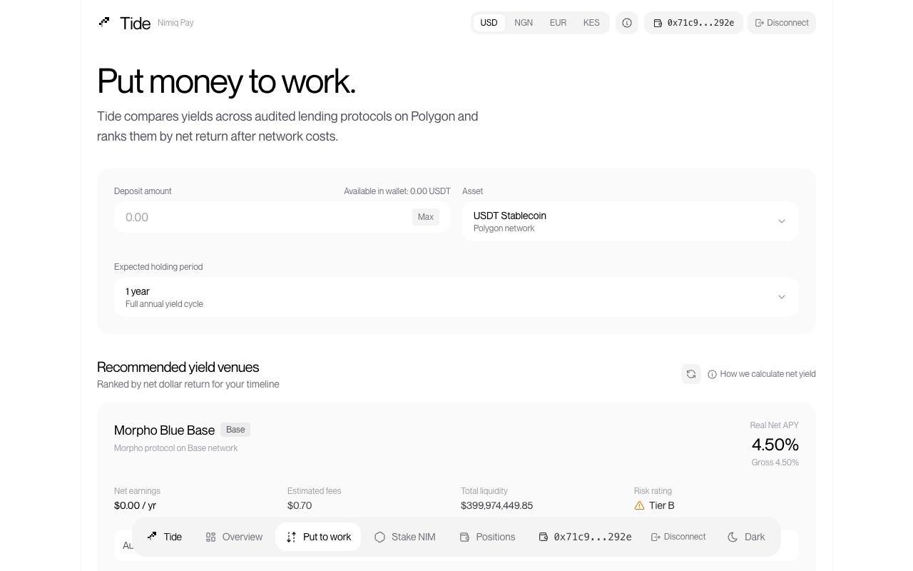
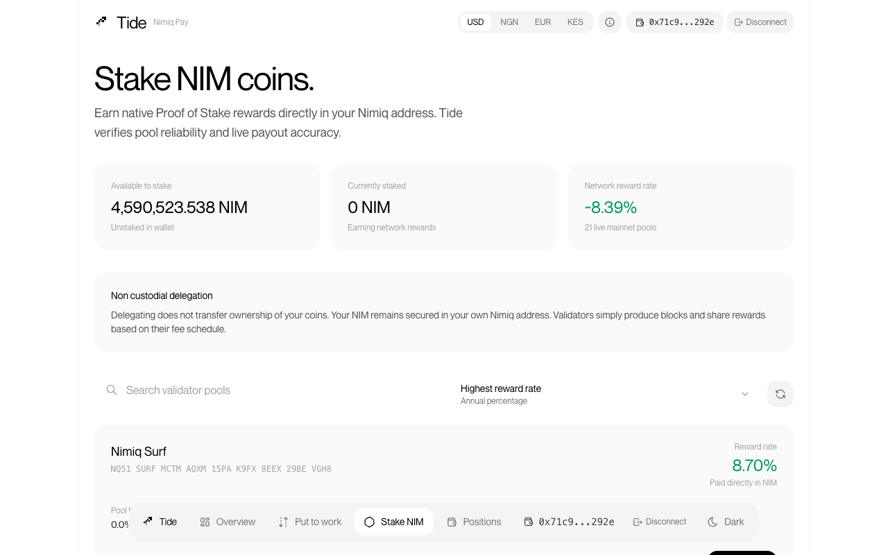
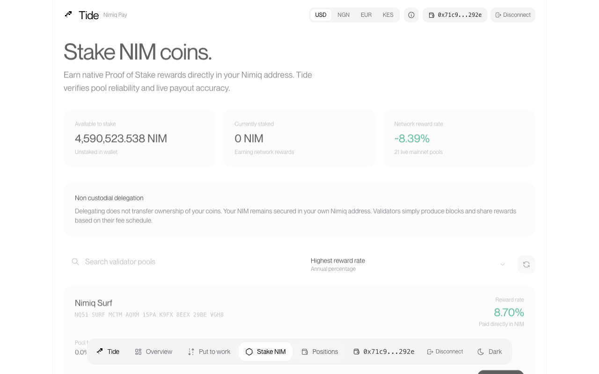

# Tide Pay

> Automated crypto yield aggregator built directly into Nimiq Pay

| Field | Value |
| --- | --- |
| Category | Pay |
| Pricing | Free |
| Team name | _Not provided — optional_ |
| Team members | _Not provided — optional_ |
| X account | _Not provided — optional_ |
| Heard about it via | X |
| Contact email | founderfotress@gmail.com |
| GitHub login | @FFWeb3 |
| Submitted at | 2026-11-11T23:59:41.580Z |

## Links

| Link | URL |
| --- | --- |
| Repo | [https://github.com/FFWeb3/tide-pay](<https://github.com/FFWeb3/tide-pay>) |
| Demo | [https://tide-pay.pages.dev/](<https://tide-pay.pages.dev/>) |
| Video | [https://youtube.com/shorts/0j-IxoO3fyE](<https://youtube.com/shorts/0j-IxoO3fyE>) |
| Skool post | _Not provided — optional_ |
| Social post | _Not provided — optional_ |

## Description

Tide Pay is a non custodial yield aggregator that lets everyday users earn clean returns on their USDT and NIM. It compares lending venues and validator pools in real time, automatically protecting small savers from network fees.

## Builder story

_Not provided — optional_

## Thumbnail

## Screenshots

---

_Generated from the submission form. `submission.yaml` in this folder is the machine-readable source of truth._
