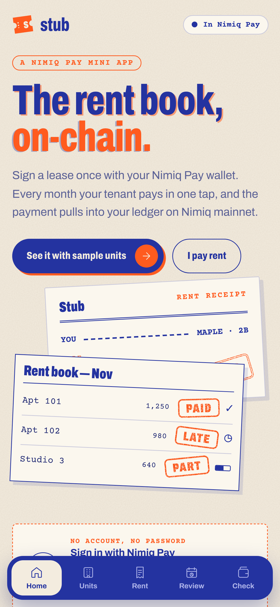
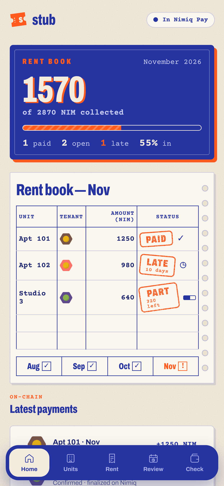
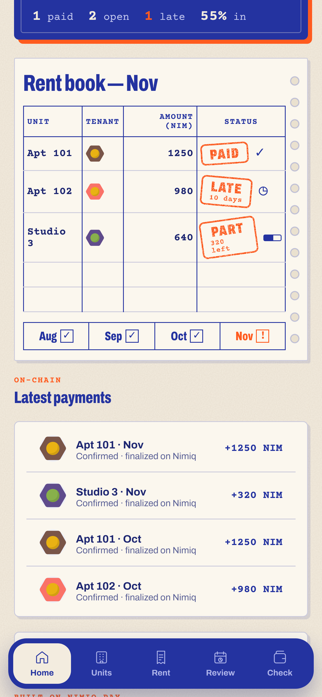
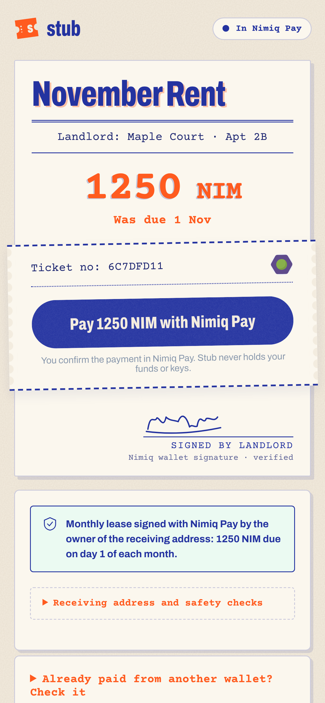
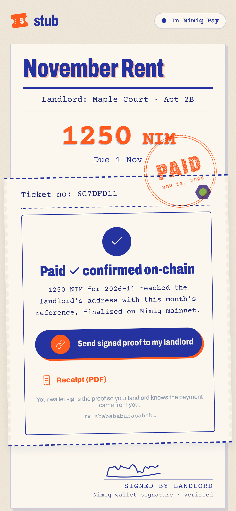

# Stub

> The rent book, on-chain. Every month's rent, with the stub to prove it.

| Field | Value |
| --- | --- |
| Category | Pay |
| Pricing | Free |
| Team name | Stub |
| Team members | Benita Ukachi |
| X account | _Not provided — optional_ |
| Heard about it via | X |
| Contact email | boussarifaadil@yahoo.com |
| GitHub login | @Faadil1 |
| Submitted at | 2026-11-11T23:27:12.421Z |

## Links

| Link | URL |
| --- | --- |
| Repo | [https://github.com/Faadil1/rentrail](<https://github.com/Faadil1/rentrail>) |
| Demo | [https://rentrail-operations-staging-csejev19s-faadil1s-projects.vercel.app/](<https://rentrail-operations-staging-csejev19s-faadil1s-projects.vercel.app/>) |
| Video | [https://youtu.be/Z1AaQ54essA](<https://youtu.be/Z1AaQ54essA>) |
| Skool post | [https://www.skool.com/miniappscompetition/introducing-stub-the-rent-book-on-chain?p=c21baba5](<https://www.skool.com/miniappscompetition/introducing-stub-the-rent-book-on-chain?p=c21baba5>) |
| Social post | [https://x.com/0x_beni_/status/2120605647003595014?a=GbLkfUzHNm1Ee2T_SDg&s=46](<https://x.com/0x_beni_/status/2120605647003595014?a=GbLkfUzHNm1Ee2T_SDg&s=46>) |

## Description

Stub is a Nimiq Pay Mini App that helps landlords create wallet-signed rent requests, track monthly payments and reconcile NIM transactions with individual rental units. Tenants pay directly through Nimiq Pay and keep a printable, verifiable payment record.

## Builder story

Stub started with a simple question: why is tracking monthly rent still so complicated for small landlords and tenants?

We wanted to turn a wallet transfer into a more understandable recurring payment experience. By combining Nimiq Pay, signed rent requests and a traditional paper-inspired rent book, we built Stub to make rent easier to request, track and verify.

Our goal is to demonstrate how blockchain payments can solve an everyday problem without requiring users to understand the underlying technology.

## Thumbnail

## Screenshots

---

_Generated from the submission form. `submission.yaml` in this folder is the machine-readable source of truth._
