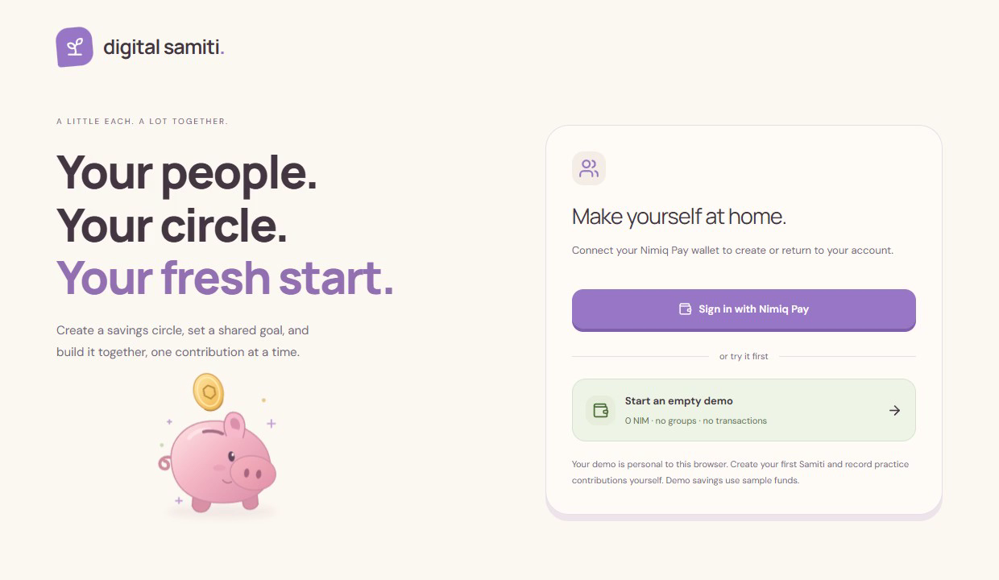

# Digital Samiti

> A little each. A lot together.

| Field | Value |
| --- | --- |
| Category | Save |
| Pricing | Free |
| Team name | _Not provided — optional_ |
| Team members | _Not provided — optional_ |
| X account | Harsh2679956149 |
| Heard about it via | nimiq community |
| Contact email | harsh.2024a@vitstudent.ac.in |
| GitHub login | @Harshyadav442277 |
| Submitted at | 2026-11-11T07:49:51.047Z |

## Links

| Link | URL |
| --- | --- |
| Repo | [https://github.com/Harshyadav442277/digital-samiti](<https://github.com/Harshyadav442277/digital-samiti>) |
| Demo | [https://digital-samiti.vercel.app](<https://digital-samiti.vercel.app>) |
| Video | [https://youtu.be/btUGK5oaa5A](<https://youtu.be/btUGK5oaa5A>) |
| Skool post | [https://www.skool.com/miniappscompetition/niminvest-digital-samiti](<https://www.skool.com/miniappscompetition/niminvest-digital-samiti>) |
| Social post | [https://x.com/Harsh2679956149/status/2120420352463704139](<https://x.com/Harsh2679956149/status/2120420352463704139>) |

## Description

Digital Samiti helps friends, families, and neighbourhood savings circles set shared goals, track contributions, and vote on loan requests. Members can sign in with Nimiq Pay, and anyone can try the workflow with simulated NIM in the free guest demo.

## Builder story

In rural India, women’s self-help groups pool small savings and lend from that fund when a member needs help. India’s Ministry of Rural Development launched the National Rural Livelihoods Mission in June 2011, now known as Deendayal Antyodaya Yojana–National Rural Livelihoods Mission (DAY-NRLM). By January 2025, the ministry reported 90.9 lakh self-help groups across the country.

Picture a member whose sewing machine breaks. Her group can lend her money for the repair and agree on when she’ll repay it. I built Digital Samiti around that workflow so every member can see who contributed, how the group voted, and when the next instalment is due. The guest demo lets anyone try it with simulated NIM.

## Thumbnail

## Screenshots

---

_Generated from the submission form. `submission.yaml` in this folder is the machine-readable source of truth._
