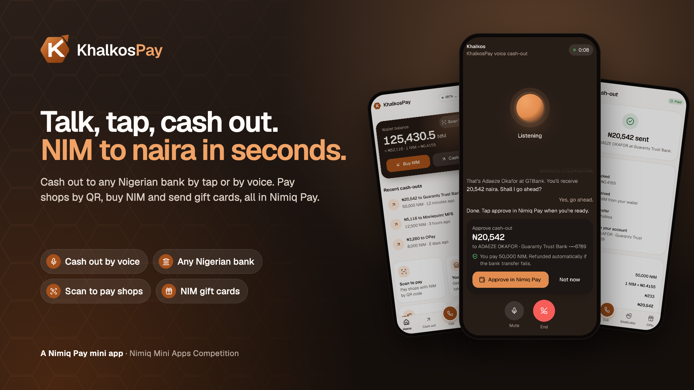
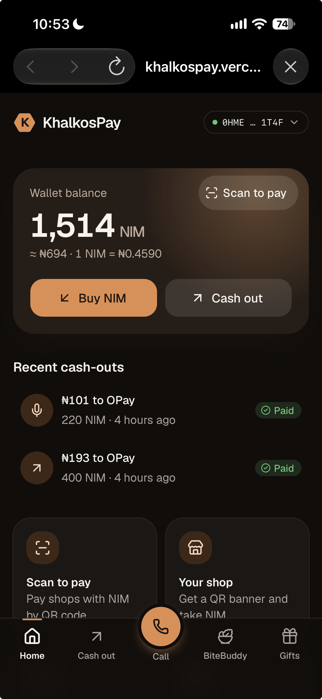
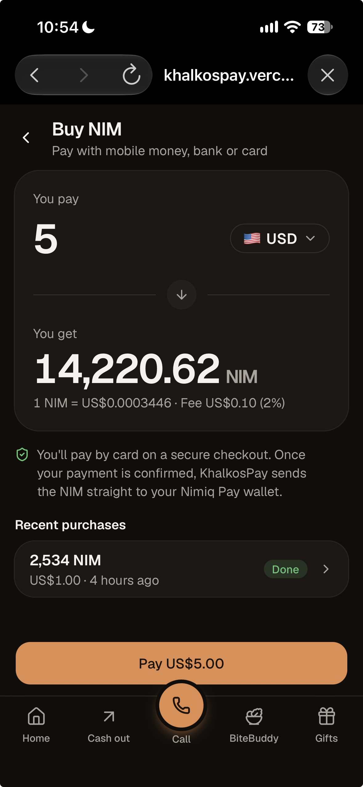
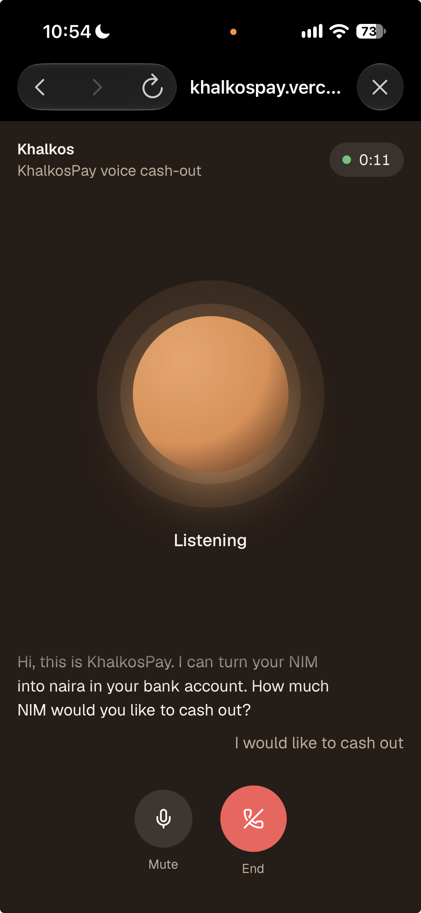
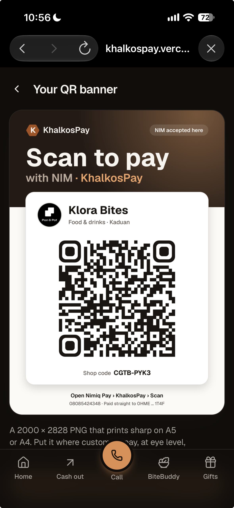
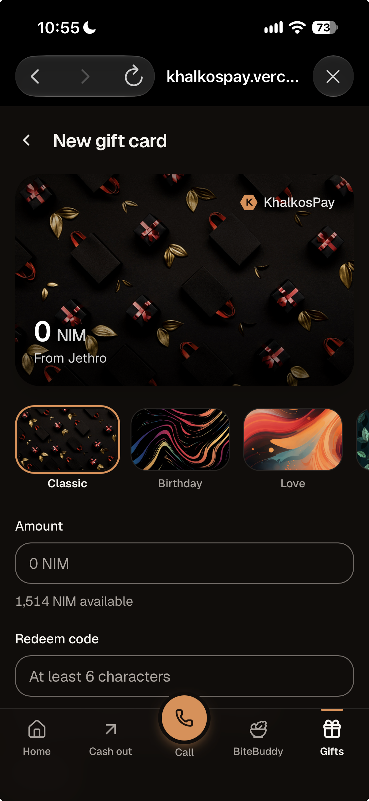

# KhalkosPay

> NIM for everyday life, from shop counter to bank account.

| Field | Value |
| --- | --- |
| Category | On/Off-Ramp |
| Pricing | Free |
| Team name | _Not provided — optional_ |
| Team members | _Not provided — optional_ |
| X account | jaykosai |
| Heard about it via | Twitter |
| Contact email | jethroadamzy@gmail.com |
| GitHub login | @JayWebtech |
| Submitted at | 2026-10-24T21:58:06.362Z |

## Links

| Link | URL |
| --- | --- |
| Repo | [https://github.com/JayWebtech/khalkospay](<https://github.com/JayWebtech/khalkospay>) |
| Demo | [https://khalkospay.vercel.app](<https://khalkospay.vercel.app>) |
| Video | [https://vimeo.com/1239853705](<https://vimeo.com/1239853705>) |
| Skool post | [https://www.skool.com/miniappscompetition/introducing-khalkospay-buy-and-cash-out-nim-to-your-local-bank?p=9c601a54](<https://www.skool.com/miniappscompetition/introducing-khalkospay-buy-and-cash-out-nim-to-your-local-bank?p=9c601a54>) |
| Social post | [https://x.com/jaykosai/status/2111912313229853178](<https://x.com/jaykosai/status/2111912313229853178>) |

## Description

KhalkosPay turns NIM into everyday money. You can cash out to any bank account in seconds, by tapping or just by talking to our AI voice assistant. You can also buy NIM in local currency, pay at shops by scanning a QR code, and send NIM as gift cards.

## Builder story

If you hold crypto, you know the dance. You find a P2P trader, send first, refresh your bank app forty times, pray, and hope the alert lands before your data does. Holding NIM shouldn’t feel like a trust exercise just to buy jollof.

So I built KhalkosPay: crypto that behaves like normal money. Tell it how much (out loud, if you like), approve once, and money lands in your bank. You can easily buy NIM tokens using your credit card

And because money is for living, I added a pet that guilt-trips you into eating vegetables.

The name? Khalkos is Greek for copper, one of the first metals people ever used as money. KhalkosPay is that idea for the NIM era: honest money that moves when you say so.

## Thumbnail

## Screenshots

---

_Generated from the submission form. `submission.yaml` in this folder is the machine-readable source of truth._
