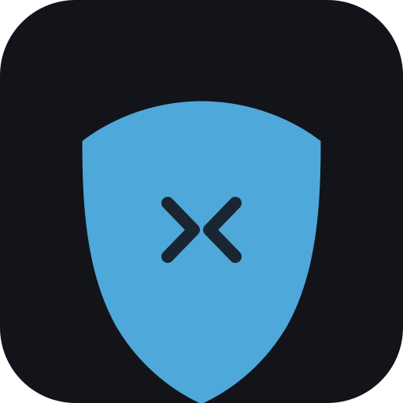
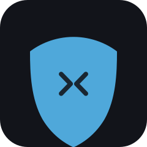
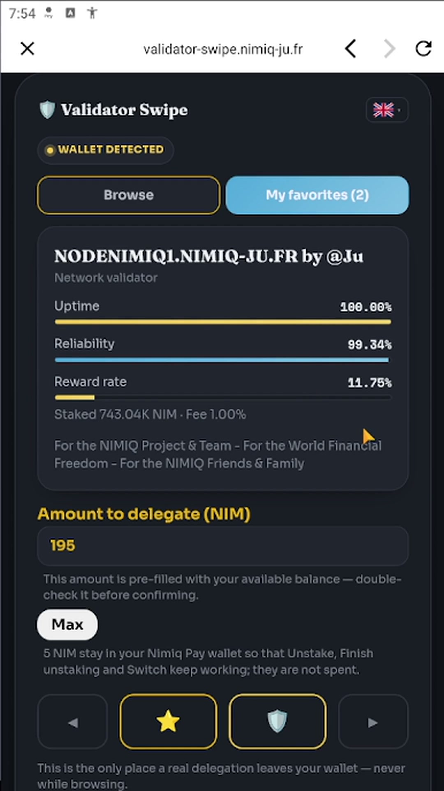
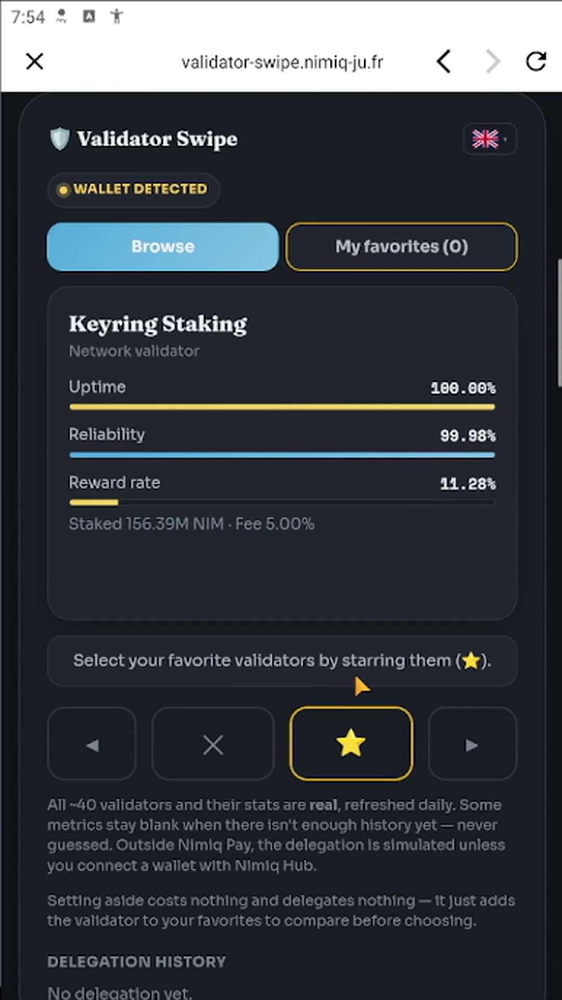
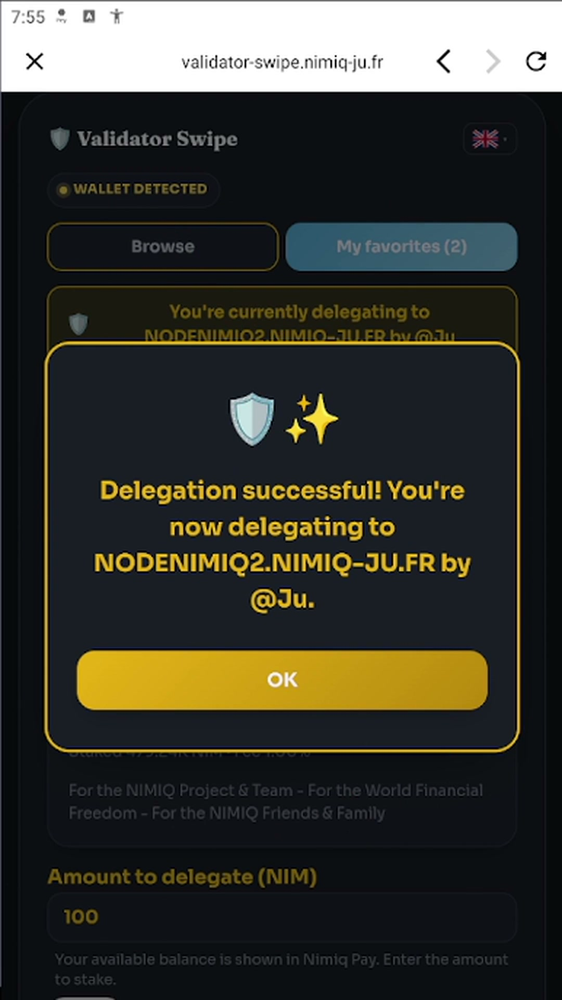
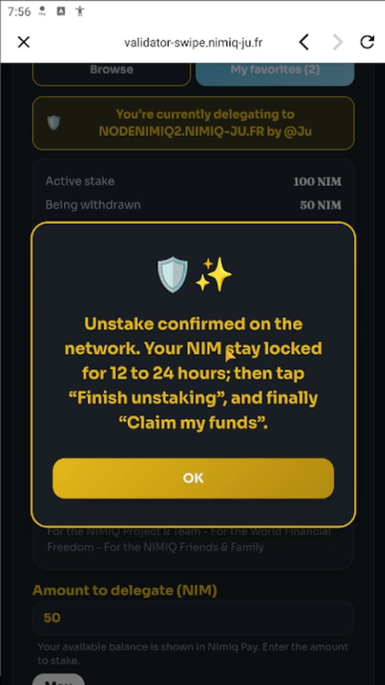
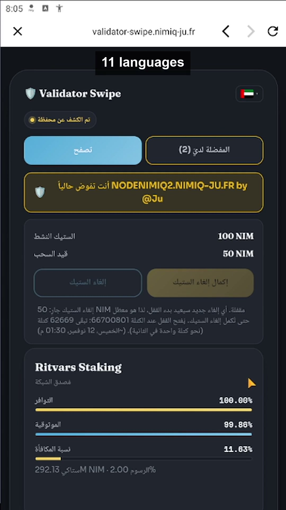

# Validator Swipe

> Swipe through Nimiq validators, stake and unstake safely from Nimiq Pay.

| Field | Value |
| --- | --- |
| Category | Earn |
| Pricing | Free |
| Team name | @Ju'Team |
| Team members | Claude |
| X account | julien59247787 |
| Heard about it via | Nimiq Community, Discord, Telegram |
| Contact email | ju@nimiq-ju.fr |
| GitHub login | @Julien59247787 |
| Submitted at | 2026-11-11T20:12:31.580Z |

## Links

| Link | URL |
| --- | --- |
| Repo | [https://github.com/Julien59247787/nimiq-app-validatorswipe](<https://github.com/Julien59247787/nimiq-app-validatorswipe>) |
| Demo | [https://validator-swipe.nimiq-ju.fr](<https://validator-swipe.nimiq-ju.fr>) |
| Video | [https://youtube.com/shorts/AySK6sId--8](<https://youtube.com/shorts/AySK6sId--8>) |
| Skool post | [https://www.skool.com/miniappscompetition/validator-swipe-is-back-for-cycle-iii-swipe-stake-unstake-safely](<https://www.skool.com/miniappscompetition/validator-swipe-is-back-for-cycle-iii-swipe-stake-unstake-safely>) |
| Social post | [https://x.com/julien59247787/status/2120609992906523026](<https://x.com/julien59247787/status/2120609992906523026>) |

## Description

Swipe through real Nimiq validators (uptime, reliability, reward rate), then stake, add and unstake from Nimiq Pay. Live staker state and unlock block from the chain, a 5 NIM safety reserve, 11 languages, zero custody.

## Builder story

Validator Swipe is back for Cycle III, rebuilt around what the staking protocol really requires. In September two of our flows (Retire, Switch) sent requests the protocol refuses, and we wrongly blamed Nimiq Pay; we corrected that publicly in 1.1.3. To make the app work for real we read the Nimiq Pay source code to understand how a Mini App's staking transactions leave the wallet, and adjusted our own Nimiq infrastructure (our two nodes and the validator dashboard API that feeds the app). Stake, add stake and unstake are verified on mainnet. Finish unstaking, Claim and Switch are implemented as the protocol requires and still have to be validated on-chain: our test unstake unlocks on Nov 12. One change is still needed on the Nimiq Pay side: when everything is staked, Nimiq Pay cannot send the unstake signals, because it sends them from its swap contract. Until then the app keeps a 5 NIM reserve. We have documented the fix and will propose it to the Nimiq Pay team as an issue and a pull request; the app already detects it (getCapabilities) and will then drop the reserve on its own. Our goal is to contribute that change so every staking step works from any Nimiq Pay wallet.

## Thumbnail

## Screenshots

---

_Generated from the submission form. `submission.yaml` in this folder is the machine-readable source of truth._
