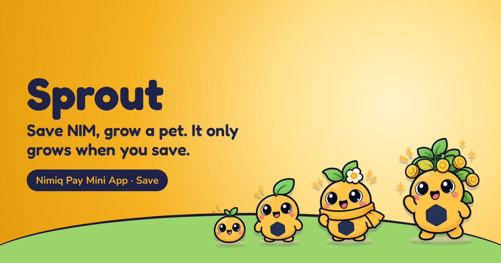
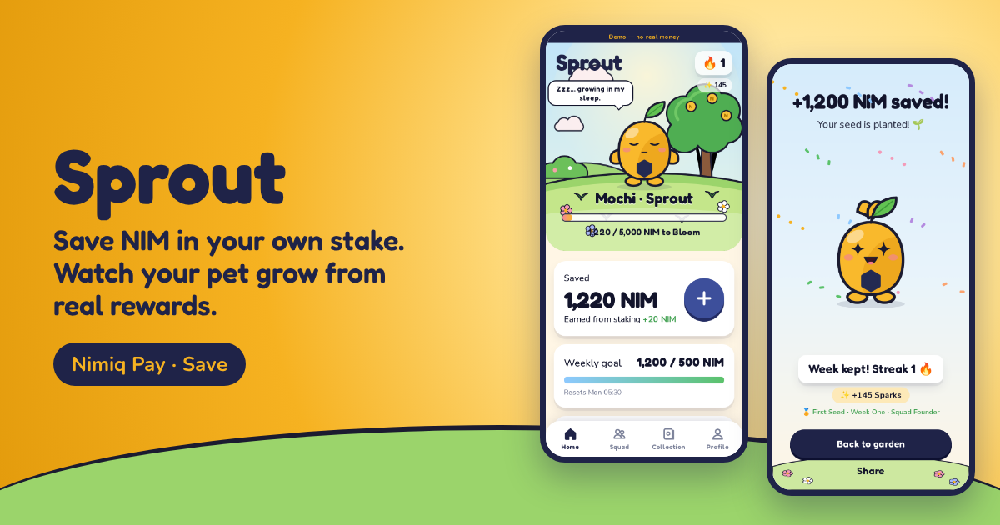
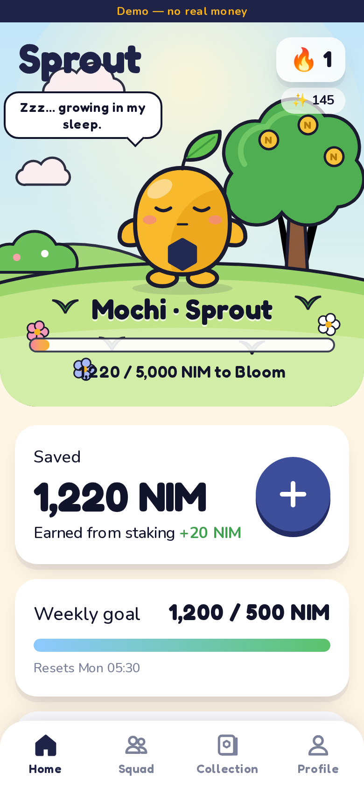
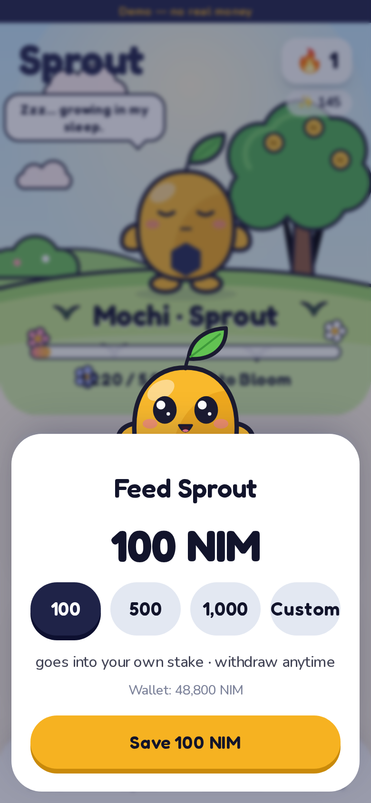
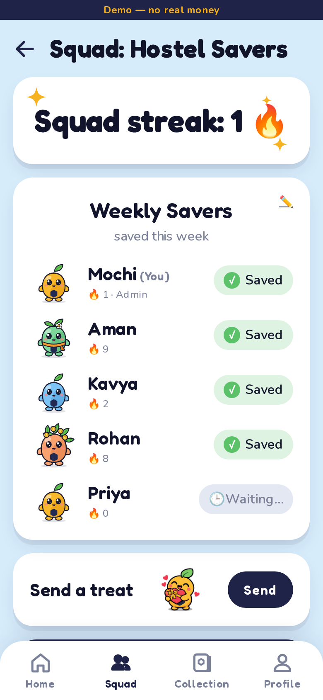
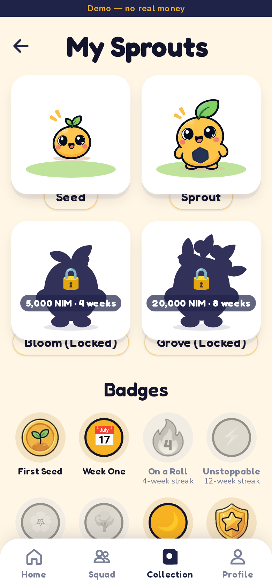

# Sprout

> Save NIM, grow a pet -> your Sprout only grows when you do

| Field | Value |
| --- | --- |
| Category | Save |
| Pricing | Free |
| Team name | _Not provided — optional_ |
| Team members | _Not provided — optional_ |
| X account | _arpit1 |
| Heard about it via | X |
| Contact email | adoranto737@gmail.com |
| GitHub login | @LSUDOKO |
| Submitted at | 2026-11-11T20:54:38.699Z |

## Links

| Link | URL |
| --- | --- |
| Repo | [https://github.com/LSUDOKO/Sprout](<https://github.com/LSUDOKO/Sprout>) |
| Demo | [https://sprout-three-neon.vercel.app](<https://sprout-three-neon.vercel.app>) |
| Video | [https://youtu.be/zP_6x3hiYb8](<https://youtu.be/zP_6x3hiYb8>) |
| Skool post | [https://www.skool.com/miniappscompetition/sprout-save-nim-grow-a-pet-save-category?p=de50fff6](<https://www.skool.com/miniappscompetition/sprout-save-nim-grow-a-pet-save-category?p=de50fff6>) |
| Social post | [https://x.com/_arpit1/status/2120620538012082398?s=20](<https://x.com/_arpit1/status/2120620538012082398?s=20>) |

## Description

Sprout makes saving a weekly habit by giving it a face: a small pet that only grows when you save. Every save is a staking transaction from your own Nimiq Pay wallet into your own NIM stake, so your money never leaves your address and earns rewards while you sleep.

## Builder story

Saving is a habit problem, not a math problem, so I gave the habit a face: Sprout, a pet that only grows when you save. Sprout never holds money. Every save is a staking transaction from your own Nimiq Pay wallet into your own stake, verified on-chain before it counts, so your pet grows from real staking rewards while you sleep. Building on Nimiq taught me that a transaction hash isn't success, that an unknown outcome must never allow a second payment, and that honest withdraw copy matters ("never locked"). Going live, I fixed real-node quirks (errors in error.data, inactiveFrom) and moved my servers next to the database, cutting demo setup from 68s to 7s. Next: more testers and squads with friends. 🌱

## Thumbnail

## Screenshots

---

_Generated from the submission form. `submission.yaml` in this folder is the machine-readable source of truth._
