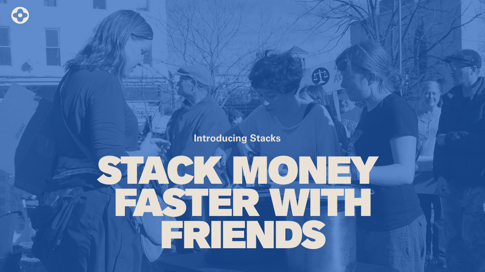
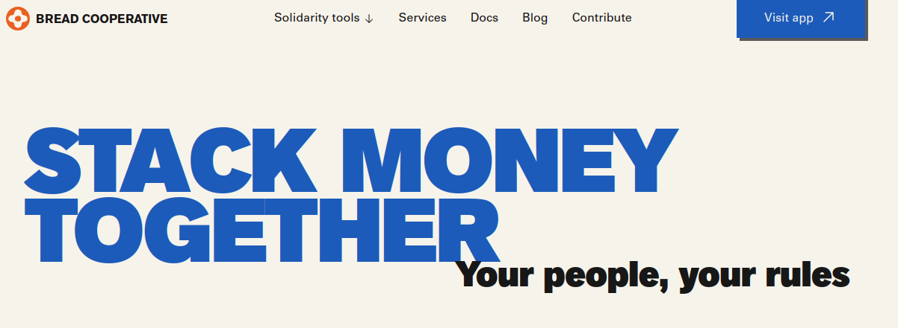
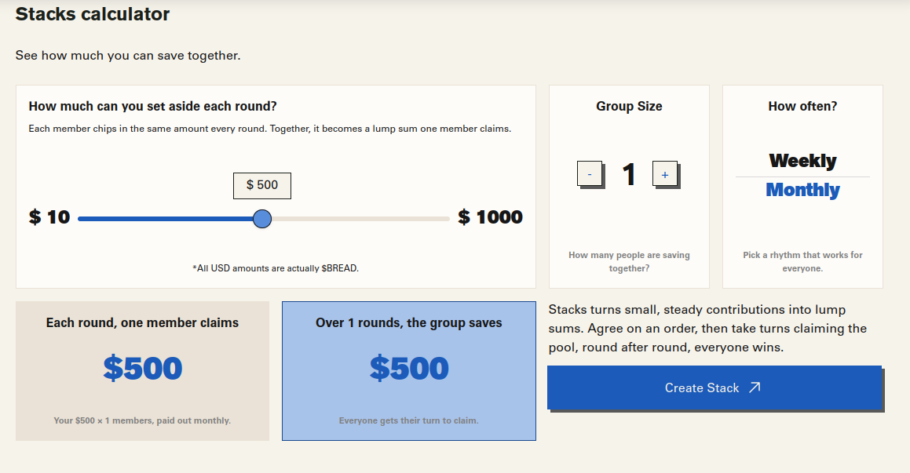
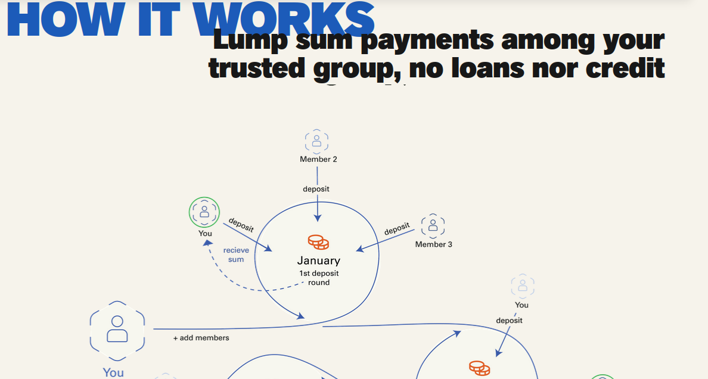
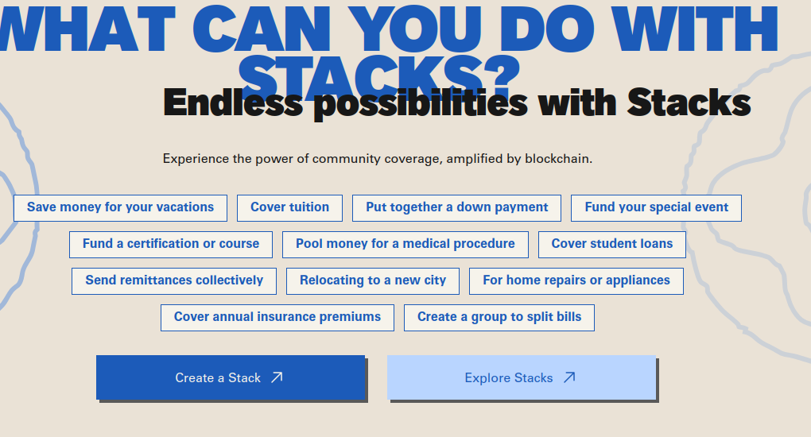
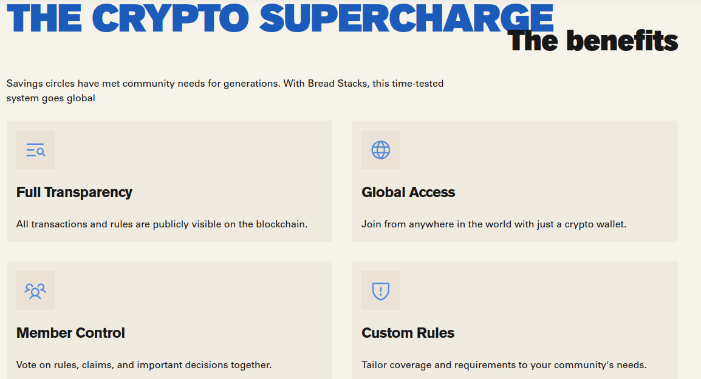

# Stacks

> Onchain savings circles: save and get interest free loans with people you trust

| Field | Value |
| --- | --- |
| Category | Save |
| Pricing | Free |
| Team name | Bread Cooperative |
| Team members | Blessing |
| X account | https://x.com/breadcoop |
| Heard about it via | TG |
| Contact email | mettodo@protonmail.com |
| GitHub login | @Mettodo |
| Submitted at | 2026-11-11T20:54:33.729Z |

## Links

| Link | URL |
| --- | --- |
| Repo | [https://github.com/BreadchainCoop/app-stacks](<https://github.com/BreadchainCoop/app-stacks>) |
| Demo | [https://development.stacks.bread.coop/](<https://development.stacks.bread.coop/>) |
| Video | [https://youtu.be/Eru04GEBU8Q](<https://youtu.be/Eru04GEBU8Q>) |
| Skool post | [https://www.skool.com/miniappscompetition/stacks-onchainc-savings-circles?p=0dbdb61c](<https://www.skool.com/miniappscompetition/stacks-onchainc-savings-circles?p=0dbdb61c>) |
| Social post | [https://x.com/mettoddo/status/2120620622325961026?a=xuA7DKxusdHkG00Md-o&s=20](<https://x.com/mettoddo/status/2120620622325961026?a=xuA7DKxusdHkG00Md-o&s=20>) |

## Description

Do we really need banks and interest to fund ourselves? A savings circle is a group of people who each put in money regularly (no fees, no interest) and one person gets the whole pot each time, taking turns until everyone gets their big payout.

## Builder story

Our mission at Bread Coop is to build tools that empower working people. Bringing onchain a centuries old solidarity practice that workers all over the world use is a no-brainer

## Thumbnail

## Screenshots

---

_Generated from the submission form. `submission.yaml` in this folder is the machine-readable source of truth._
