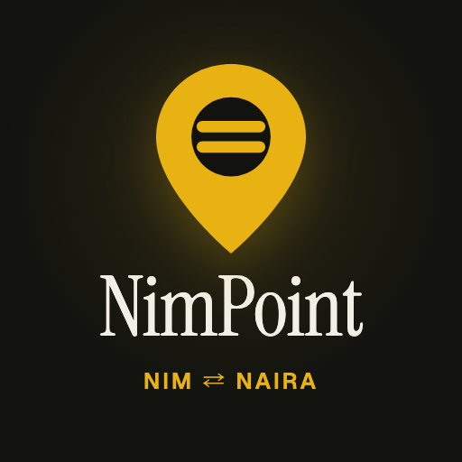
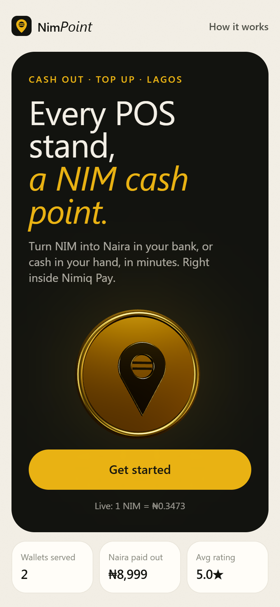
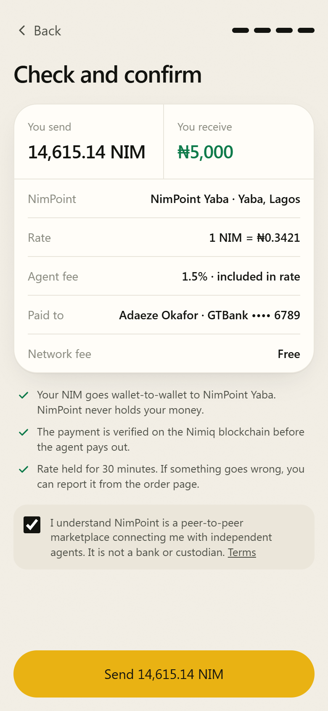
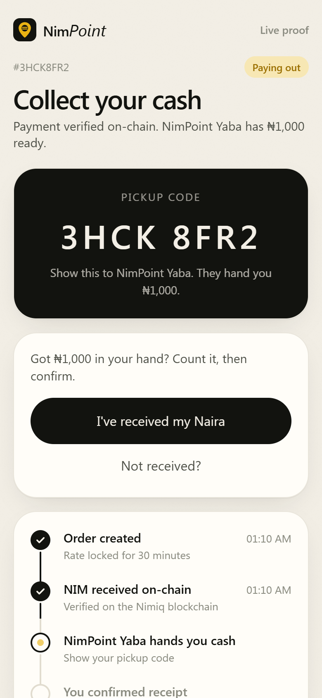
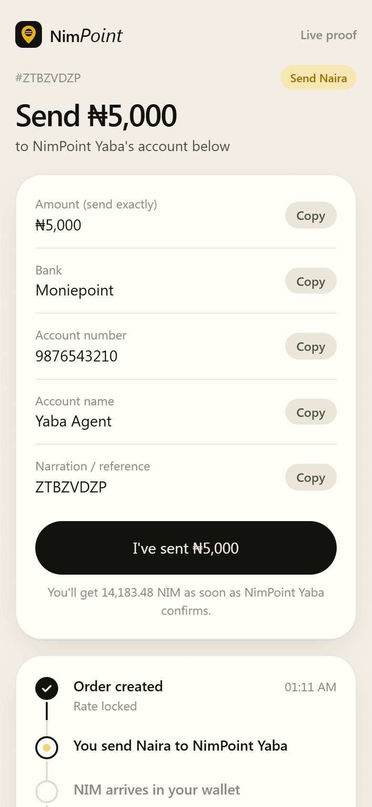
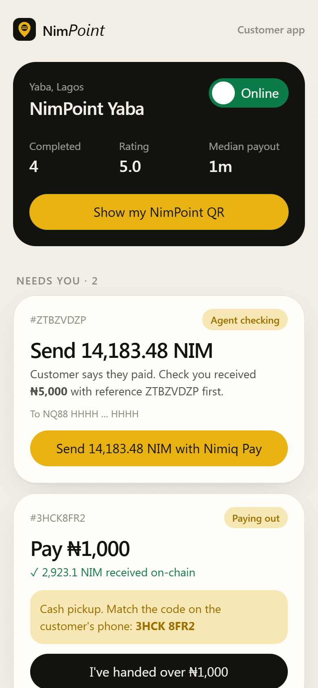

# NimPoint

> Every POS stand, a NIM cash point.

| Field | Value |
| --- | --- |
| Category | On/Off-Ramp |
| Pricing | Free |
| Team name | Pavilion |
| Team members | Opeoluwa Mobolaji |
| X account | olathepavilion |
| Heard about it via | _Not provided — optional_ |
| Contact email | olaboyefavour52@gmail.com |
| GitHub login | @Pavilion-devs |
| Submitted at | 2026-11-11T22:05:18.598Z |

## Links

| Link | URL |
| --- | --- |
| Repo | [https://github.com/opeblow/NIMPOINT](<https://github.com/opeblow/NIMPOINT>) |
| Demo | [https://nimpoint.vercel.app](<https://nimpoint.vercel.app>) |
| Video | [https://youtu.be/xasleZF4qhE](<https://youtu.be/xasleZF4qhE>) |
| Skool post | _Not provided — optional_ |
| Social post | [https://x.com/nimpoint/status/2120636662329802824?s=19](<https://x.com/nimpoint/status/2120636662329802824?s=19>) |

## Description

NimPoint is a Nimiq Pay Mini App that lets people in Nigeria cash out NIM to any Nigerian bank or fintech wallet, or as cash at a local POS agent, and top up NIM with Naira. Customers pay agents wallet-to-wallet. NimPoint locks the rate, verifies every NIM payment on the Nimiq bl

## Builder story

_Not provided — optional_

## Thumbnail

## Screenshots

---

_Generated from the submission form. `submission.yaml` in this folder is the machine-readable source of truth._
