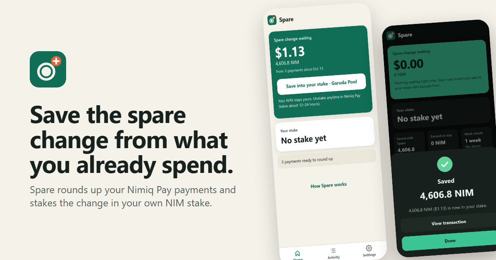
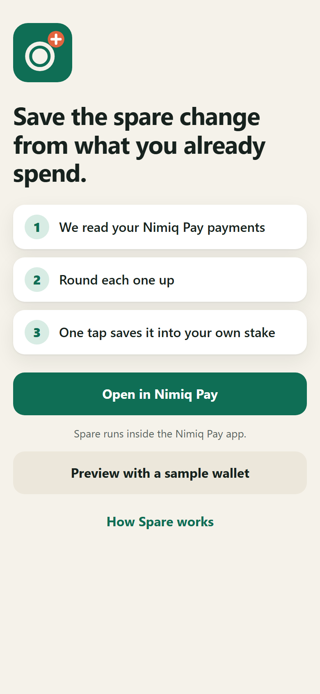
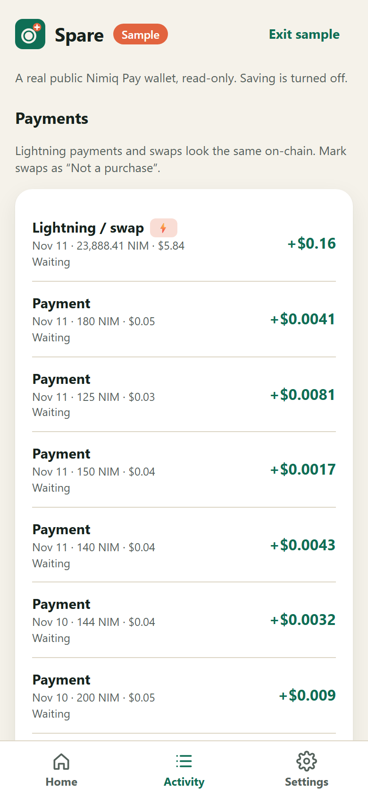
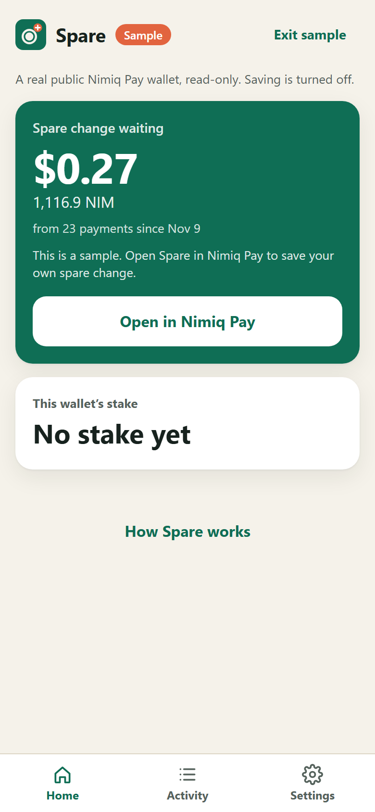
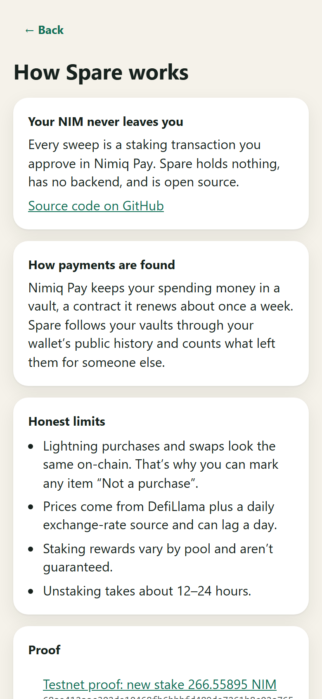
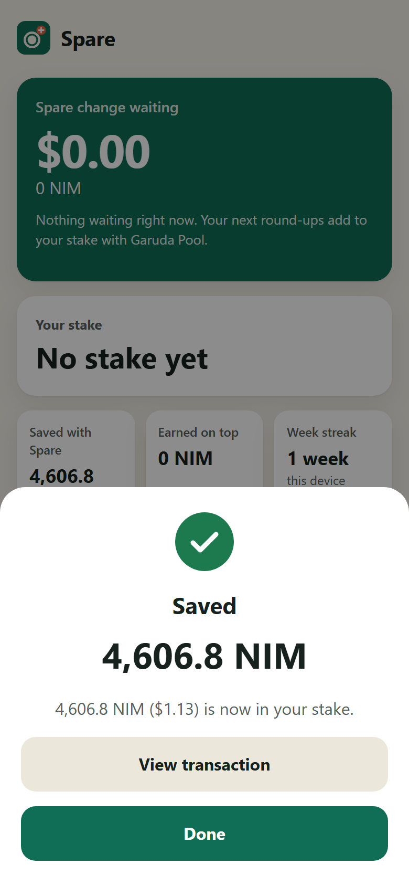

# Spare

> Round up every Nimiq Pay payment and save the spare change into your own NIM stake, in one tap.

| Field | Value |
| --- | --- |
| Category | Save |
| Pricing | Free |
| Team name | Spare |
| Team members | Soham Juneja |
| X account | https://x.com/juneja_soham |
| Heard about it via | Gmail |
| Contact email | junejasoham@gmail.com |
| GitHub login | @SohamJuneja |
| Submitted at | 2026-11-11T20:43:59.128Z |

## Links

| Link | URL |
| --- | --- |
| Repo | [https://github.com/SohamJuneja/spare](<https://github.com/SohamJuneja/spare>) |
| Demo | [https://spare-dun.vercel.app](<https://spare-dun.vercel.app>) |
| Video | [https://youtu.be/xDHfuD4ZY9M](<https://youtu.be/xDHfuD4ZY9M>) |
| Skool post | [https://www.skool.com/miniappscompetition/spare-round-up-every-nimiq-pay-payment-save-the-change-into-your-own-stake?p=10aeaaaf](<https://www.skool.com/miniappscompetition/spare-round-up-every-nimiq-pay-payment-save-the-change-into-your-own-stake?p=10aeaaaf>) |
| Social post | [https://x.com/juneja_soham/status/2120618280222335257?a=KJ8XZwxGyB-5ae9wIuU&s=19](<https://x.com/juneja_soham/status/2120618280222335257?a=KJ8XZwxGyB-5ae9wIuU&s=19>) |

## Description

Spare reads the payments you already make in Nimiq Pay, rounds each one up, and saves the spare change into your own NIM stake with one tap. No goals to remember, no deposits to plan, no custody: your NIM stays yours and earns staking rewards.

## Builder story

Every savings app I've tried fails the same way: it asks me to remember to save. Goal jars, savings circles, piggy banks all depend on a manual deposit, and manual deposits are the first habit to go. Round-ups fixed this for millions of people in traditional banking: you don't decide to save, your spending does it for you. Nobody had built that for Nimiq Pay, so I did.

Spare reads the payments you've already made, rounds each one up and lets you sweep the total into your own NIM stake with one approval. Spare holds nothing and has no backend. Every sweep is a staking transaction you sign in Nimiq Pay, and the money stays in your wallet, earning.

The hard part was finding the spending at all. Nimiq Pay doesn't pay from your wallet address. It pays from an HTLC vault that it replaces roughly every week, so a naive history read shows zero spending. Spare decodes each vault's creation data to rebuild the chain of vaults that belong to you, and separates real payments from internal moves, refunds and staking. It also tells Lightning swap HTLCs apart from vaults: both name your wallet as sender, so the hash lock and the swap hub decide. I checked the decoder against live account state and wrote fixture-backed tests for every case.

Round-ups had to fit NIM. A 10 NIM payment is a fraction of a cent, so rounding to the next dollar would save more than you spent. Spare sizes the rounding step to each payment and caps every round-up at half the payment, so savings stay believable in USD, EUR, CRC or GMD.

For the sweep I verified the staking rules against the chain and node source. The wallet, not the vault, is the staker. A first stake needs 100 NIM, after which any amount can be added. When the outcome of a sweep is unknown, Spare checks the chain before it will ever ask again, so it can't double-save. It defaults to a pool that actually pays its stakers, skipping the top-ranked one that doesn't.

Testing: I ran two real sweeps on testnet inside Nimiq Pay, a new stake and then an add-to-stake, and the staker balance matches to the luna. Both transactions are linked in the app and the README. The app works in English and Spanish, in light and dark mode, with a read-only sample wallet so anyone can see it working in seconds.

Honest limits are in the app too: on-chain, a Lightning purchase looks the same as a swap, so you can mark any item "Not a purchase".

Next: USDT round-ups on Polygon, a weekly "your spare change is waiting" moment, and savings squads.

## Thumbnail

## Screenshots

---

_Generated from the submission form. `submission.yaml` in this folder is the machine-readable source of truth._
