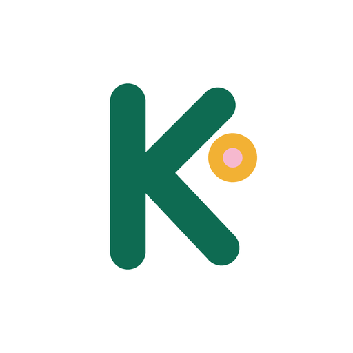
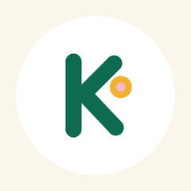
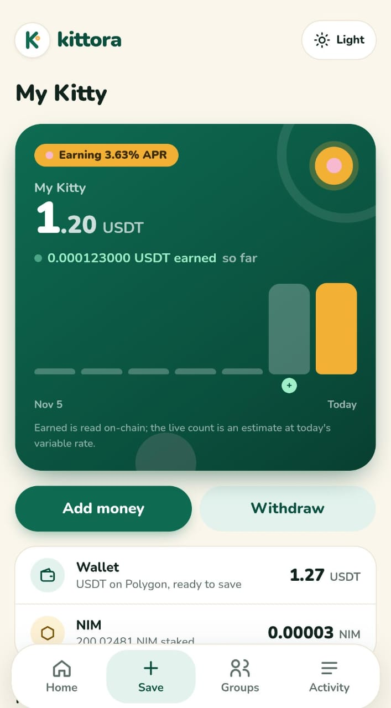
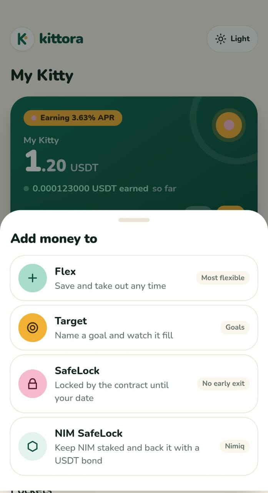
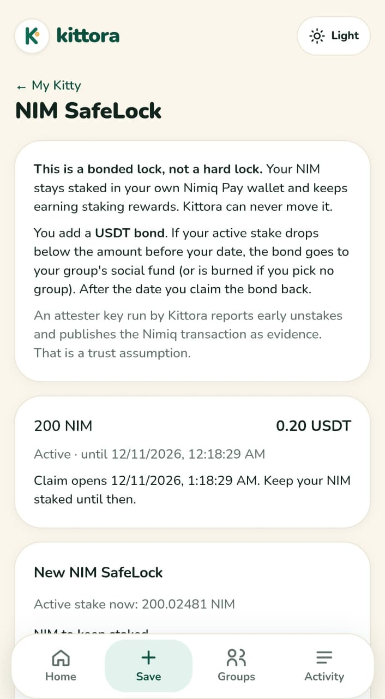
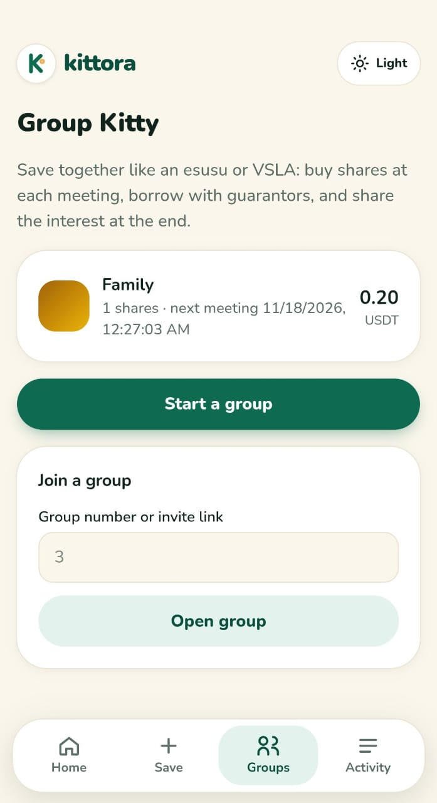
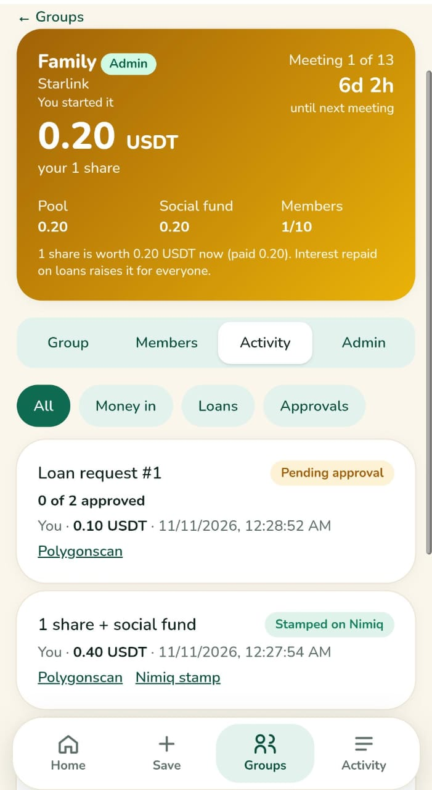

# Kittora

> save alone, grow together

| Field | Value |
| --- | --- |
| Category | Save |
| Pricing | Free |
| Team name | _Not provided — optional_ |
| Team members | _Not provided — optional_ |
| X account | kittorasave |
| Heard about it via | _Not provided — optional_ |
| Contact email | mebostellamaris@gmail.com |
| GitHub login | @Stella112 |
| Submitted at | 2026-11-11T21:33:32.205Z |

## Links

| Link | URL |
| --- | --- |
| Repo | [https://github.com/Stella112/kittora](<https://github.com/Stella112/kittora>) |
| Demo | [https://kittora.xyz/](<https://kittora.xyz/>) |
| Video | [https://youtu.be/8-MLt5si7_g?si=IaRsCmyLIEwI7LIY](<https://youtu.be/8-MLt5si7_g?si=IaRsCmyLIEwI7LIY>) |
| Skool post | [https://www.skool.com/miniappscompetition/introducing-kittora-personal-savings-meets-cooperative-finance?p=3dc7fe1d](<https://www.skool.com/miniappscompetition/introducing-kittora-personal-savings-meets-cooperative-finance?p=3dc7fe1d>) |
| Social post | [https://x.com/kittorasave/status/2119176715834441920](<https://x.com/kittorasave/status/2119176715834441920>) |

## Description

Kittora brings personal savings and cooperative finance into Nimiq Pay. Create flexible, goal-based and locked savings pockets, or join a group to contribute, request collateral-backed loans, approve lending together and share realized interest at the end of a savings cycle. Smar

## Builder story

Across Nigeria and much of Africa, people save together in esusu and ajo groups: everyone contributes each meeting, members can borrow, and the pot is shared at the end. It works because people trust each other, but the records live in a notebook and the money sits idle in naira that loses value. Kittora puts that circle on-chain inside Nimiq Pay. Savings are in dollars that earn, every contribution, loan and approval is visible to the whole group, loans need guarantors and approvals, and at Share-Out everyone gets their savings plus the group's interest. Members never touch gas: they sign in Nimiq Pay and Kittora pays the fees. NIM holders can keep their NIM staked and back a savings promise with a bond. "Save alone, grow together."

## Thumbnail

## Screenshots

---

_Generated from the submission form. `submission.yaml` in this folder is the machine-readable source of truth._
