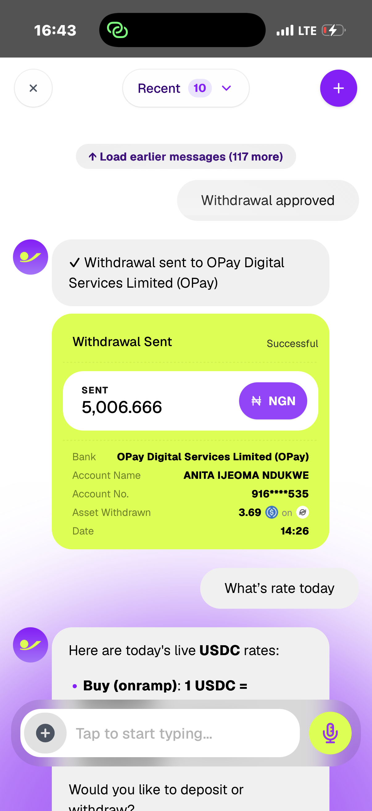
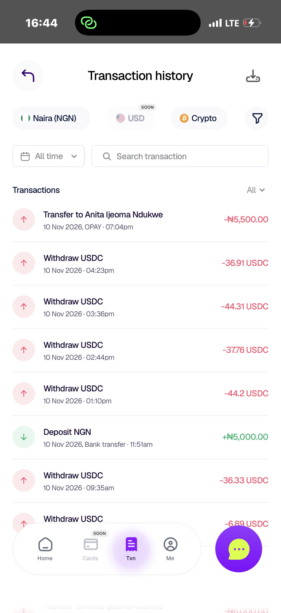

# JUMPA

> Ai financial assistant that lets you Move money and manage  the way you chat

| Field | Value |
| --- | --- |
| Category | Pay |
| Pricing | Free |
| Team name | JUMPA TEAM |
| Team members | 4 |
| X account | a_nitapounds |
| Heard about it via | X |
| Contact email | anitandukwe7@gmail.com |
| GitHub login | @anitandukwe |
| Submitted at | 2026-11-11T15:57:34.837Z |

## Links

| Link | URL |
| --- | --- |
| Repo | [https://github.com/official-jumpa/jumpa-web-app](<https://github.com/official-jumpa/jumpa-web-app>) |
| Demo | [https://usejumpa.com/nimiq](<https://usejumpa.com/nimiq>) |
| Video | [https://www.loom.com/share/9776cab1f3a14aceb396c6ae5c244718](<https://www.loom.com/share/9776cab1f3a14aceb396c6ae5c244718>) |
| Skool post | [https://www.skool.com/miniappscompetition/were-live?p=7c23fee7](<https://www.skool.com/miniappscompetition/were-live?p=7c23fee7>) |
| Social post | [https://x.com/a_nitapounds/status/2120545274644885695?s=46](<https://x.com/a_nitapounds/status/2120545274644885695?s=46>) |

## Description

Crypto users still need multiple apps for earning yield, spending stablecoins, and converting to local currency, which creates friction, custody risks, and fragmented experiences.

## Builder story

_Not provided — optional_

## Thumbnail

## Screenshots

---

_Generated from the submission form. `submission.yaml` in this folder is the machine-readable source of truth._
