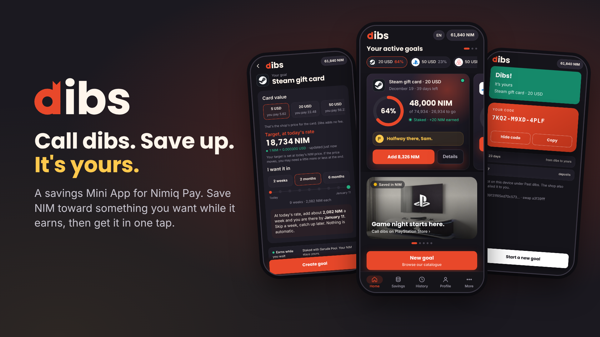

# Dibs

> Call dibs. Save up. It's yours.

| Field | Value |
| --- | --- |
| Category | Save |
| Pricing | Free |
| Team name | Churros |
| Team members | Aziz Chourou, Khadija Chourou |
| X account | calldibs_app |
| Heard about it via | Word of mouth |
| Contact email | calldibs.contact@gmail.com |
| GitHub login | @aziz-chourou |
| Submitted at | 2026-11-11T02:11:08.736Z |

## Links

| Link | URL |
| --- | --- |
| Repo | [https://github.com/khadijachou/dibs](<https://github.com/khadijachou/dibs>) |
| Demo | [https://dibs-sepia.vercel.app](<https://dibs-sepia.vercel.app>) |
| Video | [https://youtu.be/y2SuazkWBkM](<https://youtu.be/y2SuazkWBkM>) |
| Skool post | [https://www.skool.com/miniappscompetition/meet-dibs-save-nim-for-something-you-want-get-it-in-one-tap](<https://www.skool.com/miniappscompetition/meet-dibs-save-nim-for-something-you-want-get-it-in-one-tap>) |
| Social post | [https://x.com/calldibs_app/status/2120331986145612079](<https://x.com/calldibs_app/status/2120331986145612079>) |

## Description

Dibs is a Mini App in Nimiq Pay that helps you save for gift cards. Choose Steam, Amazon, Netflix, Apple or 17 other brands, put aside NIM every week, and redeem your card with one tap once you hit your goal. Your savings earn rewards along the way.

## Builder story

Dibs started with a question we kept asking ourselves: why do savings apps always end with a balance? You save, you hit your number, and then you still have to go somewhere else to buy the thing. We wanted the goal to be the thing itself.

We're Khadija and Aziz, a sister and brother team of two, and we kept our rules simple: one screen at a time, one action per screen, and nothing in the app we couldn't test on mainnet ourselves.

The idea went through a few names. We called it "Payoff" for about a day, but it never felt like us, and honestly, it was a little boring. "Calling dibs" said it better. You claim something first, then you earn it.

The first version was running on testnet by the end of October. The first real moment came on November 4, when we bought a Steam gift card from Nimiq Pay over Lightning. Bitrefill sent the invoice, payLightningInvoice paid it, and the code came back in eight seconds. That was the day we knew the end of the flow worked. Next, we went back to the start: how people save.

In Dibs, saving means staking. Every deposit is a staking transaction from the user's own account, delegated to Garuda Pool, so the NIM never leaves the user and earns rewards while it waits. That choice led to the hardest part of the build: getting the NIM back. The protocol needs three steps (deactivate, wait for the release, then retire and remove the stake), and the wait takes 12 to 24 hours. We could have hidden that behind a custodial pool. We chose to visualize it instead with a ring that fills up toward the real release time, the transaction and block behind each step, and a single tap at the end. We ran the full cycle on mainnet on November 6 and 7, and it took 12 hours and 4 minutes from stopping the stake to the release. Nimiq's team and the Skool community helped us figure out which account holds what, which saved us a full day.

We planned error handling before writing any of the code. Every notice tells you what happened, whether your NIM moved, and what to do next. No payment is ever retried automatically. If a payment's outcome is unclear, the pay button stays locked until the shop confirms it. And cancelling in Nimiq Pay is treated as a normal choice, not an error.

We spent the last few days on the part that keeps people coming back. Saving for weeks needs small wins along the way, so Dibs now has XP, six ranks, 21 badges you can share on X, and an optional weekly quest. We set one rule here too: nothing ever goes down. There's no streak to lose and no XP taken away, just a bonus for the weeks you show up. Until November 30, we're also rewarding real saving with NIM ourselves, paid by hand after we check each deposit or order. Privacy stayed the same throughout: your goals live on your phone, and usage stats are anonymous and only shared if you say yes.

Dibs is open source under MIT, available in English, French and Spanish, with 21 brands priced live. The gift cards are sold and delivered by Bitrefill as a code or a link. Our small server only requests the invoice and passes the order along, and it never stores a code. Dibs runs full screen in Nimiq Pay, with its own sounds and animations. No custody, no fiat, no smart contract, no token of our own. Just Nimiq Pay, staking and Lightning, in that order.

And we’re just getting started. Next, we plan to add more brands, more rewards tied to ranks, levels, and badges, a proof page where every card purchase can be checked on chain, and a notice for when the NIM price changes between calling dibs and getting your card.

Dibs! It's yours.

## Thumbnail

## Screenshots

---

_Generated from the submission form. `submission.yaml` in this folder is the machine-readable source of truth._
