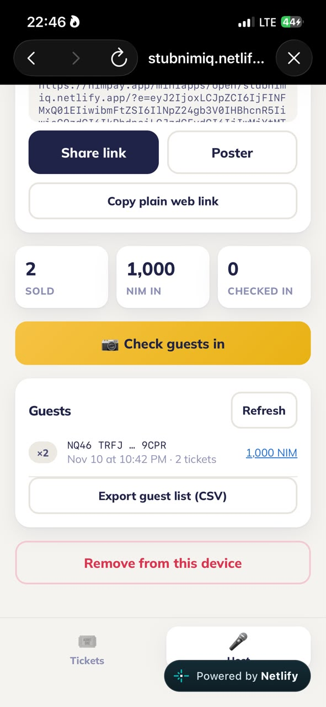
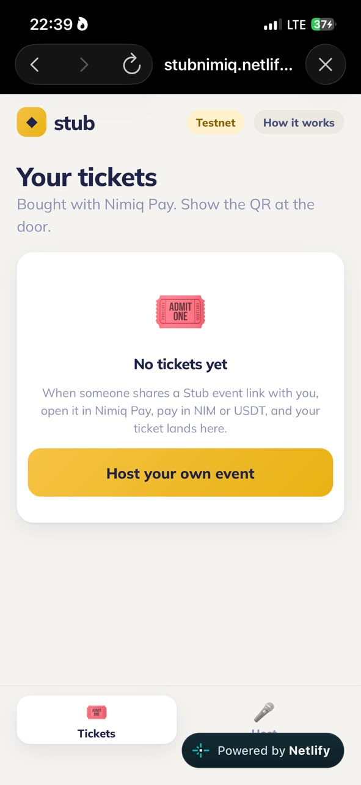
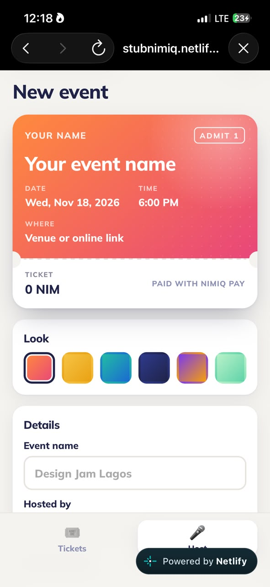

# stubpay

> Sell event tickets in NIM or USDT. Share one link, get paid wallet to wallet, scan guests at the door

| Field | Value |
| --- | --- |
| Category | Pay |
| Pricing | Free |
| Team name | _Not provided — optional_ |
| Team members | _Not provided — optional_ |
| X account | ToluDavid29 |
| Heard about it via | _Not provided — optional_ |
| Contact email | davidsalako809@gmail.com |
| GitHub login | @davidsalako809-rgb |
| Submitted at | 2026-11-11T18:11:18.244Z |

## Links

| Link | URL |
| --- | --- |
| Repo | [https://github.com/davidsalako809-rgb/Stub](<https://github.com/davidsalako809-rgb/Stub>) |
| Demo | [https://stubnimiq.netlify.app](<https://stubnimiq.netlify.app>) |
| Video | [https://www.loom.com/share/86b23fa3be524fc59cdd96290ee233bb](<https://www.loom.com/share/86b23fa3be524fc59cdd96290ee233bb>) |
| Skool post | _Not provided — optional_ |
| Social post | _Not provided — optional_ |

## Description

Stub let's anyone sell tickets in Nimiq Pay. Hosts create an event and share one link or poster. Guests pay in NIM or USDT straight to the host's wallet, and each ticket is a QR of the payment. At the door, Stub verifies it on-chain and admits the ticket once. No server, no fees!

## Builder story

_Not provided — optional_

## Thumbnail

## Screenshots

---

_Generated from the submission form. `submission.yaml` in this folder is the machine-readable source of truth._
