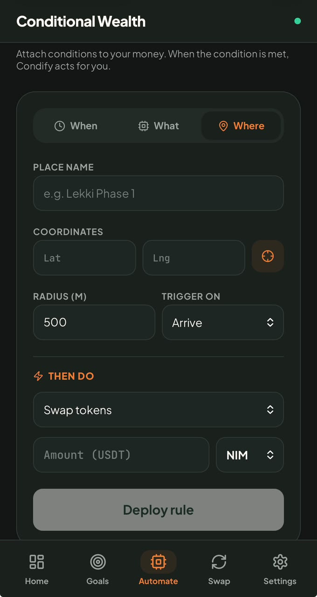
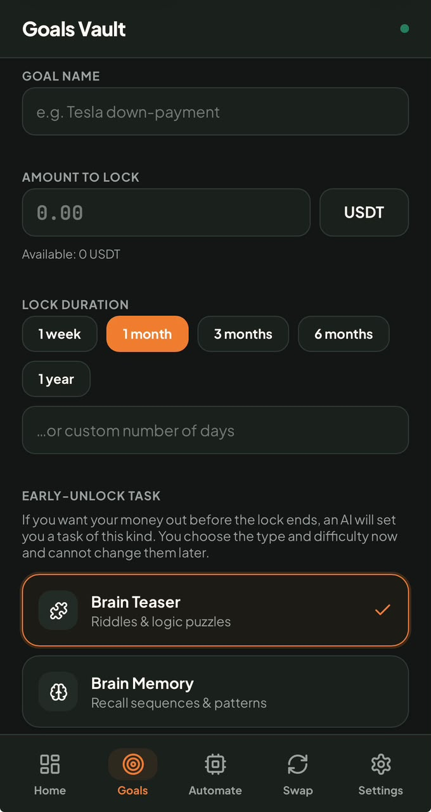
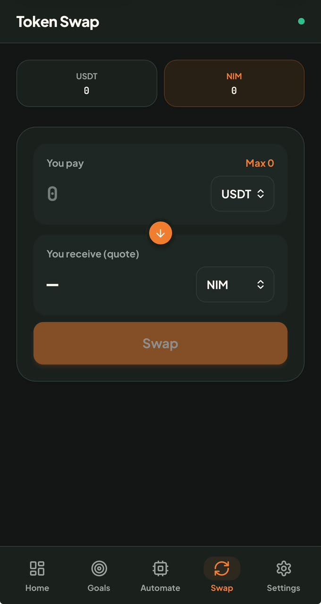
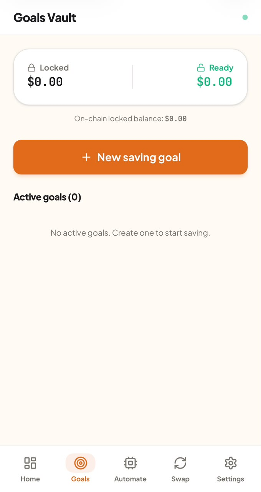

# Condify

> Set the Conditions, Then Let Your Assets Follow Them.

| Field | Value |
| --- | --- |
| Category | Save |
| Pricing | Free |
| Team name | DawnikHQ |
| Team members | _Not provided — optional_ |
| X account | dawnik |
| Heard about it via | X |
| Contact email | dawnikhq@gmail.com |
| GitHub login | @dawnikhq |
| Submitted at | 2026-11-11T23:57:26.693Z |

## Links

| Link | URL |
| --- | --- |
| Repo | [https://github.com/dawnikhq/condify](<https://github.com/dawnikhq/condify>) |
| Demo | [https://condify.onrender.com](<https://condify.onrender.com>) |
| Video | [https://youtu.be/l_fnlkoyLiQ?si=Dw0jguRh8DCSWRNm](<https://youtu.be/l_fnlkoyLiQ?si=Dw0jguRh8DCSWRNm>) |
| Skool post | _Not provided — optional_ |
| Social post | [https://x.com/dawnik/status/2120667161274270015](<https://x.com/dawnik/status/2120667161274270015>) |

## Description

Conditions are the new saving plan.

You can now create your own conditions for how and when your assets are transferred. 

Savings linked to healthy goals and habits. Save towards a goal. Set a rule on your assets.

## Builder story

_Not provided — optional_

## Thumbnail

## Screenshots

---

_Generated from the submission form. `submission.yaml` in this folder is the machine-readable source of truth._
