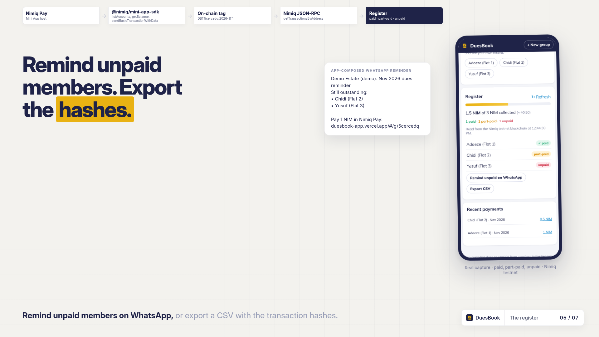
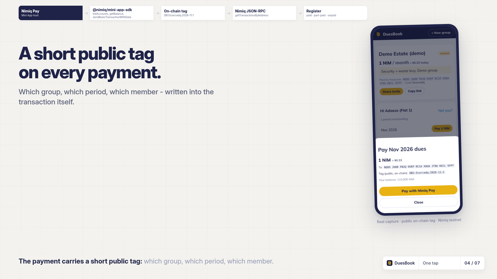

# DuesBook

> Group dues in NIM, with a register that keeps itself.

| Field | Value |
| --- | --- |
| Category | Pay |
| Pricing | Free |
| Team name | DUKERS |
| Team members | _Not provided — optional_ |
| X account | starduke001 |
| Heard about it via | _Not provided — optional_ |
| Contact email | starduke001@gmail.com |
| GitHub login | @dukemawex |
| Submitted at | 2026-11-11T20:55:08.935Z |

## Links

| Link | URL |
| --- | --- |
| Repo | [https://github.com/dukemawex/duesbook](<https://github.com/dukemawex/duesbook>) |
| Demo | [https://duesbook-app.vercel.app/](<https://duesbook-app.vercel.app/>) |
| Video | [https://youtu.be/_Hd0O0VOVp4?is=np7p2b2q-BPjnemg](<https://youtu.be/_Hd0O0VOVp4?is=np7p2b2q-BPjnemg>) |
| Skool post | _Not provided — optional_ |
| Social post | [https://x.com/Emmanue07495029/status/2120621238867435787?a=3lBw4ZpArYLhwHrTWRw&s=19](<https://x.com/Emmanue07495029/status/2120621238867435787?a=3lBw4ZpArYLhwHrTWRw&s=19>) |

## Description

"DuesBook helps treasurers of estates, alumni sets, cooperatives and clubs collect recurring dues in NIM inside Nimiq Pay. A treasurer creates a group, sets the amount and period, and shares a link. Members open it in Nimiq Pay and pay with one tap. Each payment carries a short o

## Builder story

_Not provided — optional_

## Thumbnail

## Screenshots

---

_Generated from the submission form. `submission.yaml` in this folder is the machine-readable source of truth._
