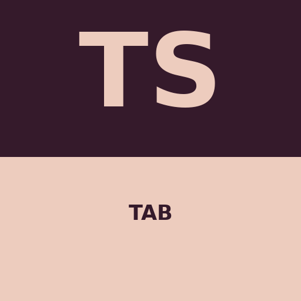
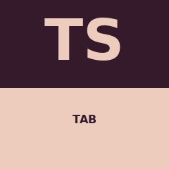
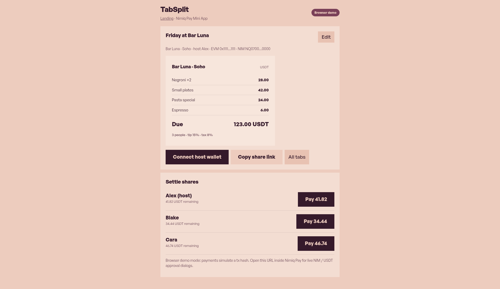
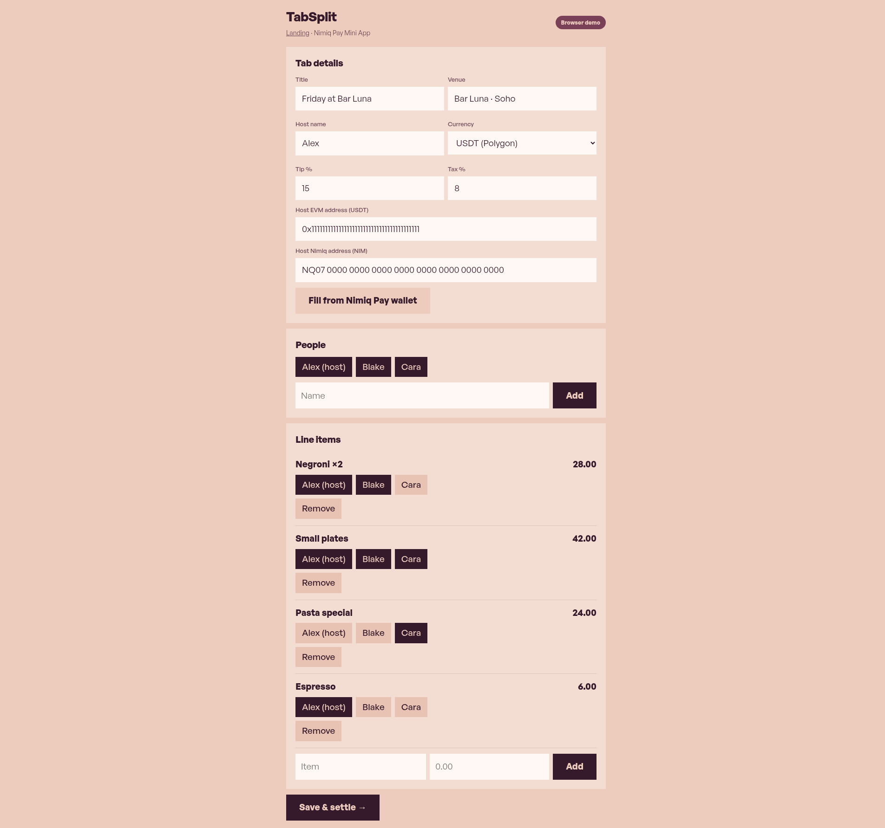
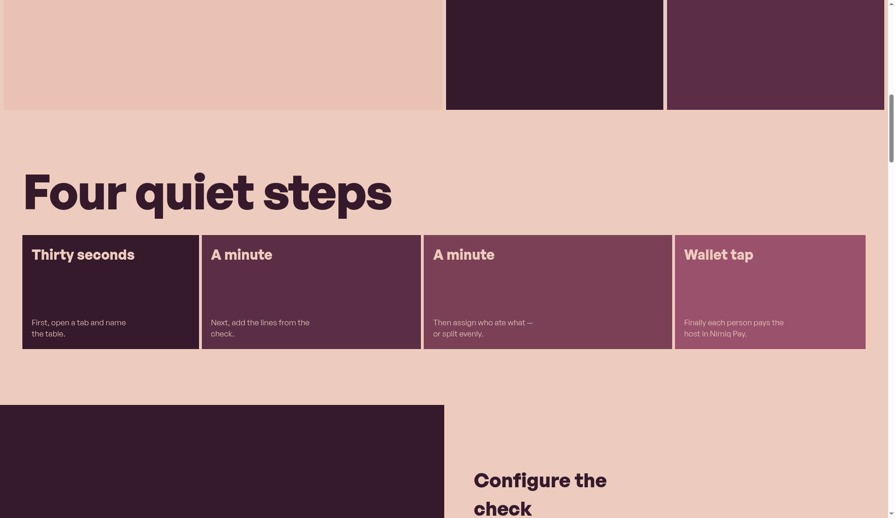

# TabSplit

> Split a restaurant or bar tab; friends settle shares to the host with NIM (Nimiq Pay SDK) or Polygon USDT.

| Field | Value |
| --- | --- |
| Category | Pay |
| Pricing | Free |
| Team name | Solo · Caesar (Jiachen Xie) · GitHub er-s-an |
| Team members | _Not provided — optional_ |
| X account | _Not provided — optional_ |
| Heard about it via | _Not provided — optional_ |
| Contact email | 3137612974@qq.com |
| GitHub login | @er-s-an |
| Submitted at | 2026-11-05T10:35:32.719Z |

## Links

| Link | URL |
| --- | --- |
| Repo | [https://github.com/er-s-an/tabsplit](<https://github.com/er-s-an/tabsplit>) |
| Demo | [https://tabsplit-psi.vercel.app](<https://tabsplit-psi.vercel.app>) |
| Video | [https://review-clips.vercel.app/v/tabsplit-explainer](<https://review-clips.vercel.app/v/tabsplit-explainer>) |
| Skool post | _Not provided — optional_ |
| Social post | _Not provided — optional_ |

## Description

Create a tab (venue, tip, tax), add people and line items, assign items, host connects wallet, each payer settles remaining balance. Inside Nimiq Pay: real `@nimiq/mini-app-sdk` NIM transfers + `window.ethereum` Polygon USDT ERC-20 transfer.

## Builder story

License: MIT
Team: Solo · Caesar (Jiachen Xie) · GitHub er-s-an

One-liner: Split a restaurant or bar tab; friends settle shares to the host with NIM (Nimiq Pay SDK) or Polygon USDT via the injected wallet.

How it works: Create a tab (venue, tip, tax), add people and line items, assign items, host connects wallet, each payer settles remaining balance. Inside Nimiq Pay: real `@nimiq/mini-app-sdk` NIM transfers + `window.ethereum` Polygon USDT ERC-20 transfer. Outside host: clearly labeled browser demo mode with simulated hashes. No backend, no custody — localStorage + share URL.

Honesty: Real NIM/USDT only when opened in Nimiq Pay with providers; standalone browser is demo mode.

Demo: https://tabsplit-psi.vercel.app
Mini App path: https://tabsplit-psi.vercel.app/app

## Thumbnail

## Screenshots

---

_Generated from the submission form. `submission.yaml` in this folder is the machine-readable source of truth._
