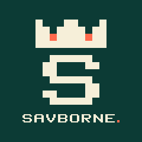
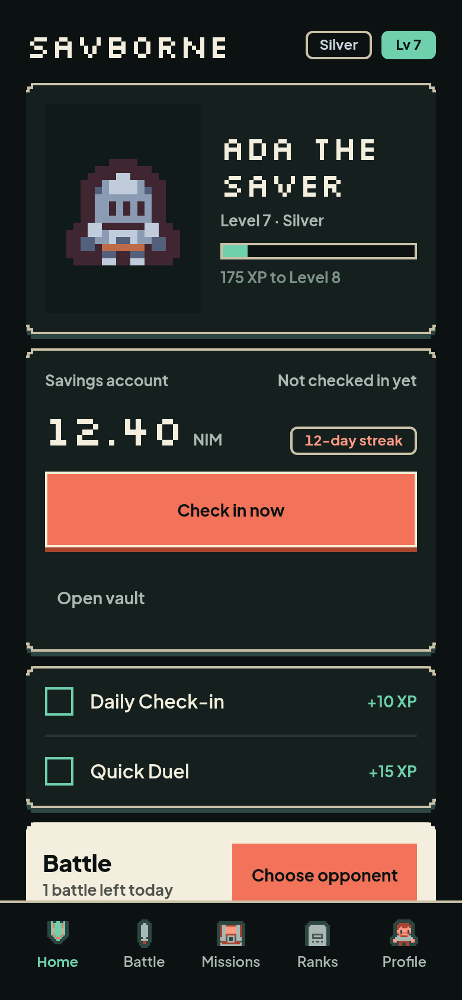
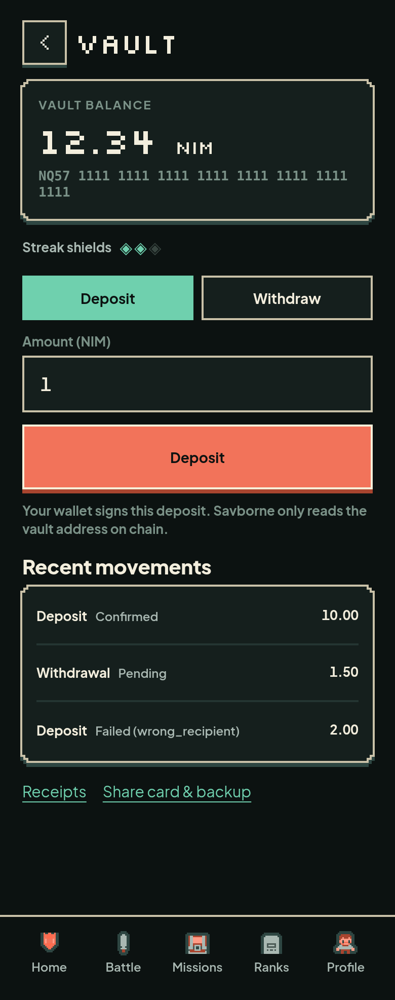
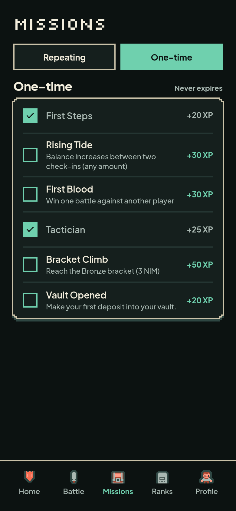
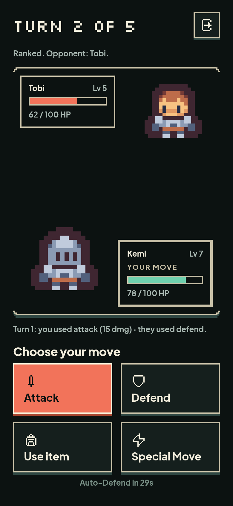
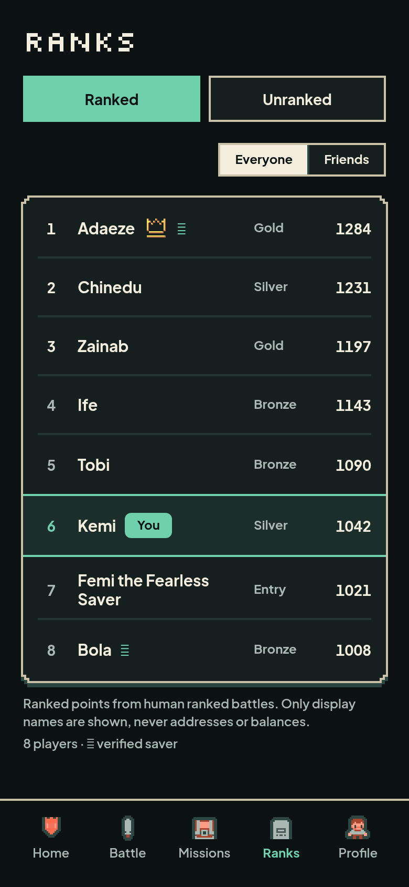

# Savborne

> Save for real. Level up for fun.

| Field | Value |
| --- | --- |
| Category | Save |
| Pricing | Free |
| Team name | _Not provided — optional_ |
| Team members | _Not provided — optional_ |
| X account | jigz_crypto |
| Heard about it via | X |
| Contact email | damilareogooluwade@outlook.com |
| GitHub login | @er4l1m4d |
| Submitted at | 2026-11-11T21:16:06.346Z |

## Links

| Link | URL |
| --- | --- |
| Repo | [https://github.com/er4l1m4d/savborne](<https://github.com/er4l1m4d/savborne>) |
| Demo | [https://savborne.vercel.app](<https://savborne.vercel.app>) |
| Video | [https://vimeo.com/user265760449/savborne-demo-video](<https://vimeo.com/user265760449/savborne-demo-video>) |
| Skool post | _Not provided — optional_ |
| Social post | [https://x.com/jigz_crypto/status/2120608869831610692](<https://x.com/jigz_crypto/status/2120608869831610692>) |

## Description

A non-custodial NIM savings RPG inside Nimiq Pay: your NIM sits in a vault only you control, and your real on-chain balance becomes XP, streaks, items and battles. Built for people who want to save but keep forgetting.

## Builder story

I kept opening my wallet, seeing the same number, and closing it. Saving felt like admin. So I built Savborne to give that number a reason to grow: a savings RPG where the NIM you actually hold becomes XP, streaks and items, and a daily check-in keeps the streak alive. The vault is non-custodial - the phrase lives on your device and Nimiq Pay signs every deposit - so the game is real and the money never leaves your control.

## Thumbnail

## Screenshots

---

_Generated from the submission form. `submission.yaml` in this folder is the machine-readable source of truth._
