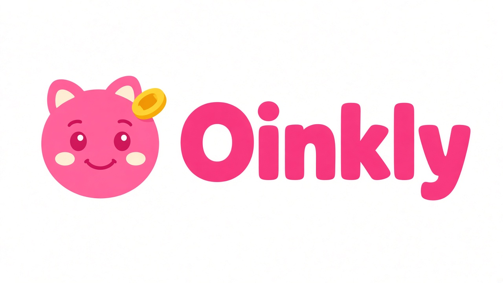
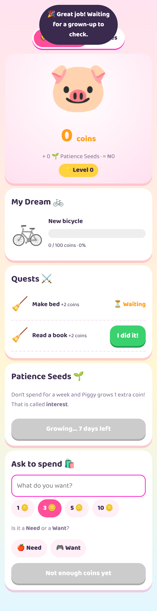
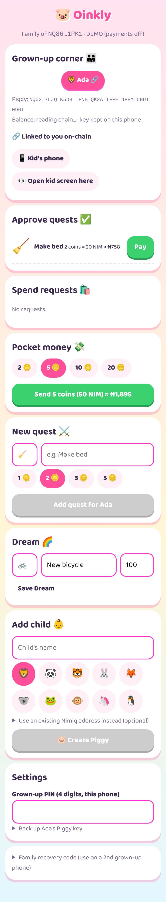
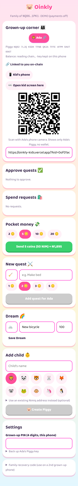
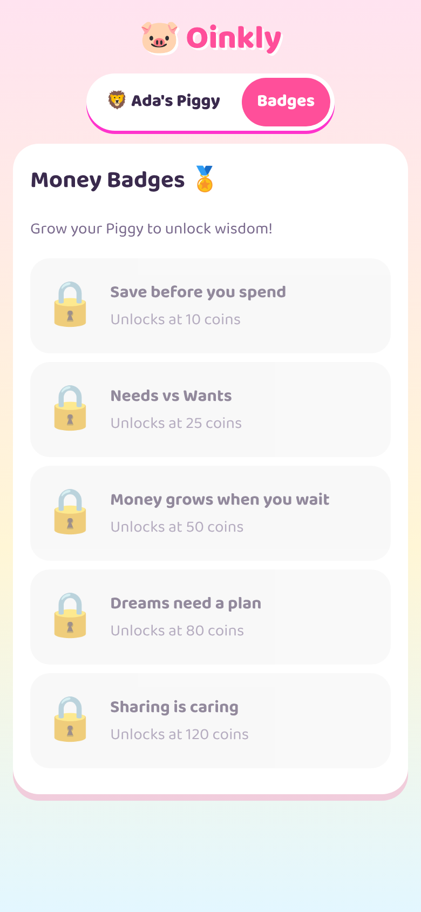
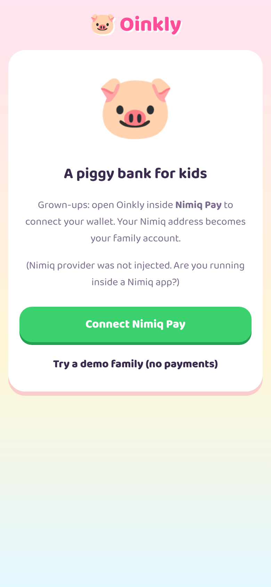

# Oinkly

> the piggy bank that pays kids to save.

| Field | Value |
| --- | --- |
| Category | Save |
| Pricing | Free |
| Team name | _Not provided — optional_ |
| Team members | _Not provided — optional_ |
| X account | GodspowerUnk |
| Heard about it via | x |
| Contact email | Ufotgodspower8@gmail.com |
| GitHub login | @godspowerufot |
| Submitted at | 2026-10-31T13:52:38.968Z |

## Links

| Link | URL |
| --- | --- |
| Repo | [https://github.com/0xGp/Oinkly](<https://github.com/0xGp/Oinkly>) |
| Demo | [https://oinkly-rosy.vercel.app](<https://oinkly-rosy.vercel.app>) |
| Video | [https://youtu.be/zWTv-tN46Y4](<https://youtu.be/zWTv-tN46Y4>) |
| Skool post | _Not provided — optional_ |
| Social post | [https://www.linkedin.com/feed/update/urn:li:activity:7522293533119156225/](<https://www.linkedin.com/feed/update/urn:li:activity:7522293533119156225/>) |

## Description

Oinkly is a piggy bank for kids that runs inside Nimiq Pay, parents create a Piggy (a real Nimiq address) for each child, post quests, and pay rewards in NIM. Kids earn coins, save toward a Dream, collect daily saver points for money they keep, and unlock name tags and badges for

## Builder story

Watching kids get pocket money as cash, it disappears by Friday, parents can’t see where it went, and “saving” stays a grown-up lecture, Parents can  pay quests in real NIM. Kids save toward a Dream, collect saver points for coins they keep, rank up with name tags and badges, and can cash points back into NIM.

## Thumbnail

## Screenshots

---

_Generated from the submission form. `submission.yaml` in this folder is the machine-readable source of truth._
