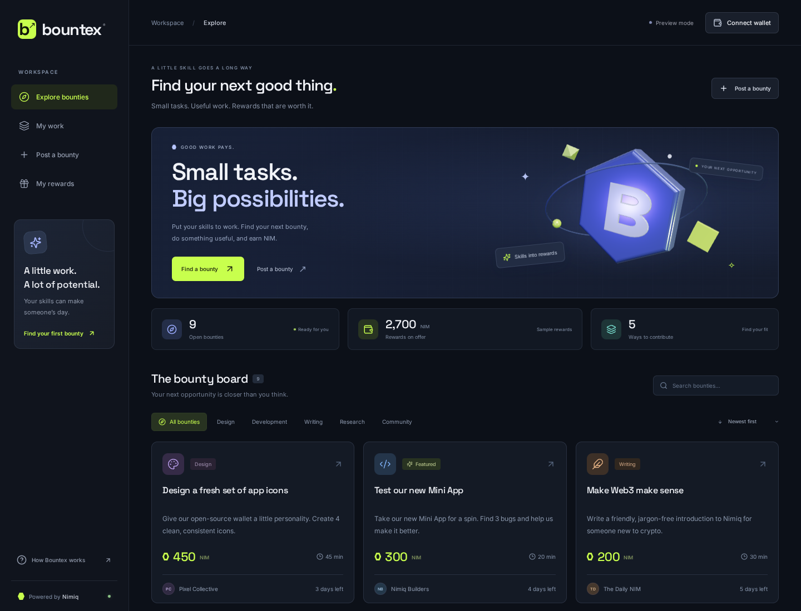
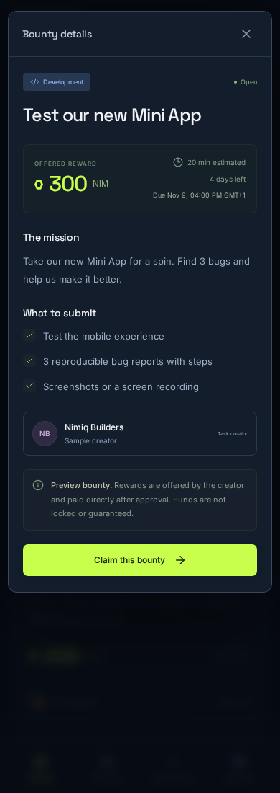
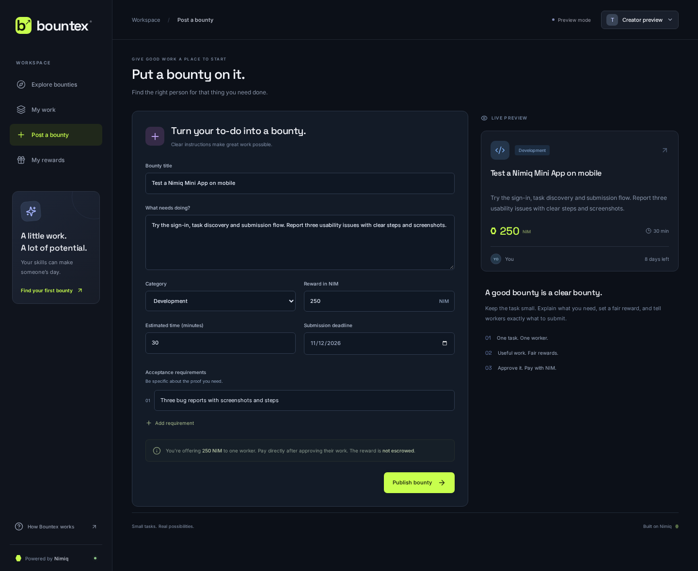
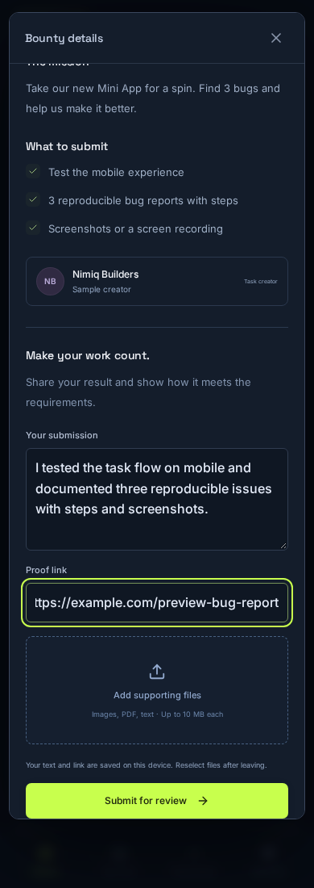
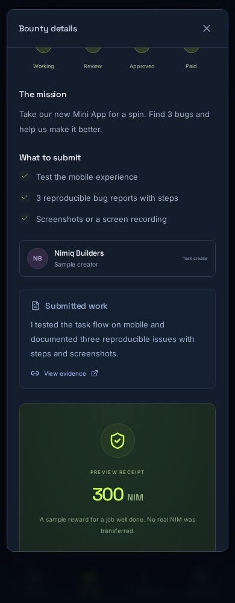

# Bountex

> Good work pays.

| Field | Value |
| --- | --- |
| Category | Off-theme |
| Pricing | Free |
| Team name | _Not provided — optional_ |
| Team members | _Not provided — optional_ |
| X account | _Not provided — optional_ |
| Heard about it via | _Not provided — optional_ |
| Contact email | el.chapie1@gmail.com |
| GitHub login | @greyw0rks |
| Submitted at | 2026-11-05T20:11:03.963Z |

## Links

| Link | URL |
| --- | --- |
| Repo | [https://github.com/greyw0rks/bountex](<https://github.com/greyw0rks/bountex>) |
| Demo | [https://bountex.vercel.app](<https://bountex.vercel.app>) |
| Video | [https://youtu.be/HH_CVf1lT7w](<https://youtu.be/HH_CVf1lT7w>) |
| Skool post | _Not provided — optional_ |
| Social post | _Not provided — optional_ |

## Description

Bountex helps builders and communities turn small tasks into NIM rewards. Workers claim bounties and submit proof; creators review the work and pay directly through Nimiq Pay, with clear progress and on-chain payment verification.

## Builder story

_Not provided — optional_

## Thumbnail

## Screenshots

---

_Generated from the submission form. `submission.yaml` in this folder is the machine-readable source of truth._
