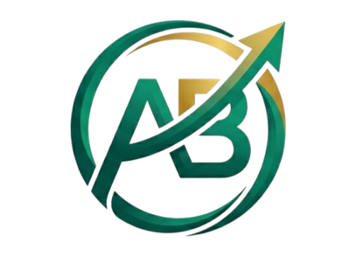
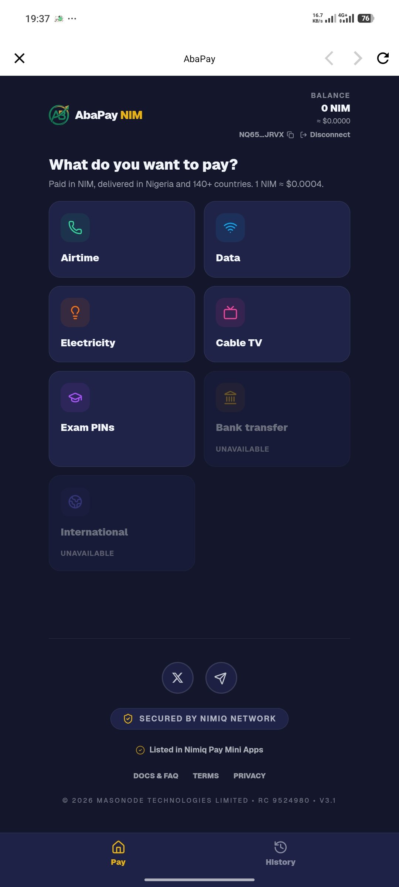
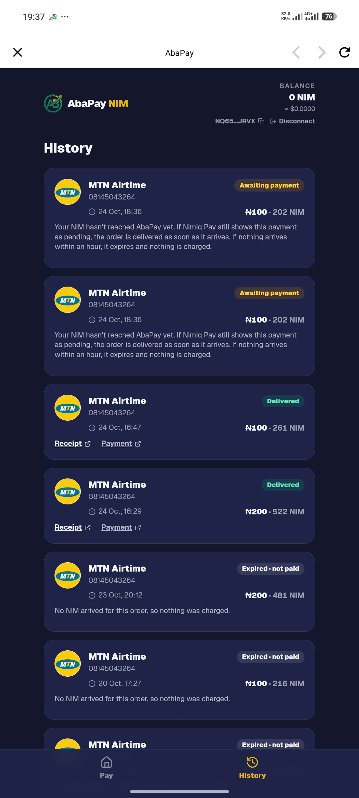
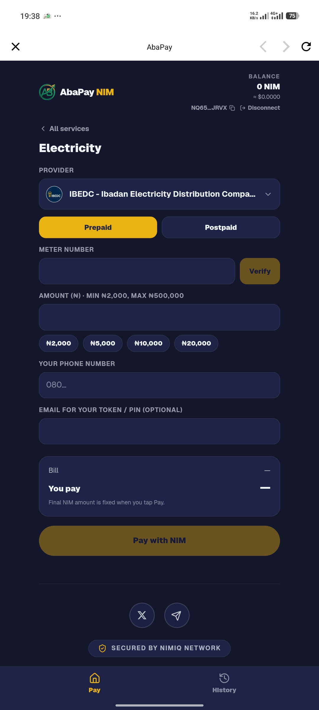

# AbaPay

> Pay everyday bills with NIM

| Field | Value |
| --- | --- |
| Category | Pay |
| Pricing | Paid |
| Team name | AbaPay |
| Team members | _Not provided — optional_ |
| X account | investorphem |
| Heard about it via | X |
| Contact email | hello@abapays.com |
| GitHub login | @investorphem |
| Submitted at | 2026-10-25T21:42:56.612Z |

## Links

| Link | URL |
| --- | --- |
| Repo | [https://github.com/investorphem/AbaPay](<https://github.com/investorphem/AbaPay>) |
| Demo | [https://nim.abapays.com](<https://nim.abapays.com>) |
| Video | [https://www.loom.com/share/e6f3afa3fdb8496d858cde1c9d4df297](<https://www.loom.com/share/e6f3afa3fdb8496d858cde1c9d4df297>) |
| Skool post | [https://www.skool.com/miniappscompetition/abapay-is-now-live-on-nimiq-pay?p=05d6da04](<https://www.skool.com/miniappscompetition/abapay-is-now-live-on-nimiq-pay?p=05d6da04>) |
| Social post | [https://x.com/abapays/status/2094503000857248137](<https://x.com/abapays/status/2094503000857248137>) |

## Description

AbaPay lets users pay for airtime, data, electricity, cable TV, education bills, and local bank transfers directly with NIM inside Nimiq Pay. It’s built for Nimiq users who want to spend their NIM on real-world everyday needs without leaving the app.

## Builder story

AbaPay turns NIM into real-world utility inside Nimiq Pay.

Most people hold NIM but still struggle to spend it on everyday needs. AbaPay solves that by letting users pay for airtime, mobile data, electricity, cable TV, education PINs, and local bank transfers directly with NIM — all from a Mini App that runs inside Nimiq Pay.

We built this after months of shipping real bill-payment infrastructure on Celo, where AbaPay has processed thousands of live utility payments and received recognition including a Prezenti Frontier grant and first place at the Celo Agents at Work hackathon. That work proved people want crypto they can actually use for real life, not just trade.
On Nimiq Pay, the experience is simple and non-custodial. Users connect their wallet through the Mini App SDK, see a live NIM quote based on market rates, confirm the payment, and the bill is delivered. No seed phrases are entered into the app, and no funds are held by AbaPay.

AbaPay is for anyone in the Nimiq community who wants their NIM to pay for something useful today — topping up a phone, keeping the lights on, or sending money to a local bank account — without leaving Nimiq Pay.
By bringing proven real-world payment rails into the Nimiq ecosystem, we give NIM holders a practical reason to use and hold the token. This is utility that works on the first try.

## Thumbnail

## Screenshots

---

_Generated from the submission form. `submission.yaml` in this folder is the machine-readable source of truth._
