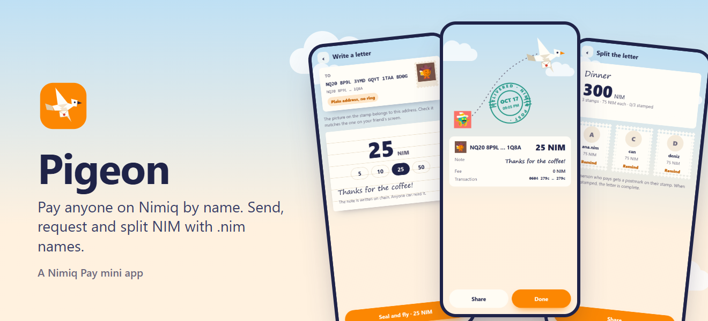
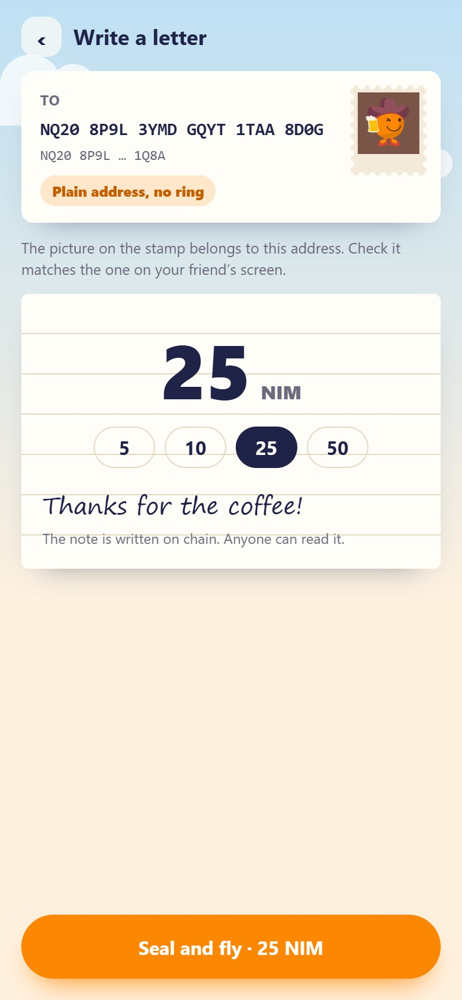
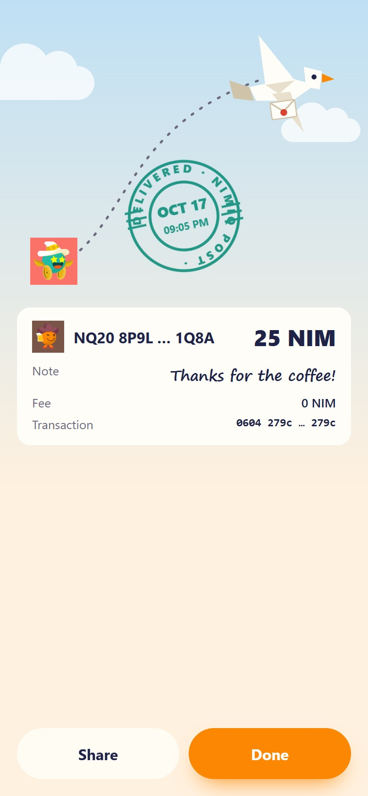
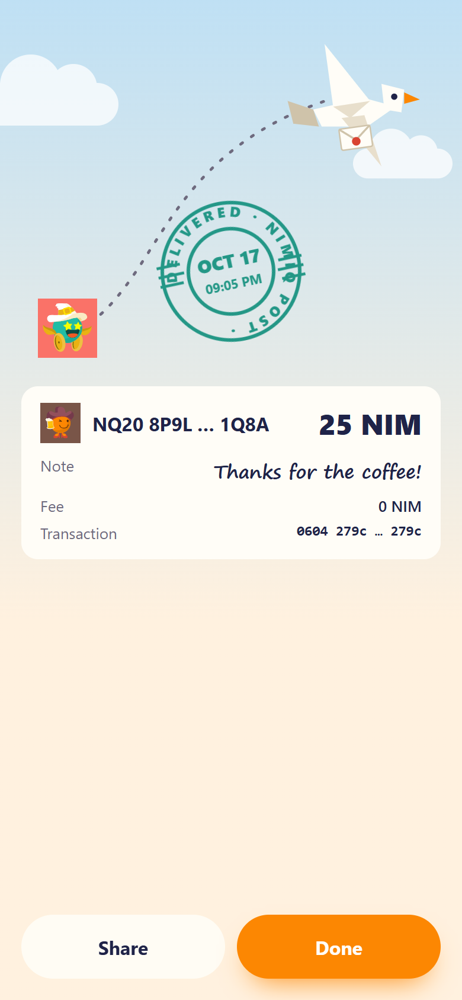
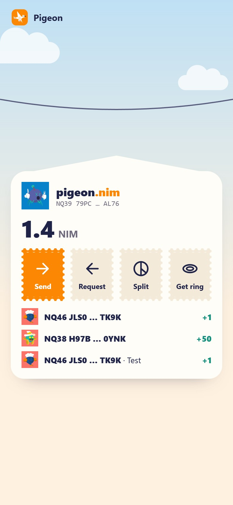

# Pigeon

> Pay anyone on Nimiq by name. Send, request and split NIM with .nim names, right inside Nimiq Pay.

| Field | Value |
| --- | --- |
| Category | Pay |
| Pricing | Free |
| Team name | _Not provided — optional_ |
| Team members | _Not provided — optional_ |
| X account | heylogramtv |
| Heard about it via | Nimiq Community |
| Contact email | pigeon@heylogram.com |
| GitHub login | @jakalijey |
| Submitted at | 2026-10-19T20:02:29.475Z |

## Links

| Link | URL |
| --- | --- |
| Repo | [https://github.com/jakalijey/pigeon](<https://github.com/jakalijey/pigeon>) |
| Demo | [https://pigeon.heylogram.com](<https://pigeon.heylogram.com>) |
| Video | [https://youtu.be/gAgeB7Ck_w8](<https://youtu.be/gAgeB7Ck_w8>) |
| Skool post | [https://www.skool.com/miniappscompetition/pigeon-pay-anyone-on-nimiq-by-name?p=1627cad7](<https://www.skool.com/miniappscompetition/pigeon-pay-anyone-on-nimiq-by-name?p=1627cad7>) |
| Social post | [https://x.com/heylogramtv/status/2112272684226887922](<https://x.com/heylogramtv/status/2112272684226887922>) |

## Description

Pigeon turns long NQ addresses into names. Send NIM to mert.nim, tie a payment request to a link, or split a bill into stamps that get a postmark as each friend pays. Every person shows with their Nimiq Identicon, and a link that fakes a name is blocked.

## Builder story

Pigeon: pay anyone on Nimiq by name.

The problem: a Nimiq address is 36 characters. Nobody remembers one, people copy it from chats, and a swapped address is easy to miss. Paying a friend back for coffee should be as easy as saying their name.

What it does: in Pigeon, money is a letter. You write mert.nim, the amount and a note, seal it, and the pigeon flies to the right address. You can also tie a note to the pigeon's leg (a payment request link) and it flies back to you when the other person pays. For a dinner bill, the letter is torn into stamps, one per friend, and each stamp gets a postmark when that friend pays.

How .nim names work without contracts: Nimiq has no smart contracts, so the registry is a set of public rules applied to ordinary transactions. A payment to the registry address with the note "nim:&lt;name>" that pays at least the name's price registers it; the earliest valid payment on chain wins. Anyone can rebuild the same table from the chain. Requests work the same way: the payer's wallet sends the note "ode:&lt;id>", and the server sees the payment on chain by itself. Nobody reports a payment, and the server cannot invent one.

Safety: the app never holds keys or money; every payment is confirmed in Nimiq Pay. Every person is shown with their Nimiq Identicon, so a lookalike name stands out. If a request link claims to come from mert.nim but the money would go elsewhere, Pigeon blocks it and shows both pigeons side by side. Notes are public on chain and the app says so before you send.

How it uses Nimiq Pay: Pigeon asks the wallet for the user's address and opens straight into their balance and incoming payments. Sending, paying a request and registering a name all go through the wallet's own confirmation, with zero fee.

Built with: the official @nimiq/core light client on the server (reading mainnet), @nimiq/identicons, and plain HTML, CSS and JavaScript in the app. It follows the phone language (English or Turkish) and the light or dark theme.

What comes next: profiles on names, transfer and sale of names, subnames such as shop.mert.nim, commit and reveal registration with refunds, merchant QR codes, a shared community jar, and a small library so any Nimiq app can resolve .nim names. The roadmap is in the README.

Live: https://pigeon.heylogram.com
Code: https://github.com/jakalijey/pigeon (MIT)

## Thumbnail

## Screenshots

---

_Generated from the submission form. `submission.yaml` in this folder is the machine-readable source of truth._
