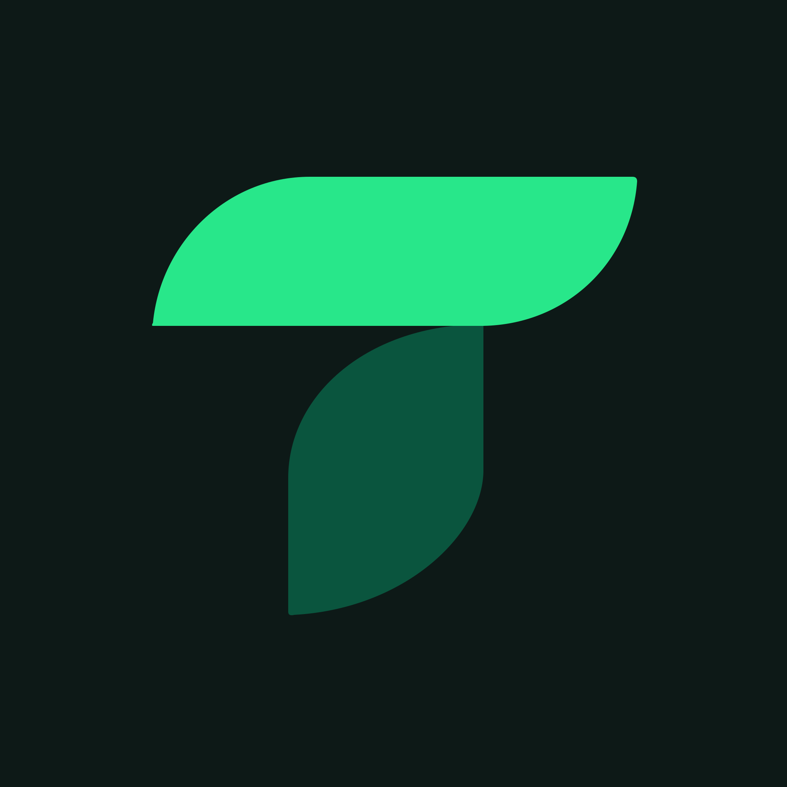
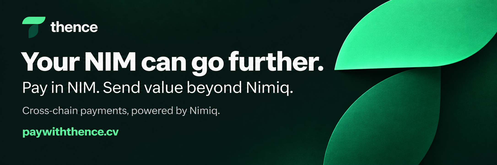
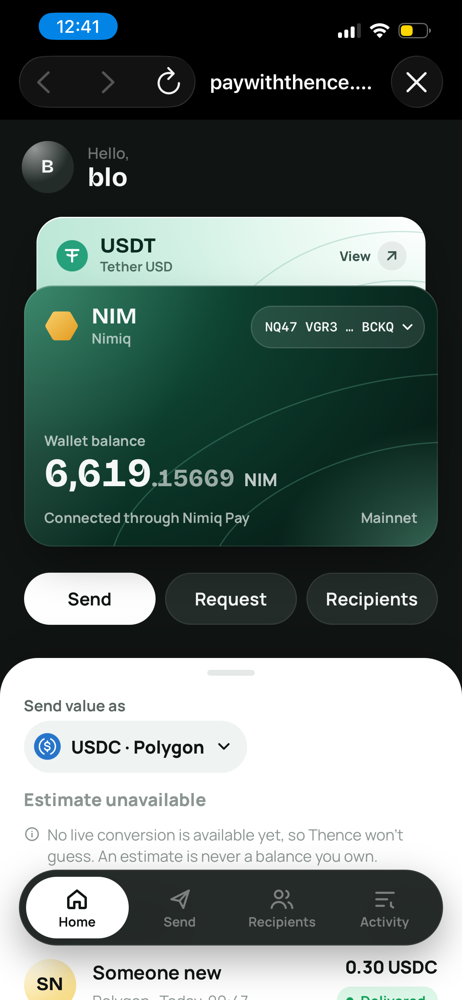
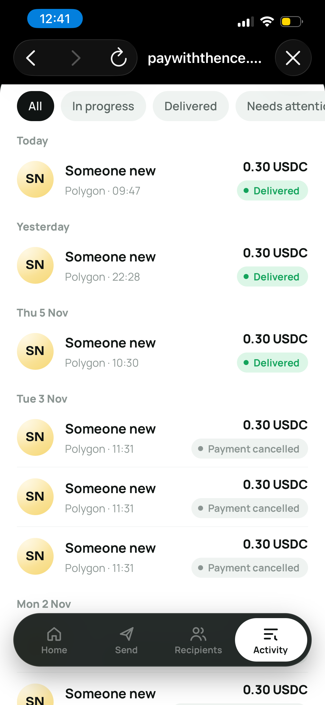
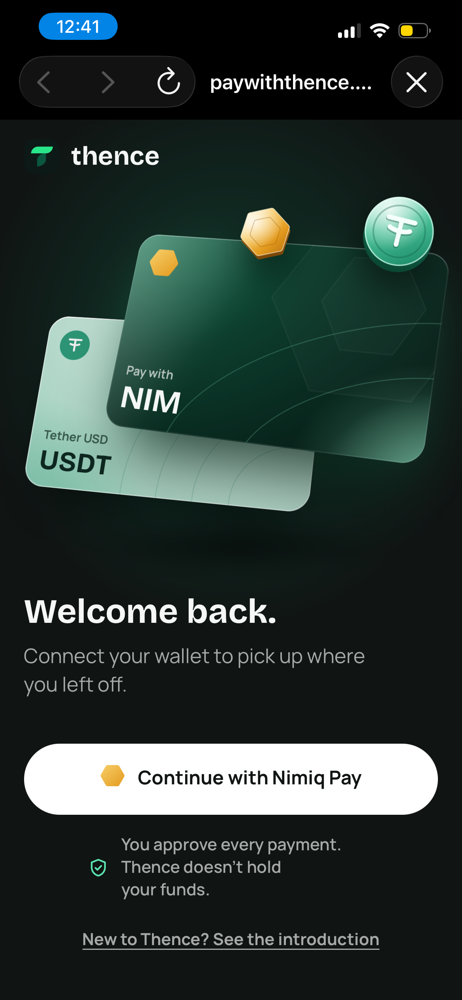
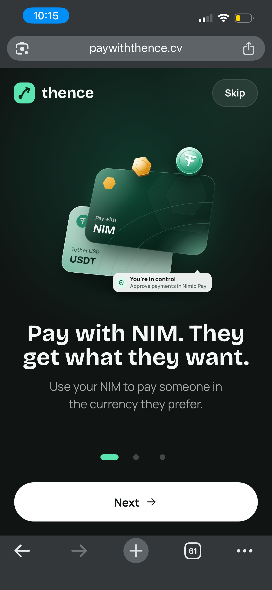
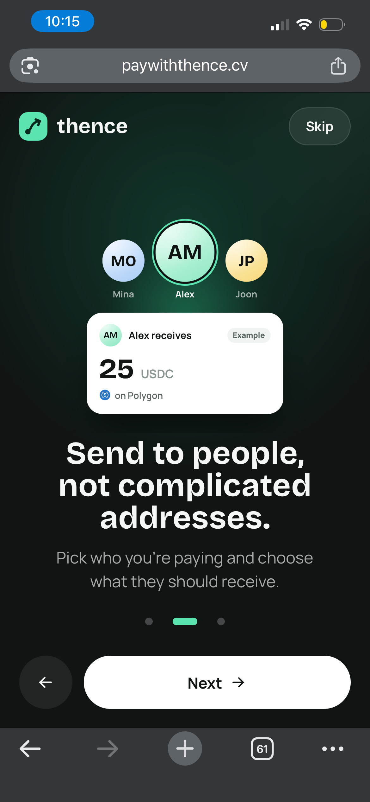

# Thence

> Your NIM can go further.

| Field | Value |
| --- | --- |
| Category | Pay |
| Pricing | Free |
| Team name | _Not provided — optional_ |
| Team members | _Not provided — optional_ |
| X account | _Kaaelaa_ @usethence |
| Heard about it via | On X |
| Contact email | kaelah679@gmail.com |
| GitHub login | @kaelah971 |
| Submitted at | 2026-11-07T12:49:12.685Z |

## Links

| Link | URL |
| --- | --- |
| Repo | [https://github.com/kaelah971/thence](<https://github.com/kaelah971/thence>) |
| Demo | [https://paywiththence.cv/](<https://paywiththence.cv/>) |
| Video | [https://youtube.com/shorts/t9NncKoJ98o?is=H9x8U4j6dDHQ3uFN](<https://youtube.com/shorts/t9NncKoJ98o?is=H9x8U4j6dDHQ3uFN>) |
| Skool post | [https://www.skool.com/miniappscompetition/i-built-a-way-to-pay-beyond-the-nimiq-ecosystem?p=e63fc40a](<https://www.skool.com/miniappscompetition/i-built-a-way-to-pay-beyond-the-nimiq-ecosystem?p=e63fc40a>) |
| Social post | [https://x.com/usethence/status/2119047521540645196?a=pCIscIsqWYewm0jzVZQ&s=46](<https://x.com/usethence/status/2119047521540645196?a=pCIscIsqWYewm0jzVZQ&s=46>) |

## Description

Thence is a cross-chain payment mini app built for Nimiq Pay. It lets users pay with NIM while recipients receive cryptocurrency on another supported blockchain, without manually swapping or bridging funds. Starting with USDC on Polygon, Thence offers live payment quotes, deliver

## Builder story

I built Thence because something about crypto payments has always bothered me: why should paying someone become complicated just because we use different blockchains?

Imagine holding NIM and wanting to pay someone who prefers USDC on Polygon. Suddenly, a simple payment becomes a process involving swaps, bridges, multiple wallets, and different networks.

I wanted to remove that friction.

So I built Thence, a cross-chain payment mini app for Nimiq Pay that allows users to pay with NIM while recipients receive supported assets on another blockchain.

Getting it to work with real funds took several iterations. I had to work through payment confirmation delays, settlement verification, and delivery-state issues.

But eventually, I completed real NIM-to-USDC payments on mainnet and verified that the funds arrived on Polygon.

That was the moment Thence went from an idea to something genuinely useful.

USDC on Polygon is our first live destination, but my bigger vision is to make NIM useful for payments across more blockchain ecosystems.

Your NIM can go further.

## Thumbnail

## Screenshots

---

_Generated from the submission form. `submission.yaml` in this folder is the machine-readable source of truth._
