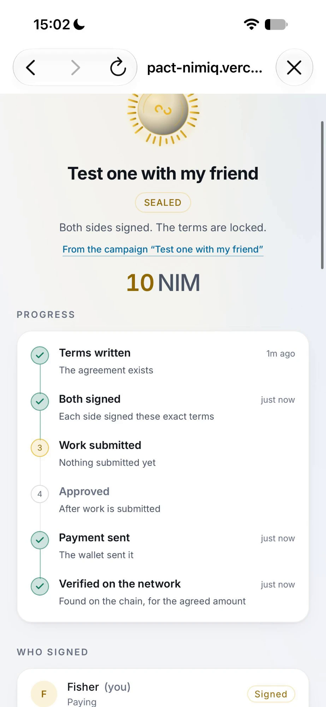
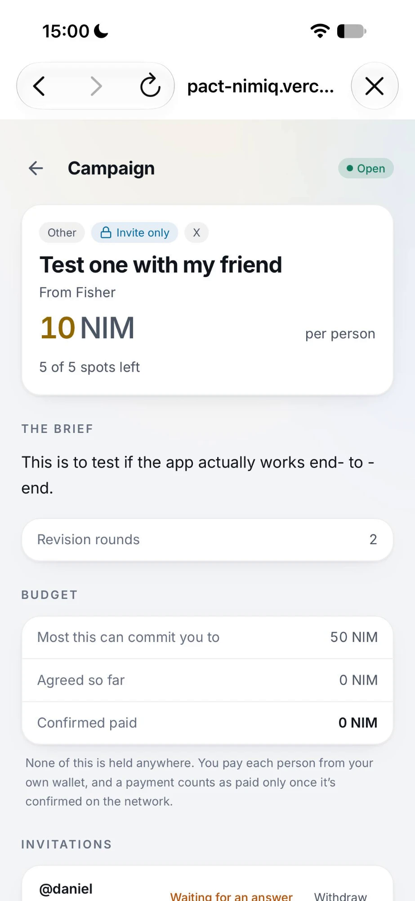
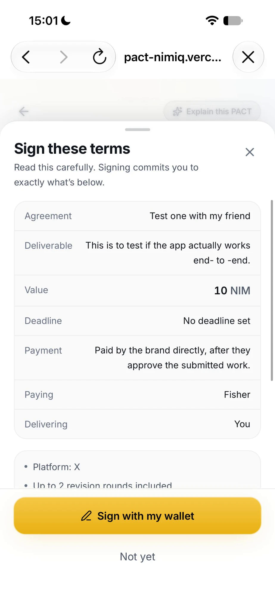
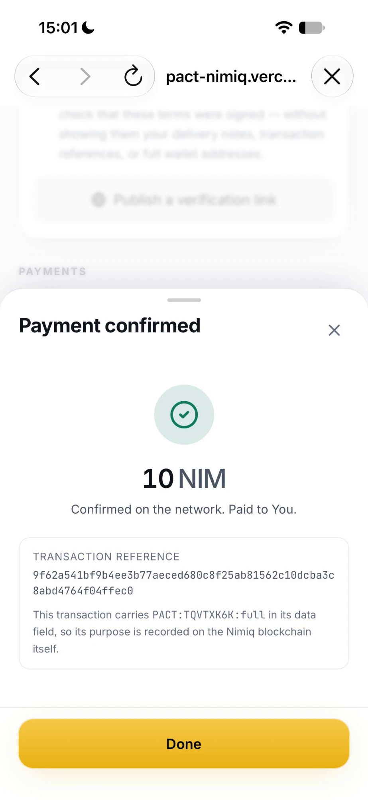
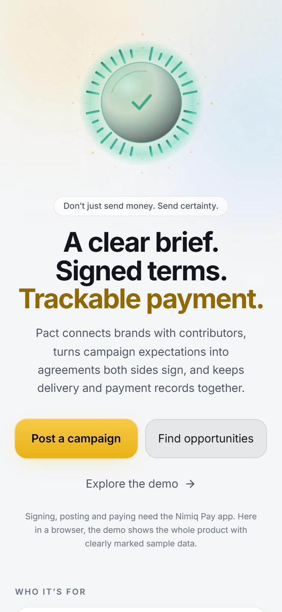

# Pact.v2

> Don't just send money. Send certainty.

| Field | Value |
| --- | --- |
| Category | Pay |
| Pricing | Free |
| Team name | _Not provided — optional_ |
| Team members | _Not provided — optional_ |
| X account | makeclipbag |
| Heard about it via | X |
| Contact email | adelekekhaleed105@gmail.com |
| GitHub login | @khaleed0019 |
| Submitted at | 2026-10-28T15:54:38.749Z |

## Links

| Link | URL |
| --- | --- |
| Repo | [https://github.com/khaleed0019/pact](<https://github.com/khaleed0019/pact>) |
| Demo | [https://pact-nimiq.vercel.app](<https://pact-nimiq.vercel.app>) |
| Video | [https://youtu.be/6n78vloDfoM?si=O_9nAEbfZoJIuNHP](<https://youtu.be/6n78vloDfoM?si=O_9nAEbfZoJIuNHP>) |
| Skool post | [https://www.skool.com/miniappscompetition/running-a-campaign-on-pact-with-nim?p=1f0749e4](<https://www.skool.com/miniappscompetition/running-a-campaign-on-pact-with-nim?p=1f0749e4>) |
| Social post | [https://x.com/makeclipbag/status/2115472122336124960](<https://x.com/makeclipbag/status/2115472122336124960>) |

## Description

PACT helps brands and creators turn work agreements into wallet-signed terms and verifiable payments. Publish campaigns, invite specific contributors, track deliverables, and pay through Nimiq Pay with NIM or supported USDT. PACT connects the work to the payment without hold fund

## Builder story

I’m building PACT to make freelance and creator-work agreements clearer and payments easier to verify. PACT connects brands and contributors through clear terms, wallet signatures, work tracking and payment records. For Cycle III, I’m focused on helping brands find the right contributors through public campaigns and private invitations, while making it easier for contributors to understand their terms and track their work from agreement to payment.

My goal is to make Nimiq Pay more useful for real-world work.

## Thumbnail

## Screenshots

---

_Generated from the submission form. `submission.yaml` in this folder is the machine-readable source of truth._
