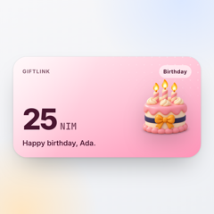
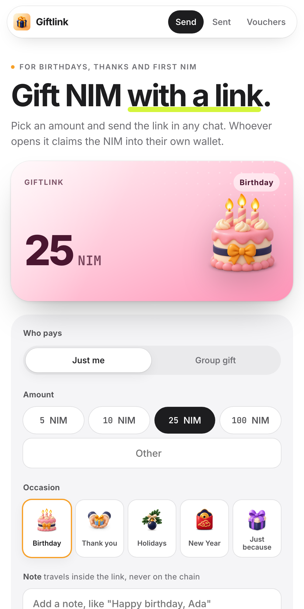
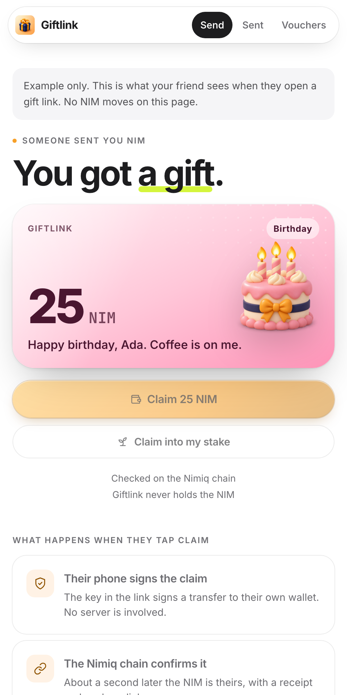
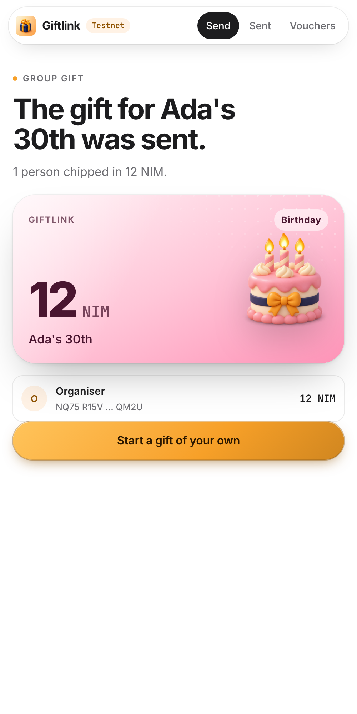

# Giftlink

> Gift NIM with a link. Friends claim it in Nimiq Pay, chip in to group gifts, or scan a voucher at your meetup.

| Field | Value |
| --- | --- |
| Category | Save |
| Pricing | Free |
| Team name | _Not provided — optional_ |
| Team members | _Not provided — optional_ |
| X account | heykinnu |
| Heard about it via | _Not provided — optional_ |
| Contact email | dhirajkavuri29@gmail.com |
| GitHub login | @kinnuworks |
| Submitted at | 2026-11-11T23:11:09.815Z |

## Links

| Link | URL |
| --- | --- |
| Repo | [https://github.com/kinnuworks/giftlink](<https://github.com/kinnuworks/giftlink>) |
| Demo | [https://giftlink-beige.vercel.app](<https://giftlink-beige.vercel.app>) |
| Video | [https://youtu.be/rGJo2MzOw9g](<https://youtu.be/rGJo2MzOw9g>) |
| Skool post | _Not provided — optional_ |
| Social post | [https://x.com/heykinnu/status/2120648586346270993](<https://x.com/heykinnu/status/2120648586346270993>) |

## Description

Pick an amount and an occasion, approve one payment, and send the link in any chat. Whoever opens it in Nimiq Pay claims the NIM into their own wallet, or straight into staking. Group gifts, QR voucher sheets and take-back included. No server ever holds the NIM.

## Builder story

Giftlink is gifting for Nimiq Pay, because the easiest way to get someone into NIM is to hand them some.

Nimiq already had cashlinks in the web wallet. I wanted them inside Nimiq Pay, with the things people actually do with gifts: birthdays, a thank-you, a group present, a stack of vouchers at a meetup.

How it works: one payment moves the NIM to a fresh address made for that gift. The key to that address lives only in the link, so Giftlink never holds anyone's money and there is no server to trust. When your friend taps Claim, their phone signs the transfer and the Nimiq chain confirms it about a second later. Links use the same format as Nimiq Hub cashlinks, so they also open in the web wallet.

What I added beyond cashlinks:
- Group gifts: a chip-in link lets friends add NIM to the same gift, and everyone sees who's in, read from the chain.
- Voucher sheets: one payment becomes up to 25 QR vouchers to print or share at a meetup.
- Take back: your sent gifts are rebuilt from the chain from one wallet signature, on any phone, so unclaimed gifts come back to you.
- Claim into staking: if you already stake, a gift joins your stake in one step.
- A secret-word lock for gifts posted in group chats (Giftlink suggests four random words), and a thank-you note the recipient can send back on chain.
- A public stats page that counts claims from on-chain markers, so anyone can check real use.

The code is MIT licensed, with unit tests and a testnet end-to-end script.

## Thumbnail

## Screenshots

---

_Generated from the submission form. `submission.yaml` in this folder is the machine-readable source of truth._
