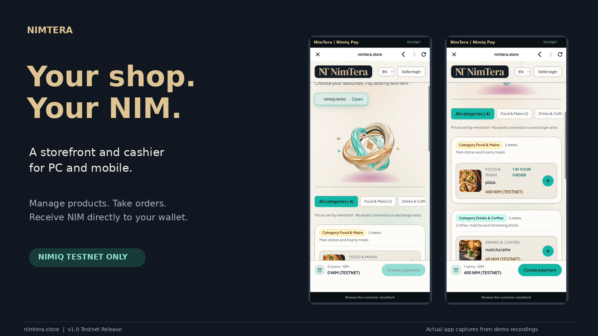
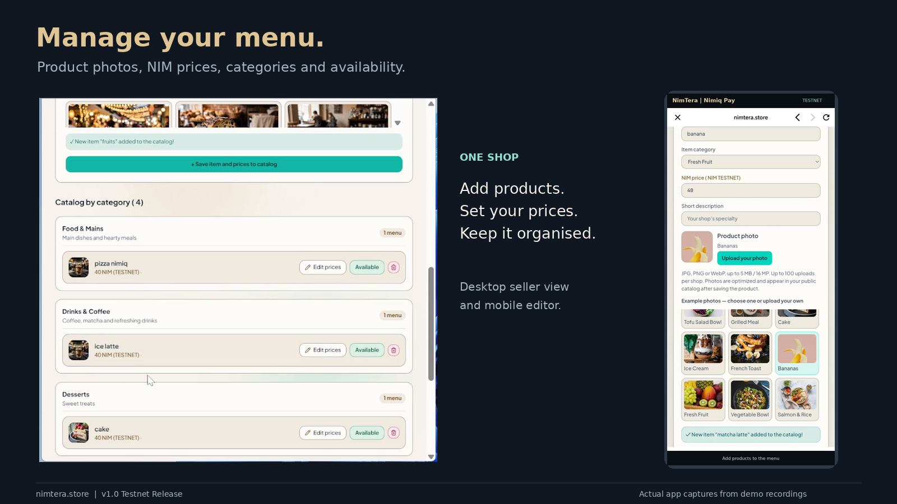
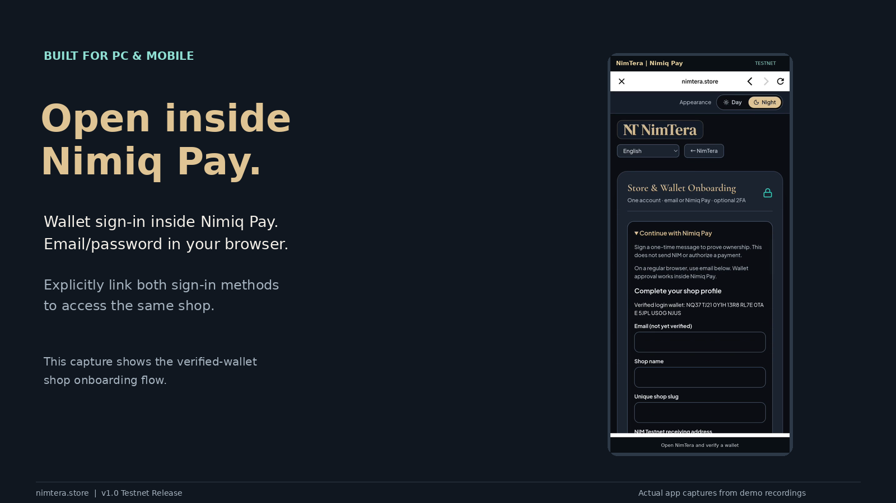
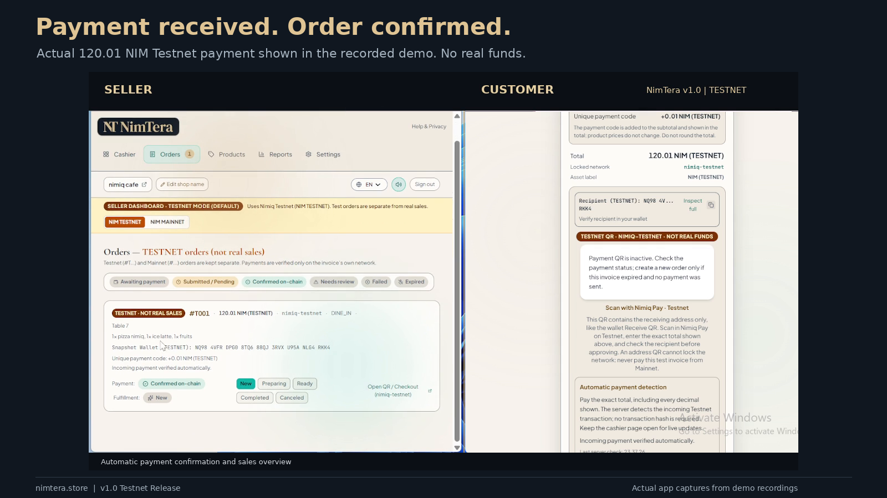

# NimTera

> A NIM storefront and cashier for PC and mobile, powered by Nimiq Pay.

| Field | Value |
| --- | --- |
| Category | Pay |
| Pricing | Free |
| Team name | _Not provided — optional_ |
| Team members | _Not provided — optional_ |
| X account | cryptotudemun |
| Heard about it via | x |
| Contact email | syifamehrunnisa@gmail.com |
| GitHub login | @lilrobin4 |
| Submitted at | 2026-11-06T17:51:49.441Z |

## Links

| Link | URL |
| --- | --- |
| Repo | [https://github.com/lilrobin4/nimtera](<https://github.com/lilrobin4/nimtera>) |
| Demo | [https://nimtera.store/](<https://nimtera.store/>) |
| Video | [https://youtu.be/cyui7cFwUGg?si=QhA6M2dW1XwXEeXW](<https://youtu.be/cyui7cFwUGg?si=QhA6M2dW1XwXEeXW>) |
| Skool post | [https://www.skool.com/miniappscompetition/nimtera-v10-a-nim-storefront-cashier-for-pc-and-mobile?p=25bf6c69](<https://www.skool.com/miniappscompetition/nimtera-v10-a-nim-storefront-cashier-for-pc-and-mobile?p=25bf6c69>) |
| Social post | [https://x.com/cryptotudemun/status/2118760251264750014?a=g4psZr4PLVodsRE2b2k&s=20](<https://x.com/cryptotudemun/status/2118760251264750014?a=g4psZr4PLVodsRE2b2k&s=20>) |

## Description

NimTera is a digital storefront and cashier app that helps shops and cafés manage products, take orders, and accept NIM payments. Currently available on Testnet.

## Builder story

NimTera started with a simple goal: make accepting NIM useful for everyday shops, not just demonstrate a payment button.

I wanted sellers to manage products, share a storefront, and follow orders through checkout and payment confirmation in one place. Customers should be able to browse and order without creating an account, on either PC or mobile.

NimTera supports email/password sign-in in a browser and wallet sign-in inside Nimiq Pay. Sellers can explicitly link both methods to the same shop. Payments go directly to the merchant’s wallet—NimTera never holds customer funds.

One key challenge was matching incoming payments without asking merchants to copy transaction hashes. NimTera adds a clearly displayed unique payment adjustment and checks incoming transactions automatically while the relevant page is open.

I also focused on everyday usability: product photos, six interface languages, Day/Night themes, optional two-factor authentication, and cashier audio announcements.

Version 1.0 runs on Nimiq Testnet. The demos show the actual desktop, mobile, and Nimiq Pay flows, including a confirmed Testnet payment. Mainnet support is planned for a future release after further testing and security review.

## Thumbnail

## Screenshots

---

_Generated from the submission form. `submission.yaml` in this folder is the machine-readable source of truth._
