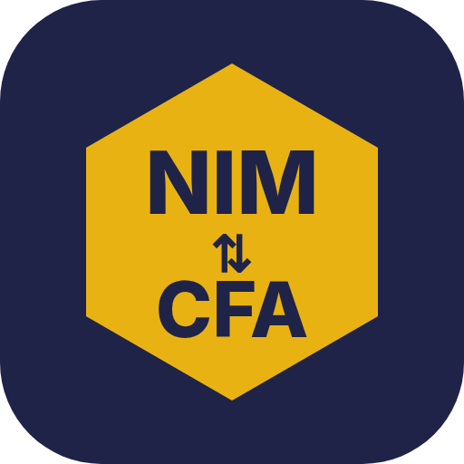
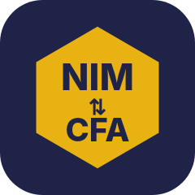
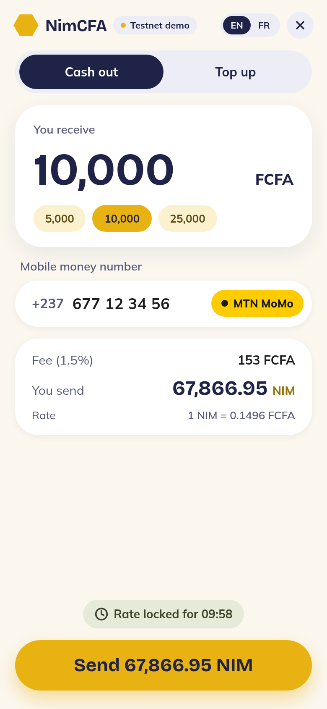
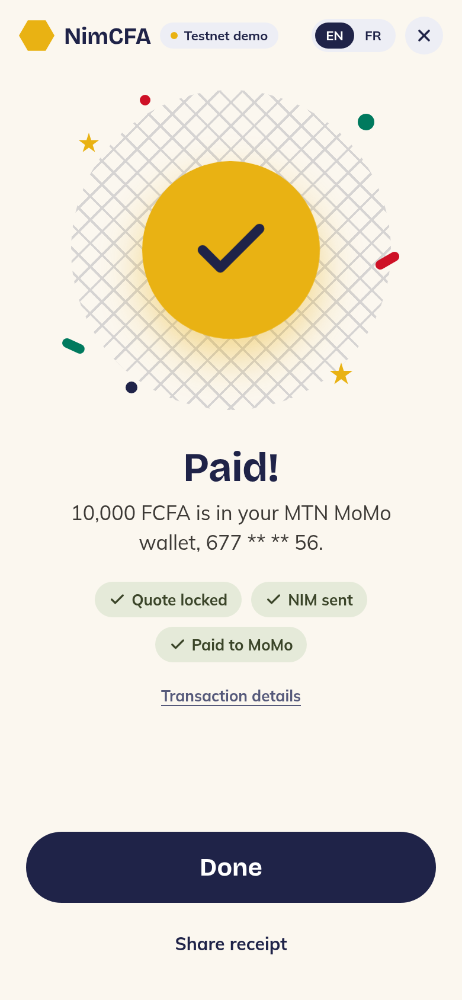
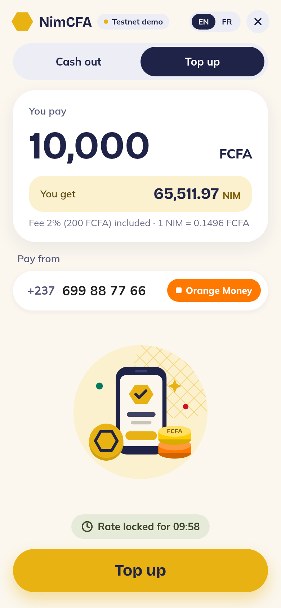
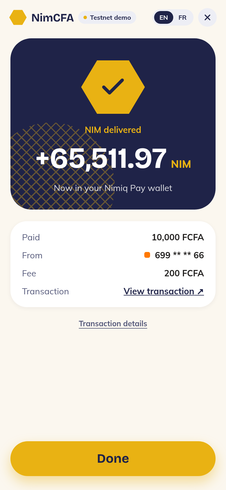
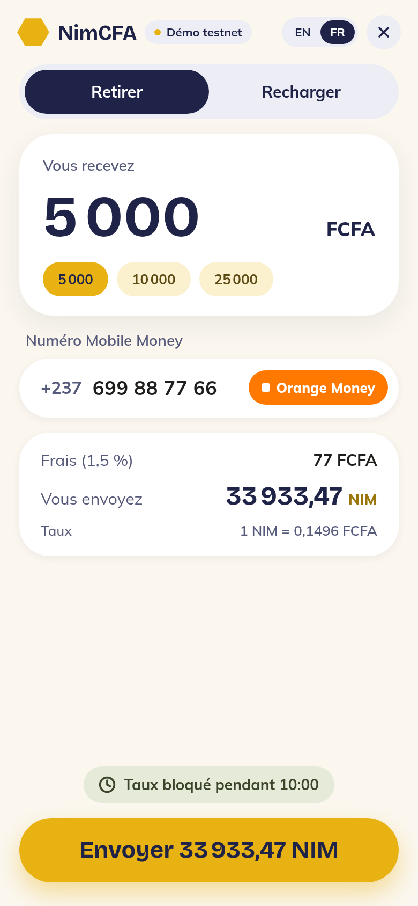

# NimCFA

> Cash out NIM to MTN MoMo or Orange Money, or top up NIM with mobile money, without leaving Nimiq Pay.

| Field | Value |
| --- | --- |
| Category | On/Off-Ramp |
| Pricing | Free |
| Team name | Mbanya Dev |
| Team members | _Not provided — optional_ |
| X account | _Not provided — optional_ |
| Heard about it via | Nimiq community / miniappscompetition.com |
| Contact email | maureenwepngong+mbanya@gmail.com |
| GitHub login | @mbanyadev |
| Submitted at | 2026-10-31T12:31:03.322Z |

## Links

| Link | URL |
| --- | --- |
| Repo | [https://github.com/mbanyadev/nimcfa](<https://github.com/mbanyadev/nimcfa>) |
| Demo | [https://mbanyadev.github.io/nimcfa/](<https://mbanyadev.github.io/nimcfa/>) |
| Video | [https://vimeo.com/1241703996](<https://vimeo.com/1241703996>) |
| Skool post | _Not provided — optional_ |
| Social post | _Not provided — optional_ |

## Description

NimCFA turns NIM into FCFA and back through MTN MoMo and Orange Money, right inside Nimiq Pay. It's for people in Cameroon who are paid in NIM and need cash, or who want NIM without a bank. French and English, locked quotes and automatic refunds.

## Builder story

Across Cameroon, money moves through MTN MoMo and Orange Money, not banks. Someone who earns or receives NIM has no simple way to turn it into francs they can spend at the market, and someone with francs has no simple way to get NIM.

NimCFA puts that swap inside Nimiq Pay. To cash out, you type the FCFA you want and your MoMo or Orange number. The operator is detected from the prefix, and the rate is locked for 10 minutes. One approval in Nimiq Pay sends NIM to escrow with the order memo. The order engine checks the sender, memo, amount and network on-chain, then pays out to mobile money. To top up, you approve a USSD prompt on your phone, and NIM arrives in your Nimiq Pay wallet.

Nobody should lose money to a failed transfer. If the operator rejects a payout, the NIM goes straight back. A late, short or wrong-wallet deposit is refunded too. An unknown payout result goes to manual review instead of being retried, so nobody is paid twice. Phone numbers are masked, and the app never sees a private key.

The app uses the Nimiq Pay mini app SDK for accounts, balance and sending with a memo, and follows the host's language (French or English) and network. Today it runs on Nimiq testnet with a mobile money simulator. Next come a Fapshi or CamPay sandbox, testers in Cameroon, USDT cash-out and a network of local agents.

## Thumbnail

## Screenshots

---

_Generated from the submission form. `submission.yaml` in this folder is the machine-readable source of truth._
