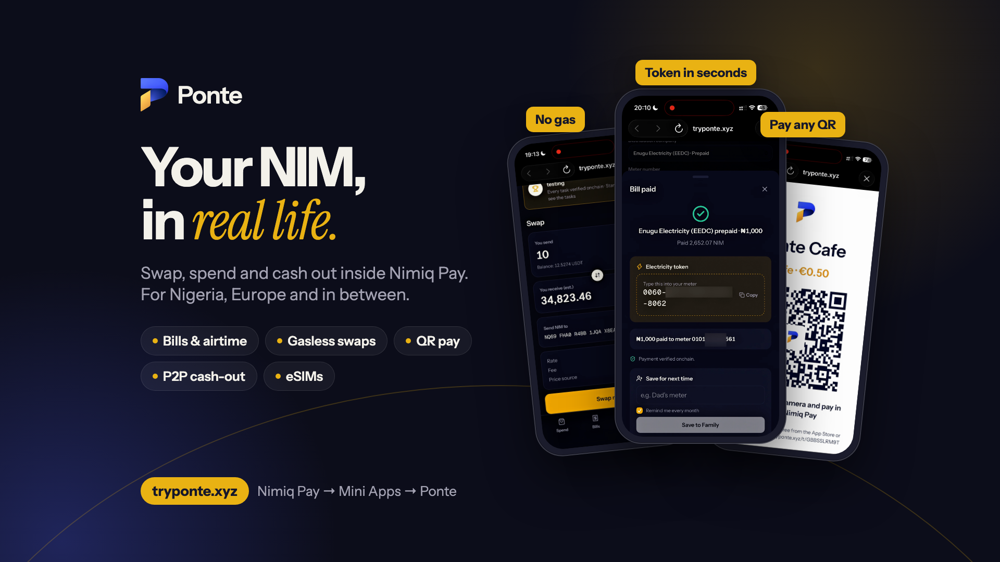
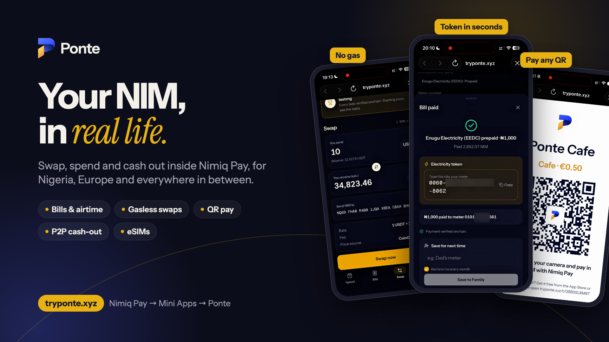
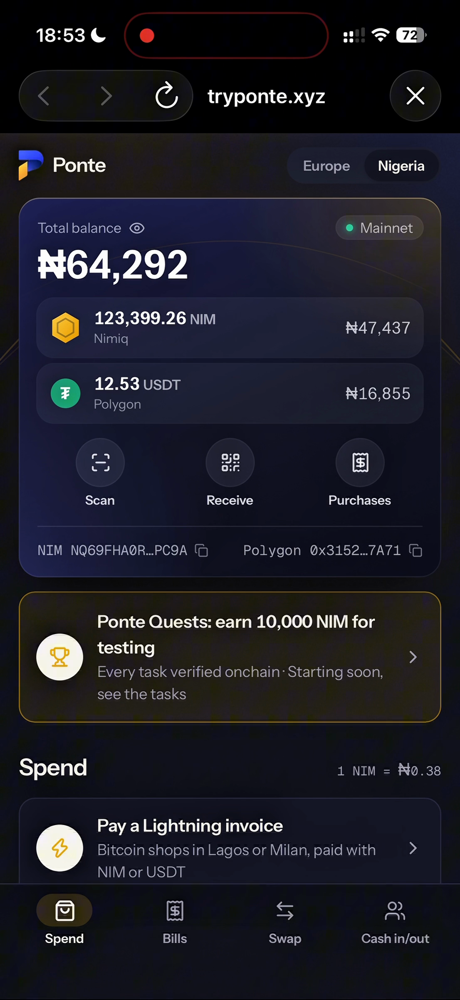
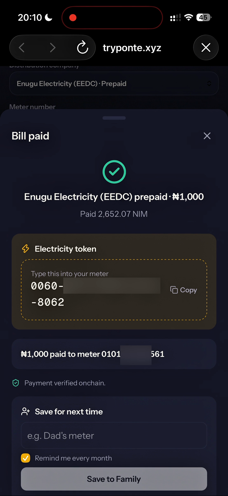
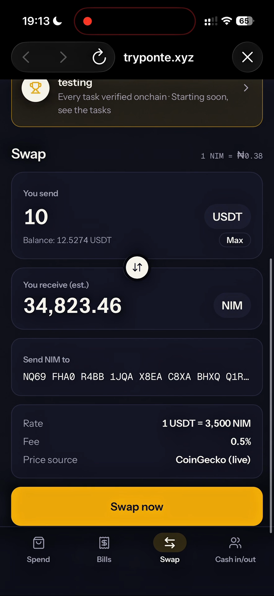
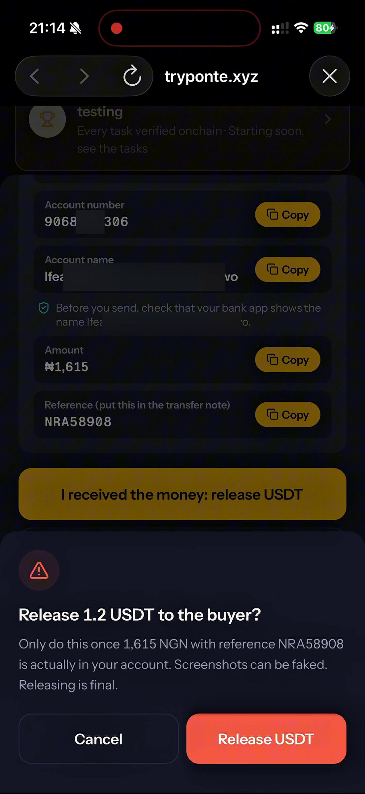

# Ponte

> Swap, spend and cash out NIM in Nigeria, Europe and everywhere in between.

| Field | Value |
| --- | --- |
| Category | On/Off-Ramp |
| Pricing | Free |
| Team name | Ponte |
| Team members | MrNetwork |
| X account | tryponte |
| Heard about it via | X |
| Contact email | mrnetwork0001@gmail.com |
| GitHub login | @mrnetwork0001 |
| Submitted at | 2026-11-05T16:57:43.734Z |

## Links

| Link | URL |
| --- | --- |
| Repo | [https://github.com/mrnetwork0001/Ponte](<https://github.com/mrnetwork0001/Ponte>) |
| Demo | [https://tryponte.xyz](<https://tryponte.xyz>) |
| Video | [https://www.youtube.com/watch?v=Y0S3azEGrZU](<https://www.youtube.com/watch?v=Y0S3azEGrZU>) |
| Skool post | [https://www.skool.com/miniappscompetition/ponte-is-live-in-nimiq-pay-swap-cash-out-get-paid-with-a-qr?p=d185952d](<https://www.skool.com/miniappscompetition/ponte-is-live-in-nimiq-pay-swap-cash-out-get-paid-with-a-qr?p=d185952d>) |
| Social post | [https://x.com/tryPonte/status/2116011721500323879](<https://x.com/tryPonte/status/2116011721500323879>) |

## Description

Ponte turns NIM and USDT into real life inside Nimiq Pay: pay Nigerian bills, airtime and data, buy European eSIMs, swap NIM ⇄ USDT with no gas, pay any QR, and cash out to naira or euros through an onchain P2P escrow. For Nigeria, Europe and in between.

## Builder story

I live between Italy and Nigeria. Every month I watch the same thing happen: people hold crypto, but when the electricity token runs out back home, or someone needs airtime, they still have to find a bank, a middleman or a friend with naira. Nimiq Pay made paying with NIM easy, but it couldn't pay a bill, top up a phone or reach a bank account.

Ponte is the bridge. It shows the meter owner's name before you pay and delivers the electricity token in seconds. It swaps NIM and USDT with no gas, and it lets people cash out to each other through an escrow on Polygon, where a buyer can take just the part they need.

Every payment is verified onchain. In its first week on mainnet, Ponte handled about 140 real payments, and our quest campaign paid 15 testers 150,000 NIM in under 2 hours.

## Thumbnail

## Screenshots

---

_Generated from the submission form. `submission.yaml` in this folder is the machine-readable source of truth._
