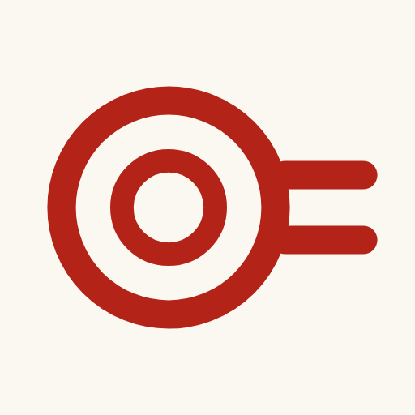
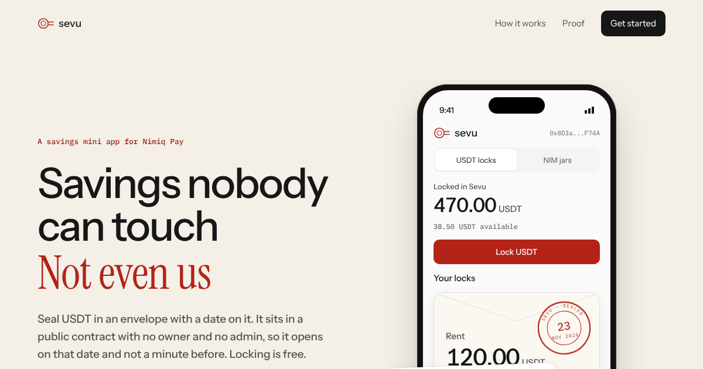
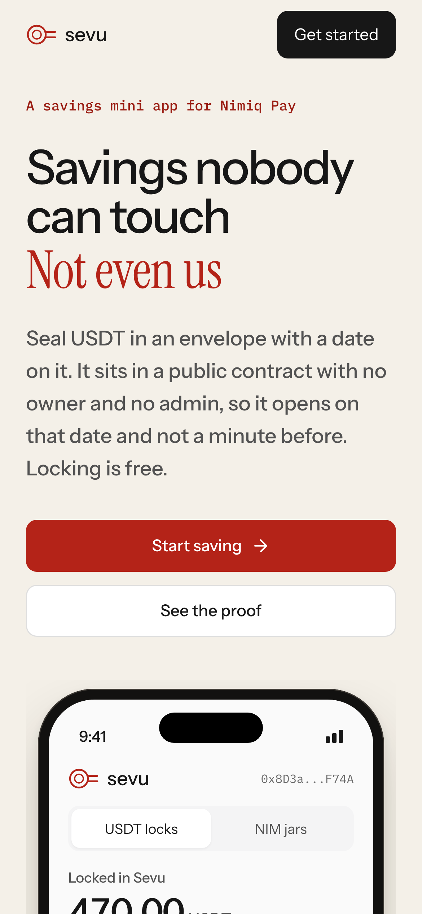
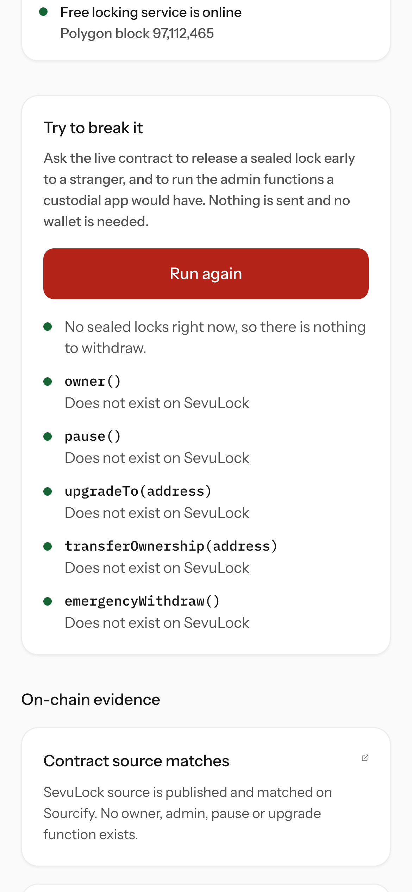
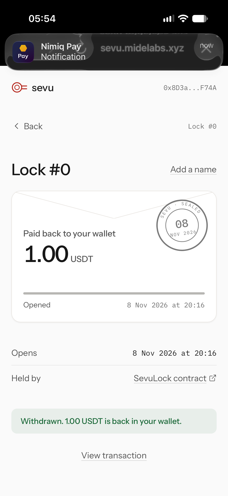
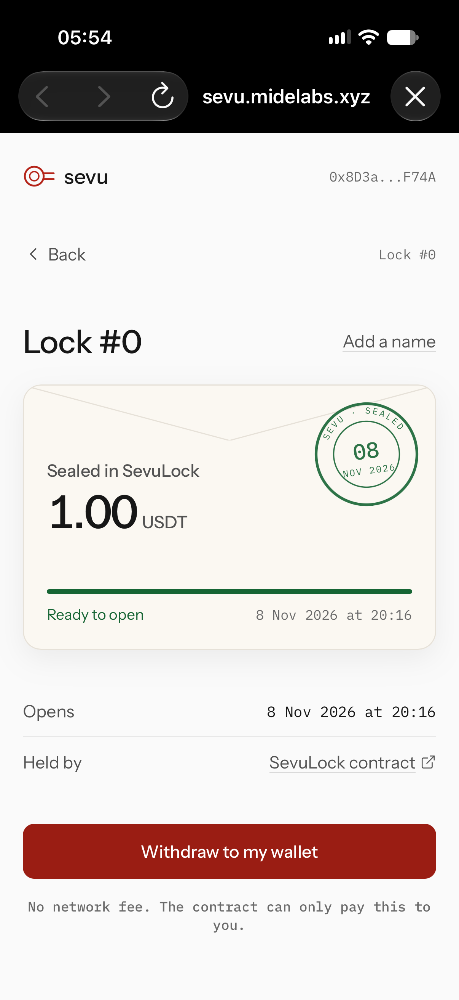

# Sevu

> Savings nobody can touch. Not even us.

| Field | Value |
| --- | --- |
| Category | Save |
| Pricing | Free |
| Team name | MideLabs |
| Team members | _Not provided — optional_ |
| X account | MystiqueMide |
| Heard about it via | Email |
| Contact email | mide27145@gmail.com |
| GitHub login | @mystiquemide |
| Submitted at | 2026-11-11T17:12:30.583Z |

## Links

| Link | URL |
| --- | --- |
| Repo | [https://github.com/mystiquemide/sevu](<https://github.com/mystiquemide/sevu>) |
| Demo | [https://sevu.midelabs.xyz](<https://sevu.midelabs.xyz>) |
| Video | [https://youtu.be/J2G94uL6fbw](<https://youtu.be/J2G94uL6fbw>) |
| Skool post | [https://www.skool.com/miniappscompetition/sevu?p=136ff9e2](<https://www.skool.com/miniappscompetition/sevu?p=136ff9e2>) |
| Social post | [https://x.com/MystiqueMide/status/2120558368859271218](<https://x.com/MystiqueMide/status/2120558368859271218>) |

## Description

Lock USDT until a date you choose, right inside Nimiq Pay. Your money sits in a public contract on Polygon with no owner, no admin and no upgrade path, so nobody can move it early, not even us. On the date it opens and pays only you. Locking is gasless, and if our server ever dis

## Builder story

Money in a wallet is always one tap from being spent. Savings apps fix that by holding your money for you, so you have to trust them not to freeze it, lose it or move it. I wanted the lock without the trust. Sevu's contract has no owner and no admin functions at all, so the only thing that can open an envelope is its date. Gasless permits made it work for Nimiq Pay users who hold USDT but no POL. The first lock went in on 1 Nov from my phone with zero POL, the contract refused my own early withdrawal, and on 8 Nov it paid the full amount back. Both transactions are on Polygonscan.

## Thumbnail

## Screenshots

---

_Generated from the submission form. `submission.yaml` in this folder is the machine-readable source of truth._
