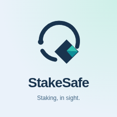
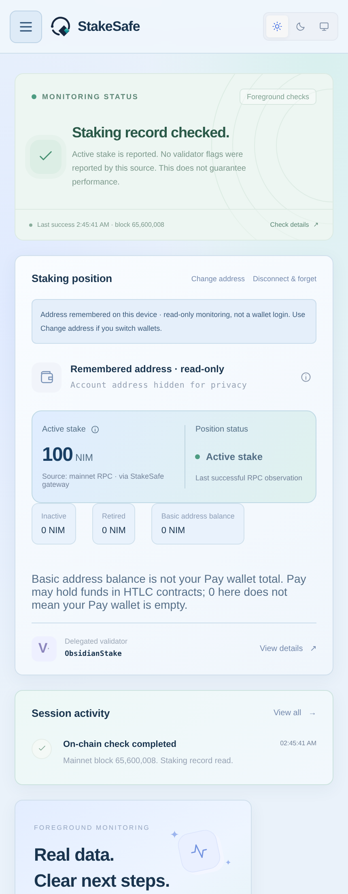
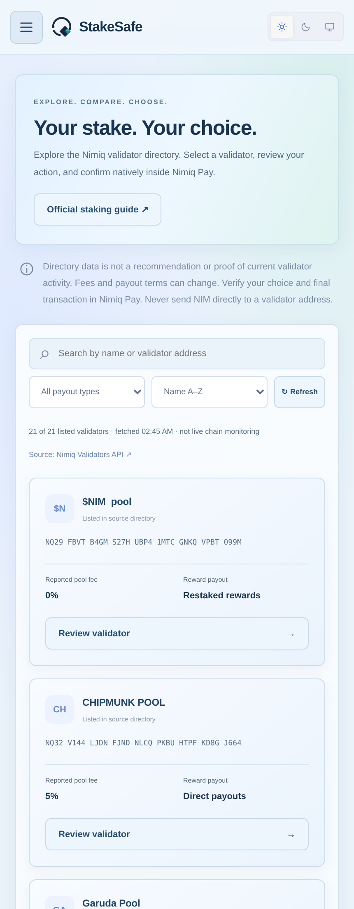
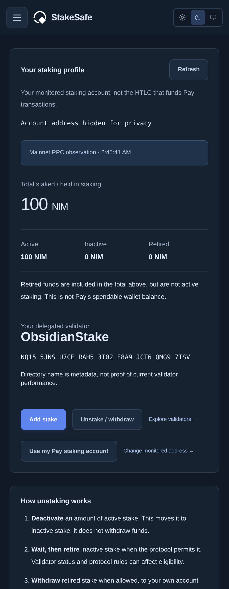
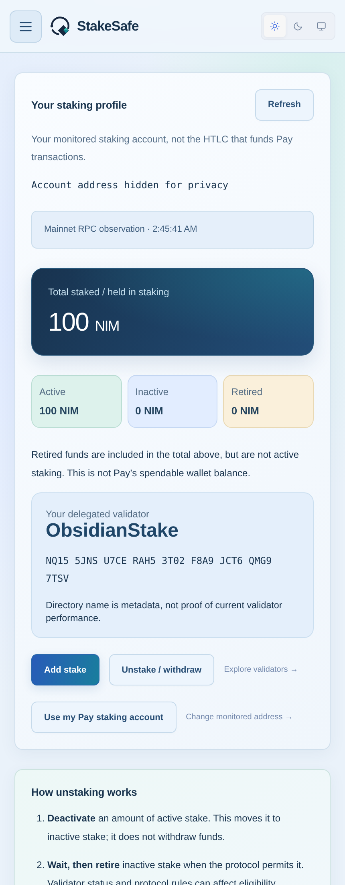

# StakeSafe

> Your Nimiq staking, in sight.

| Field | Value |
| --- | --- |
| Category | Earn |
| Pricing | Free |
| Team name | _Not provided — optional_ |
| Team members | _Not provided — optional_ |
| X account | onadeonft |
| Heard about it via | x |
| Contact email | weycatur@gmail.com |
| GitHub login | @onad1ocrypto |
| Submitted at | 2026-10-30T20:20:47.613Z |

## Links

| Link | URL |
| --- | --- |
| Repo | [https://github.com/onad1ocrypto/stakesafe](<https://github.com/onad1ocrypto/stakesafe>) |
| Demo | [https://stakesafe-kappa.vercel.app/](<https://stakesafe-kappa.vercel.app/>) |
| Video | [https://youtube.com/shorts/Iq2gzverQi0?si=igE_gNKtbhh91gAD](<https://youtube.com/shorts/Iq2gzverQi0?si=igE_gNKtbhh91gAD>) |
| Skool post | [https://www.skool.com/miniappscompetition/stakesafe-staking-in-sight-inside-nimiq-pay?p=febdb6d3](<https://www.skool.com/miniappscompetition/stakesafe-staking-in-sight-inside-nimiq-pay?p=febdb6d3>) |
| Social post | [https://x.com/onadeonft/status/2116263047920828840?a=fWTcFL3Gcv5WP5JRMlk&s=20](<https://x.com/onadeonft/status/2116263047920828840?a=fWTcFL3Gcv5WP5JRMlk&s=20>) |

## Description

Track your Nimiq staking position, explore validators, and review stake, add, switch and staged unstaking actions inside Nimiq Pay. Real mainnet reads, native wallet confirmation, light/dark themes, and no custody of your keys.

## Builder story

StakeSafe started with a simple problem: it should be easy to understand a Nimiq staking position without confusing the account being monitored with the wallet that signs a transaction.

The app combines an actual mainnet staking profile, a searchable validator directory, and reviewed native staking actions in Nimiq Pay. It separates active, inactive and retired funds, explains the staged unstaking process, and distinguishes a basic address balance from funds Pay may hold in HTLC contracts.

I focused on transparent failure states, remembered read-only monitoring, exact transaction amounts, explicit owner checks, and safeguards against repeating a request with an unknown result. Keys stay in Pay; the app's server only forwards a small allowlist of mainnet read requests.

The interface supports Light, Dark and System themes and mobile navigation. Automated tests cover the main UI and financial request guards with mocked hosts and RPC; they are not a substitute for physical-device verification. The public code is MIT licensed, with dependency attribution.

## Thumbnail

## Screenshots

---

_Generated from the submission form. `submission.yaml` in this folder is the machine-readable source of truth._
