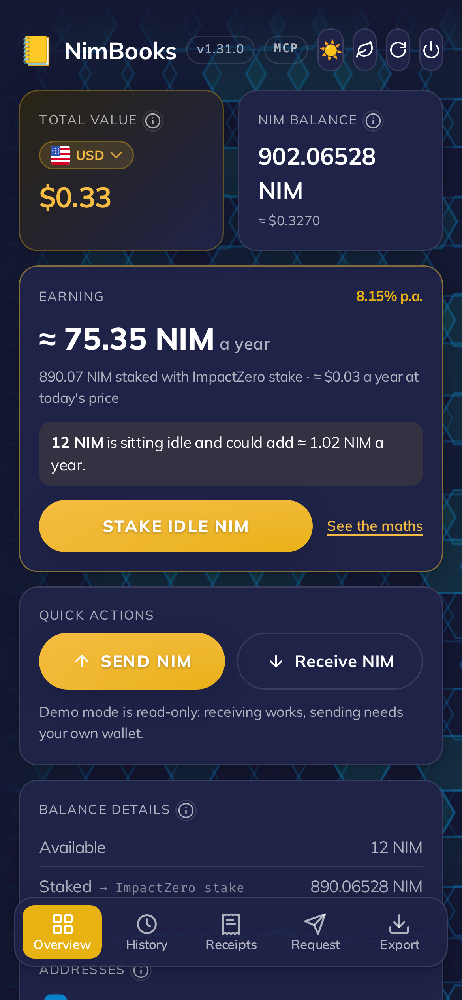
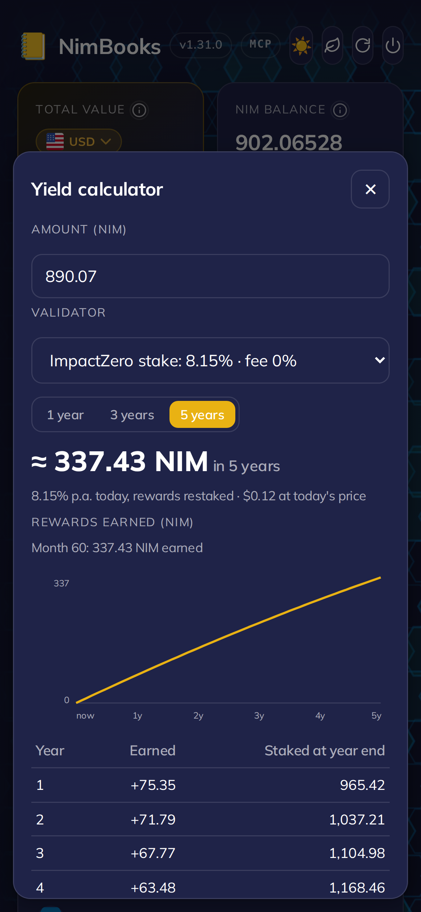
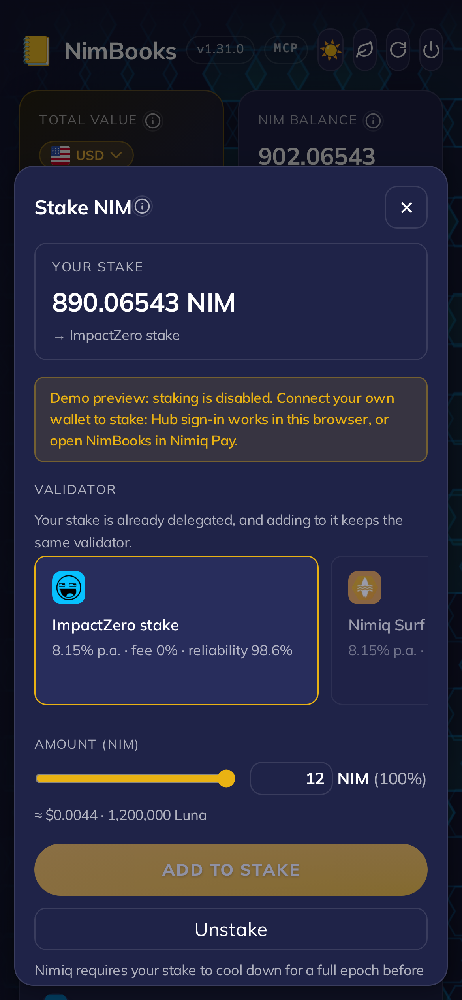
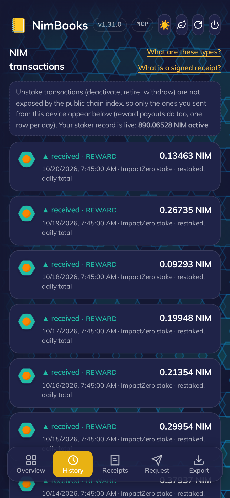
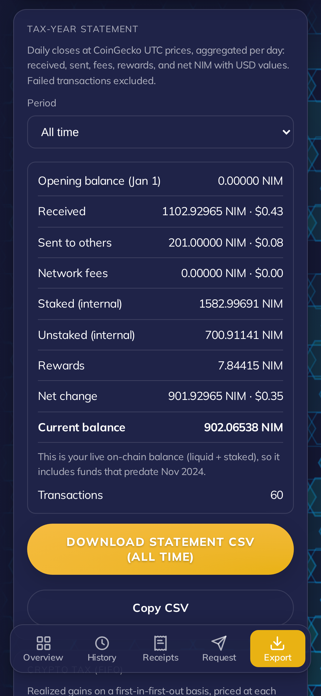

# NimBooks

> Stake from Nimiq Pay, see what your NIM earns, and keep the books for tax.

| Field | Value |
| --- | --- |
| Category | Earn |
| Pricing | Free |
| Team name | _Not provided — optional_ |
| Team members | _Not provided — optional_ |
| X account | subimpact |
| Heard about it via | nimiq official website |
| Contact email | me@subimpact.net |
| GitHub login | @subimpact |
| Submitted at | 2026-10-20T19:02:23.902Z |

## Links

| Link | URL |
| --- | --- |
| Repo | [https://github.com/subimpact/nimbooks](<https://github.com/subimpact/nimbooks>) |
| Demo | [https://nimbooks.subimpact.net](<https://nimbooks.subimpact.net>) |
| Video | [https://www.youtube.com/shorts/HMD5eVVgajQ](<https://www.youtube.com/shorts/HMD5eVVgajQ>) |
| Skool post | [https://www.skool.com/miniappscompetition/nimbooks-is-entering-cycle-3-earn?p=3a7e5dc9](<https://www.skool.com/miniappscompetition/nimbooks-is-entering-cycle-3-earn?p=3a7e5dc9>) |
| Social post | [https://x.com/subimpact/status/2111836539319947319?s=20](<https://x.com/subimpact/status/2111836539319947319?s=20>) |

## Description

Stake NIM inside Nimiq Pay, see what your stake earns a year, project 1, 3 or 5 years for any pool, and track every reward back to January 2025. Then keep the books: tax-year statements that split staking from payments, FIFO tax, and Koinly or CoinTracking CSVs.

## Builder story

I run an independent Nimiq validator, so I watch NIM move every day: rewards landing, stakes changing, payments going out. I entered NimBooks in Cycle 2 as the books for your Nimiq wallet. Since then I have rebuilt it around the question I ask most about my own NIM: what is it earning?

The Earn card on Overview shows what your stake makes in a year, or what idle NIM could earn at the median pool's rate. The yield calculator projects 1, 3 or 5 years for any pool, with compounding for restaking pools and Nimiq's falling issuance built in. You can stake straight from Nimiq Pay, even NIM that Pay is still moving while your wallet shows 0 to spend, or from Nimiq Wallet in any browser. Every staking reward back to January 2025 now appears in History, statements and tax.

The books are still there when you need them: tax-year statements that keep staking income apart from real payments, FIFO tax in your own currency, and Koinly, CoinTracking and CryptoTaxCalculator CSVs.

NimBooks never holds your keys. You approve every stake in Nimiq Pay or Nimiq Wallet. It is open source (MIT), and nimbooks-mcp gives AI assistants a read-only view of your books that can never sign.

## Thumbnail

## Screenshots

---

_Generated from the submission form. `submission.yaml` in this folder is the machine-readable source of truth._
