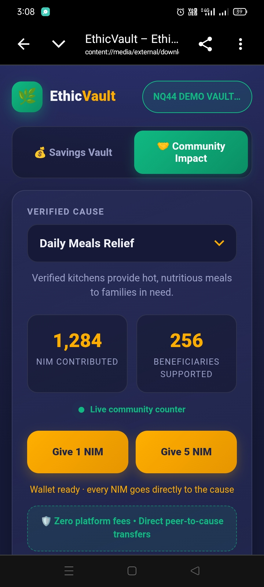
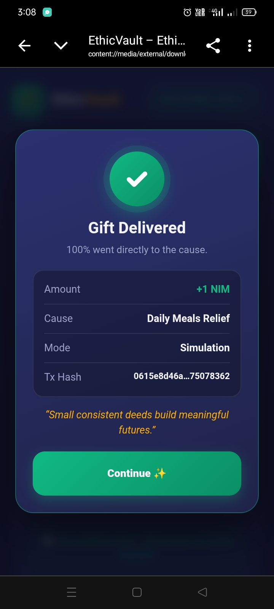
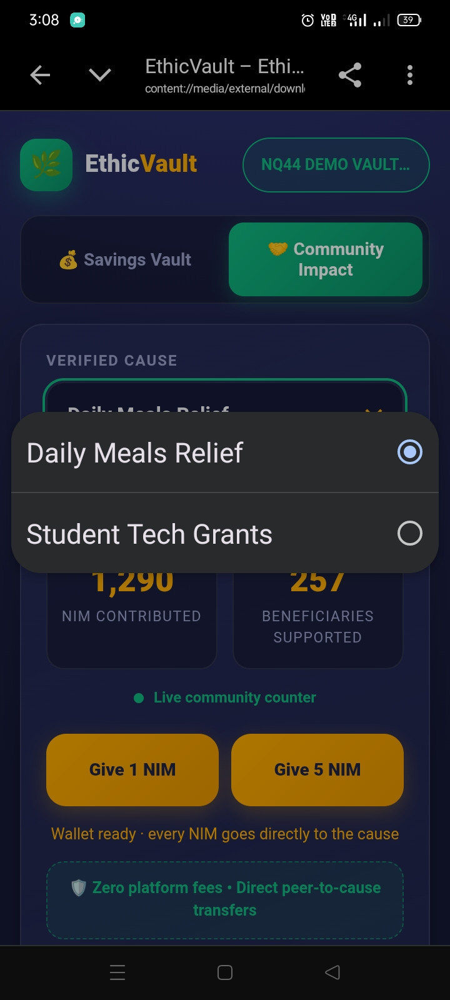
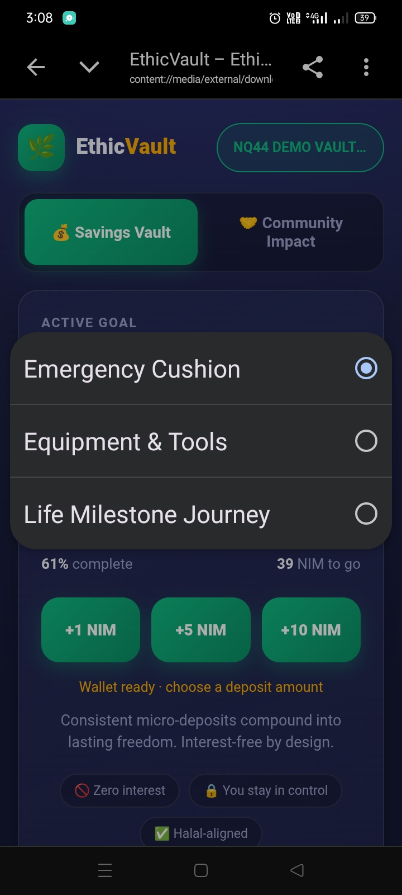
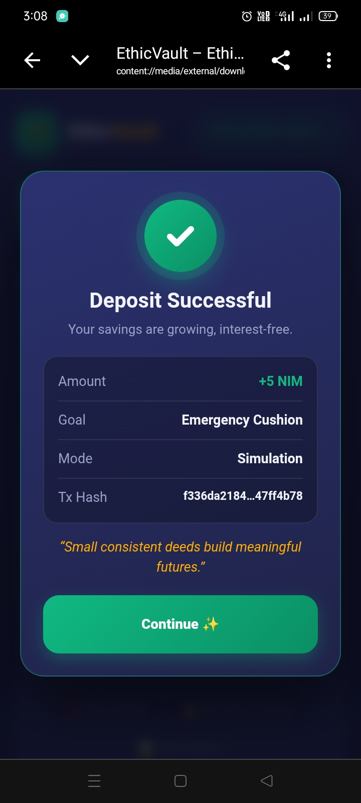

# EthicVault

> Discipline-based micro-savings & zero-fee community micro-giving.

| Field | Value |
| --- | --- |
| Category | Save |
| Pricing | Free |
| Team name | _Not provided — optional_ |
| Team members | _Not provided — optional_ |
| X account | SyedMuz09713276 |
| Heard about it via | X (Twitter) & Nimiq Community |
| Contact email | syedmuzaffarali135@gmail.com |
| GitHub login | @syedmuzaffarali135-blip |
| Submitted at | 2026-11-11T23:10:55.263Z |

## Links

| Link | URL |
| --- | --- |
| Repo | [https://github.com/syedmuzaffarali135-blip/ethicvault-nimiq](<https://github.com/syedmuzaffarali135-blip/ethicvault-nimiq>) |
| Demo | [https://ethicvault-nimiq.vercel.app](<https://ethicvault-nimiq.vercel.app>) |
| Video | [https://youtube.com/shorts/_HYYr4YFAu8?si=MxOosZYtWGZx_lJv](<https://youtube.com/shorts/_HYYr4YFAu8?si=MxOosZYtWGZx_lJv>) |
| Skool post | _Not provided — optional_ |
| Social post | [https://x.com/SyedMuz09713276/status/2120652961898778939?a=GXDEXch6_WYwfWad_wc&s=19](<https://x.com/SyedMuz09713276/status/2120652961898778939?a=GXDEXch6_WYwfWad_wc&s=19>) |

## Description

EthicVault is a zero-interest micro-savings vault and transparent community giving Mini App built on Nimiq Pay. It empowers users to achieve personal milestones through consistent deposits and send instant micro-donations with zero platform fees.

## Builder story

Inspired by the need for accessible, interest-free financial tools, I built EthicVault to show how Nimiq's frictionless micro-payments make daily savings discipline and zero-fee community micro-giving effortless directly inside a non-custodial wallet.

## Thumbnail

## Screenshots

---

_Generated from the submission form. `submission.yaml` in this folder is the machine-readable source of truth._
