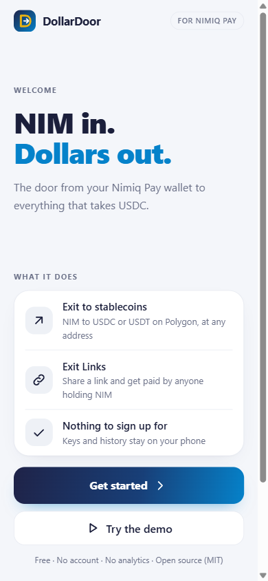
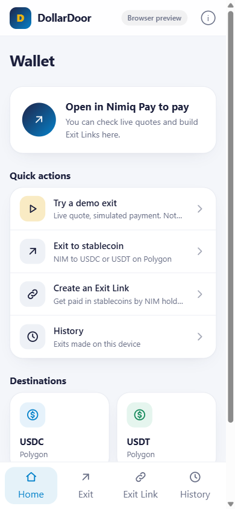
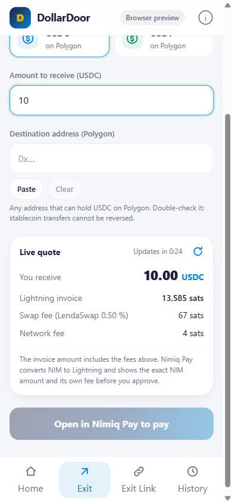
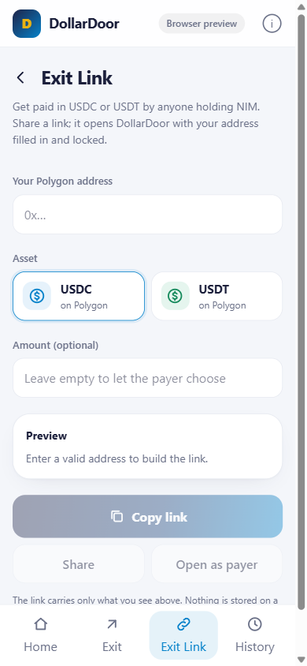

# Dollar Door

> NIM in. Dollars out. Turn NIM into USDC or USDT on Polygon at any address, without leaving Nimiq Pay.

| Field | Value |
| --- | --- |
| Category | On/Off-Ramp |
| Pricing | Free |
| Team name | _Not provided — optional_ |
| Team members | _Not provided — optional_ |
| X account | ineednoname006 |
| Heard about it via | X |
| Contact email | theageofprimes@gmail.com |
| GitHub login | @theageofprimes |
| Submitted at | 2026-11-11T23:17:19.259Z |

## Links

| Link | URL |
| --- | --- |
| Repo | [https://github.com/theageofprimes/DollarDoor](<https://github.com/theageofprimes/DollarDoor>) |
| Demo | [https://dollardoor-tau.vercel.app/](<https://dollardoor-tau.vercel.app/>) |
| Video | [https://www.youtube.com/watch?v=5PB4QJqLJr4](<https://www.youtube.com/watch?v=5PB4QJqLJr4>) |
| Skool post | [https://www.skool.com/miniappscompetition/dollar-door-submission](<https://www.skool.com/miniappscompetition/dollar-door-submission>) |
| Social post | [https://x.com/ineednoname006/status/2120654813394620885](<https://x.com/ineednoname006/status/2120654813394620885>) |

## Description

DollarDoor turns NIM into USDC or USDT on Polygon at any address you paste. It gets a live LendaSwap quote, Nimiq Pay pays the Lightning invoice, and the stablecoin is claimed gasless. Exit Links let anyone request stablecoins from NIM holders. No account, no backend.

## Builder story

I built Rewind in Cycle II, and the question I kept coming back to afterwards was simple: once someone has NIM in Nimiq Pay, where can it go? Most things online are priced in dollars and accept USDC. NIM holders had no short path there from inside the wallet.

DollarDoor is that path. You enter how much USDC or USDT you want and paste a Polygon address. The app fetches a live quote from LendaSwap, creates a Lightning-to-EVM swap, and hands the invoice to Nimiq Pay with payLightningInvoice. Nimiq Pay converts NIM to Lightning and shows the exact NIM amount before you approve. The stablecoin is then claimed gasless to your address. The app never holds funds. It has no backend, no account and no analytics; swap keys and history stay on the phone.

The part I care about most is Exit Links. Anyone who accepts USDC, such as a freelancer, a shop or another app, can make a link with their address and an amount. A NIM holder opens it in Nimiq Pay with the fields filled in and locked, and pays in NIM. That turns every USDC address into a place NIM can be spent, which is the reason I think this helps Nimiq and not just one user.

Two things I learned while building. The older LendaSwap SDK pointed at an API host that no longer answers, so I moved to the current pure TypeScript SDK, which also removed WASM from the app. And every number on screen comes from the live quote: fee, minimum, maximum and invoice amount. Nothing is hardcoded. On 11 November a quote for 10 USDC was a 13,585 sat invoice with a 0.50 % swap fee.

Status, stated plainly: quotes, invoice creation, Exit Links and the full interface are live. I have not yet completed a mainnet swap through the app end to end, because I had no NIM at the deadline. The app includes a demo mode that uses a live quote and a simulated payment, and it is labelled as simulated everywhere.

Next: a first mainnet swap with the evidence in the README, optional wallet sign-in, and more destinations.

## Thumbnail

## Screenshots

---

_Generated from the submission form. `submission.yaml` in this folder is the machine-readable source of truth._
