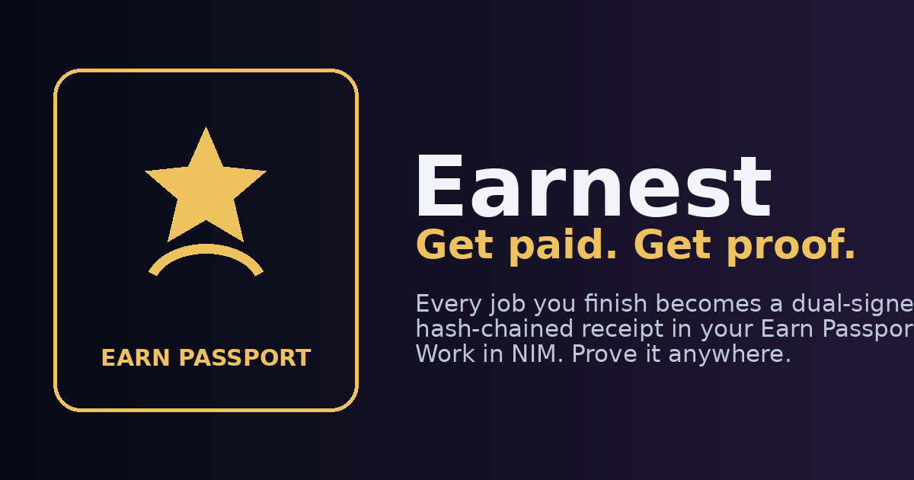
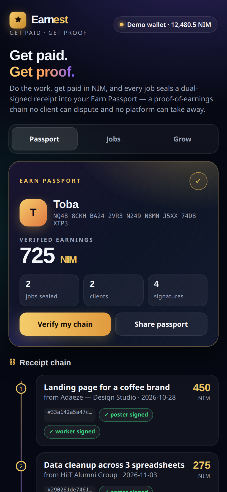
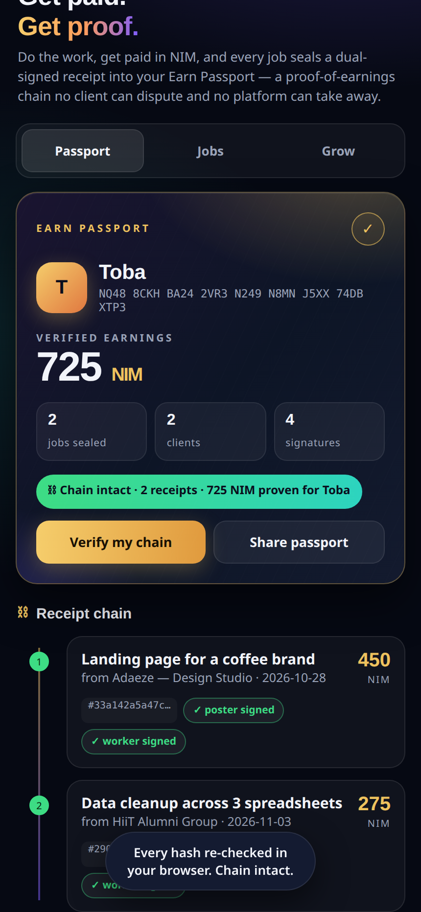
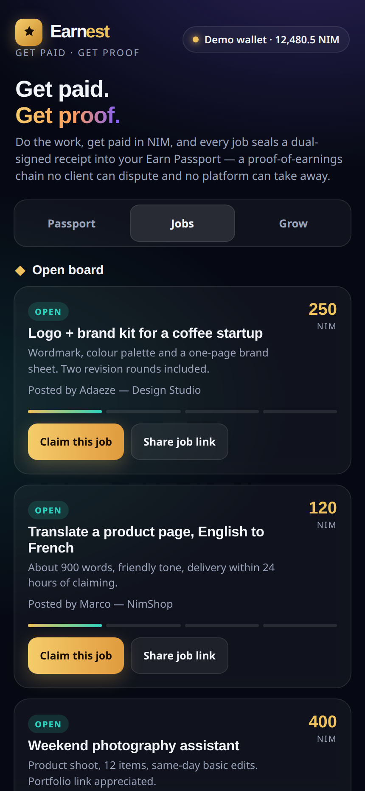
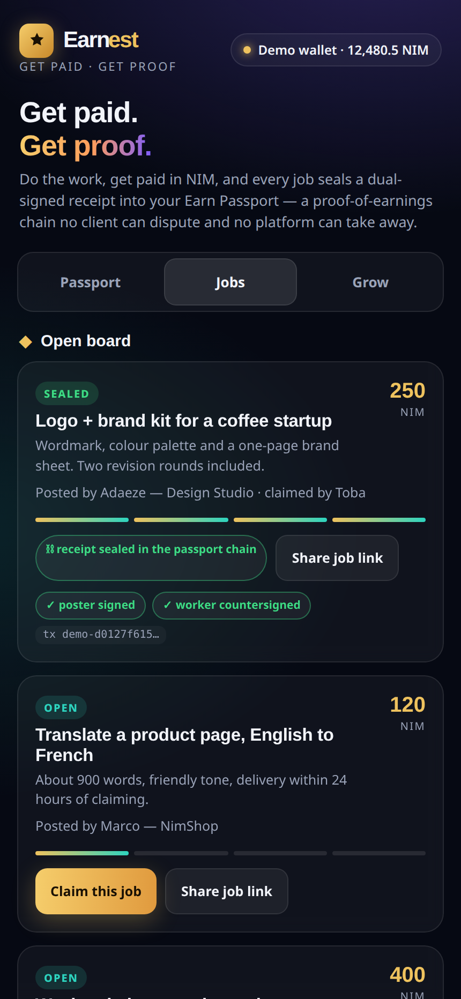
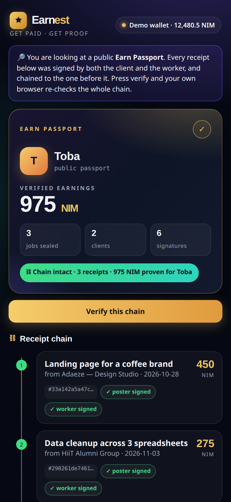

# Earnest

> Get paid. Get proof. Every NIM job you finish becomes a dual-signed receipt in your tamper-proof Earn Passport.

| Field | Value |
| --- | --- |
| Category | Earn |
| Pricing | Free |
| Team name | _Not provided — optional_ |
| Team members | _Not provided — optional_ |
| X account | tobadaniel_ |
| Heard about it via | _Not provided — optional_ |
| Contact email | officialtobadaniel@gmail.com |
| GitHub login | @tobadaniel |
| Submitted at | 2026-11-11T16:40:42.535Z |

## Links

| Link | URL |
| --- | --- |
| Repo | [https://github.com/tobadaniel/earnest](<https://github.com/tobadaniel/earnest>) |
| Demo | [https://earnest-app2.netlify.app](<https://earnest-app2.netlify.app>) |
| Video | [https://x.com/tobadaniel_/status/2120554839142731871](<https://x.com/tobadaniel_/status/2120554839142731871>) |
| Skool post | _Not provided — optional_ |
| Social post | [https://x.com/tobadaniel_/status/2120554839142731871](<https://x.com/tobadaniel_/status/2120554839142731871>) |

## Description

Earnest is where gig work meets proof. Claim a job or post one, get paid wallet to wallet in NIM, and both sides sign the receipt. Receipts chain by hash into your Earn Passport: portable proof of earnings anyone can verify in a browser. Then stake what you earned, in one app.

## Builder story

A freelancer in Lagos finishes a job, gets paid, and a month later cannot prove any of it happened. No payslip, no contract, nothing a landlord, a bank or an embassy will accept. Platforms like Upwork hold your reputation hostage: five years of five-star work vanishes the day you leave. I built Earnest so the proof belongs to the worker.

The loop is simple. A client posts a job with a NIM bounty and shares one link. A worker claims it, does the work, and gets paid wallet to wallet inside Nimiq Pay. Then both sides sign the receipt with their own wallets: the client signs that the work was accepted and paid, the worker countersigns that the money arrived. Neither signature can be added later by the other party.

Every receipt then joins the worker's Earn Passport. Each receipt commits to the SHA-256 hash of the one before it, so the whole history forms one tamper-evident chain. Edit an amount, delete a bad job, reorder the past, and every later hash breaks. The passport travels as a single link; anyone who opens it can press verify and watch their own browser recompute the entire chain and check the total. No server, no account, no permission from Earnest.

Earnings should not sit idle either. The Grow tab stakes NIM through Nimiq Pay's own staking transactions, the full create-staker and add-stake family, so money earned on a job in the morning can be working by the afternoon without leaving the app or opening an exchange account.

Technically, Earnest uses more of the Mini App toolkit than a payment button: basic transactions for pay, message signing for the dual-signature receipt protocol, the staking transaction family for Grow, and host network and balance reads throughout. It is local-first by design: jobs and passports live in shareable links, and Earnest never holds anyone's money or keys.

The honest limits: receipts prove that both parties signed the same statement, not that a job was done well; a dispute still needs humans. The roadmap is anchoring the passport's chain tip on-chain, optional HTLC escrow for high-value jobs, and a pool directory with payout history inside Grow. The gig economy runs on trust that workers cannot carry with them today. Earnest makes it portable.

## Thumbnail

## Screenshots

---

_Generated from the submission form. `submission.yaml` in this folder is the machine-readable source of truth._
