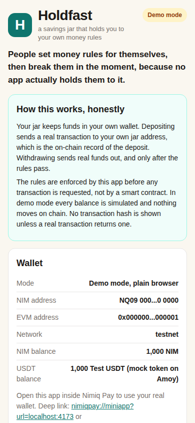
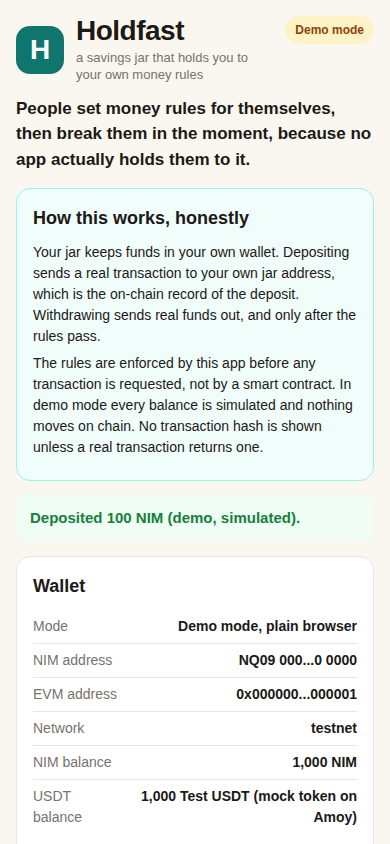
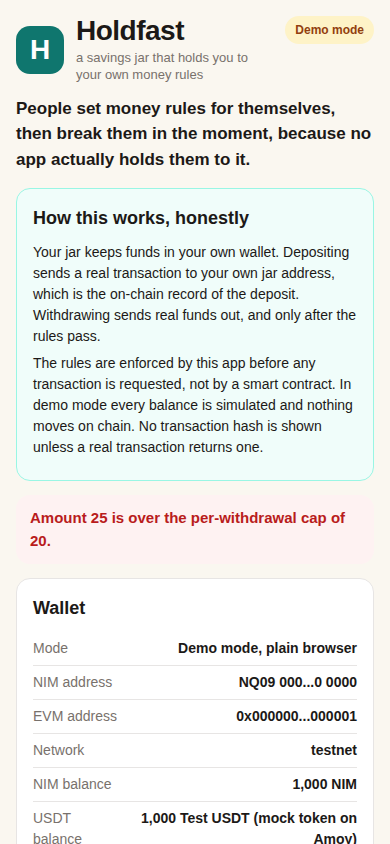
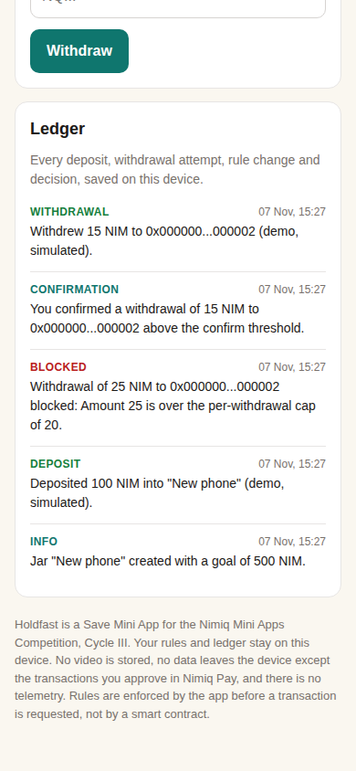

# Holdfast

> A savings jar that holds you to your own money rules.

| Field | Value |
| --- | --- |
| Category | Save |
| Pricing | Free |
| Team name | _Not provided — optional_ |
| Team members | _Not provided — optional_ |
| X account | _Not provided — optional_ |
| Heard about it via | _Not provided — optional_ |
| Contact email | 0x5ive@gmail.com |
| GitHub login | @tydavid5 |
| Submitted at | 2026-11-07T15:29:26.832Z |

## Links

| Link | URL |
| --- | --- |
| Repo | [https://github.com/tydavid5/holdfast](<https://github.com/tydavid5/holdfast>) |
| Demo | [https://holdfast-gh8paf5oy-tydavid5.vercel.app/](<https://holdfast-gh8paf5oy-tydavid5.vercel.app/>) |
| Video | [https://youtu.be/YCaV5_QpnA0](<https://youtu.be/YCaV5_QpnA0>) |
| Skool post | _Not provided — optional_ |
| Social post | _Not provided — optional_ |

## Description

Holdfast is a savings jar with a memory for Nimiq Pay. You set money rules in plain words, and the jar holds you to them, blocking withdrawals that break your rules and keeping a ledger of every attempt.

## Builder story

_Not provided — optional_

## Thumbnail

## Screenshots

---

_Generated from the submission form. `submission.yaml` in this folder is the machine-readable source of truth._
