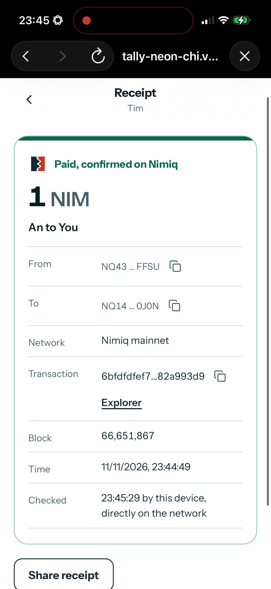
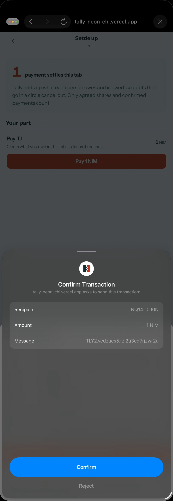
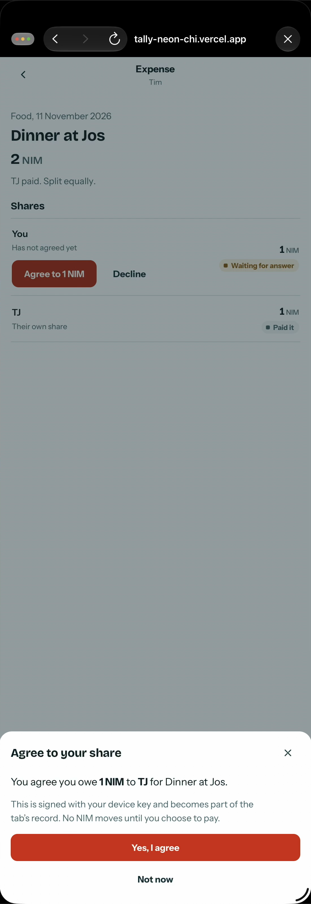
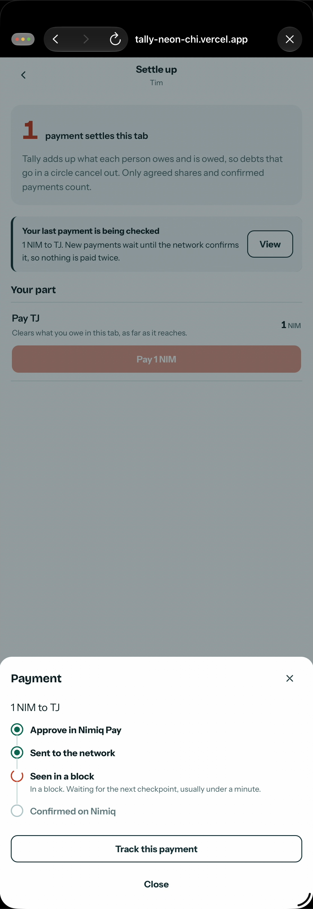
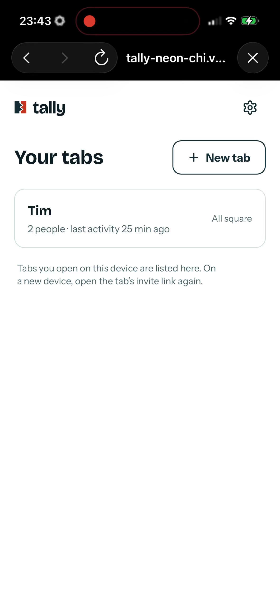

# Tally

> Shared expenses. Actually settled.

| Field | Value |
| --- | --- |
| Category | Pay |
| Pricing | Free |
| Team name | Tally |
| Team members | _Not provided — optional_ |
| X account | winsznx |
| Heard about it via | _Not provided — optional_ |
| Contact email | xidoncapitals@gmail.com |
| GitHub login | @winsznx |
| Submitted at | 2026-11-11T23:13:56.821Z |

## Links

| Link | URL |
| --- | --- |
| Repo | [https://github.com/winsznx/tally](<https://github.com/winsznx/tally>) |
| Demo | [https://tally-neon-chi.vercel.app](<https://tally-neon-chi.vercel.app>) |
| Video | [https://youtu.be/-h1qpekaeXE](<https://youtu.be/-h1qpekaeXE>) |
| Skool post | _Not provided — optional_ |
| Social post | [https://x.com/winsznx/status/2120655917318598664?a=Urfx1mdOUtyIXpv_4To&s=20](<https://x.com/winsznx/status/2120655917318598664?a=Urfx1mdOUtyIXpv_4To&s=20>) |

## Description

Tally keeps one shared tab for groups who split costs. Each person agrees to their own share, and Tally turns what's owed into the fewest NIM payments, marking each one paid only once it's confirmed on the Nimiq network.

## Builder story

Tally started in Cycle I as a testnet experiment in automatic settlement, and it didn't win. Testing it with real groups showed the hard part was never the maths. It was trust: did my friend actually pay, and did I really agree to that amount? For Cycle III we rebuilt it around that. Every share needs the debtor's own signed agreement, every payment is approved in Nimiq Pay, and a payment only counts once Tally finds it on mainnet with the right recipient, amount and memo. We switched off the old auto-pay key because Nimiq Pay's co-signed spending account made it the wrong trade-off. The first real payments between two of our wallets confirmed in about a minute.

## Thumbnail

## Screenshots

---

_Generated from the submission form. `submission.yaml` in this folder is the machine-readable source of truth._
