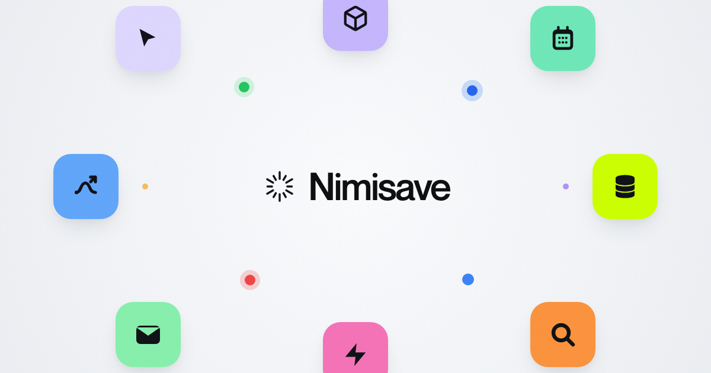
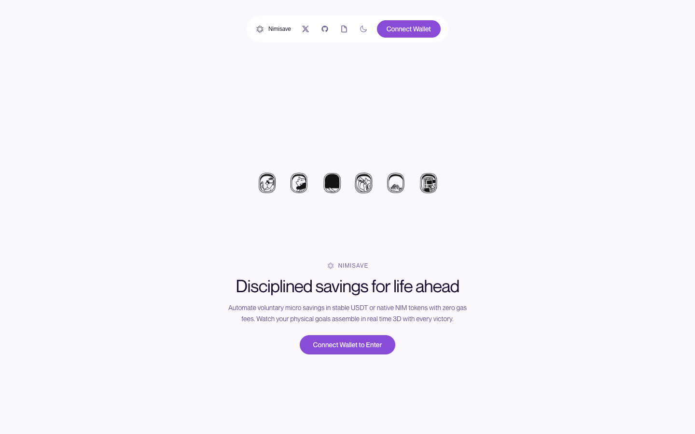
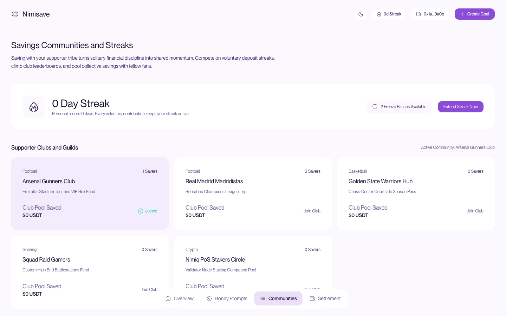
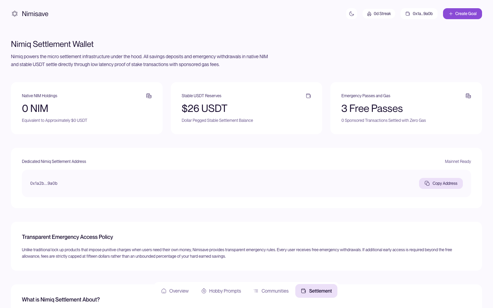

# NimiSave

> Automate disciplined savings toward physical goals with zero gas fees.

| Field | Value |
| --- | --- |
| Category | Save |
| Pricing | Free |
| Team name | NimiSave |
| Team members | _Not provided — optional_ |
| X account | _Not provided — optional_ |
| Heard about it via | Google |
| Contact email | wisdomdivine3d@gmail.com |
| GitHub login | @wisdomdivine |
| Submitted at | 2026-11-11T23:01:40.967Z |

## Links

| Link | URL |
| --- | --- |
| Repo | [https://github.com/wisdomdivine/nimisave](<https://github.com/wisdomdivine/nimisave>) |
| Demo | [https://nimisave.pages.dev/](<https://nimisave.pages.dev/>) |
| Video | [https://youtu.be/Ge3PC7dSDBE?si=FqqSj0Tc7Po7TImC](<https://youtu.be/Ge3PC7dSDBE?si=FqqSj0Tc7Po7TImC>) |
| Skool post | _Not provided — optional_ |
| Social post | _Not provided — optional_ |

## Description

Nimisave is a non custodial micro savings app that helps crypto holders and everyday hobbyists build disciplined financial habits.

## Builder story

Saving money often feels abstract and disconnected from our daily routines. Many people want to build solid reserves, yet traditional savings products lack emotional resonance and charge high transaction fees that punish frequent small deposits.

We built Nimisave to transform disciplined saving into an exciting, visual habit. By combining voluntary hobby triggers with Nimiq micro settlements, users can automatically set aside funds whenever their favorite team wins a match or after a weekly hobby session. Each contribution immediately assembles another physical piece of their chosen 3D goal in real time, from modern dream houses to vehicles and travel funds.
Nimiq makes this possible through zero gas fees, instant finality, and non custodial security. Users stay in full control of their keys while experiencing the satisfaction of watching their dreams take shape with every victory.

## Thumbnail

## Screenshots

---

_Generated from the submission form. `submission.yaml` in this folder is the machine-readable source of truth._
