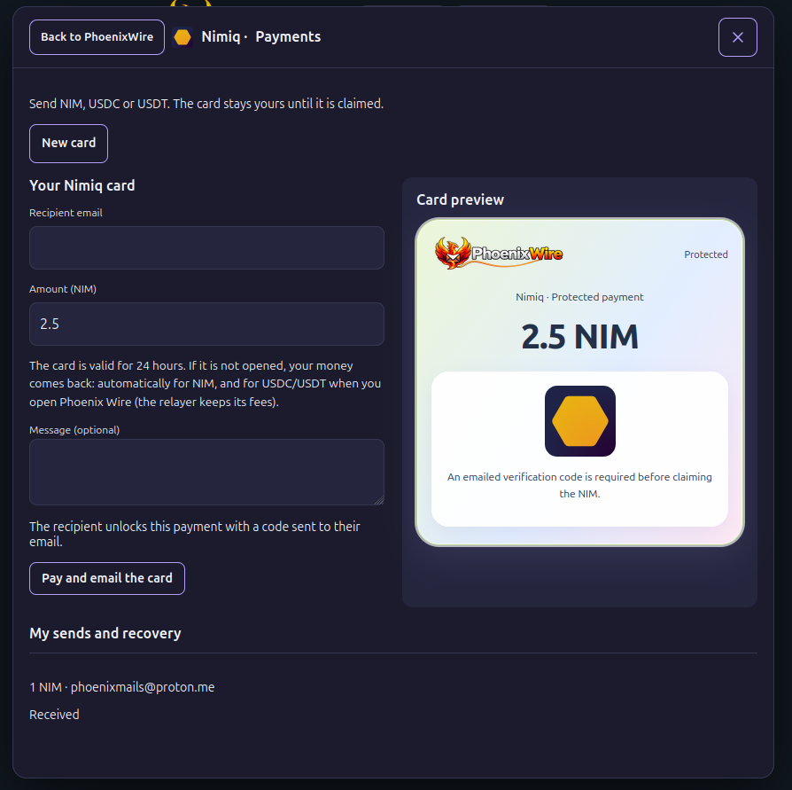
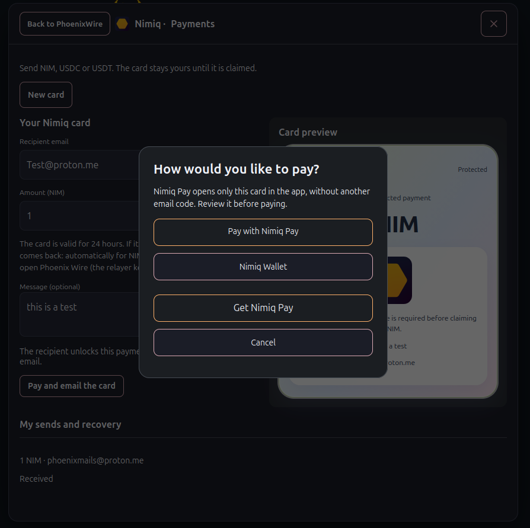
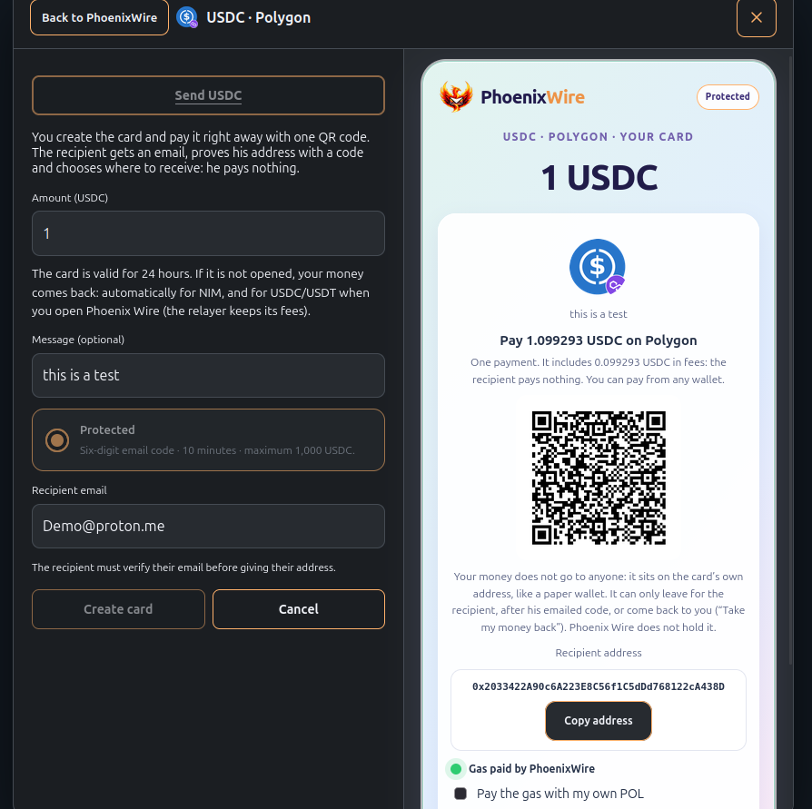
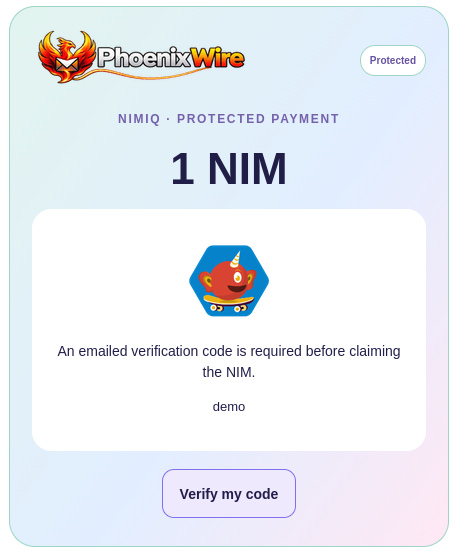
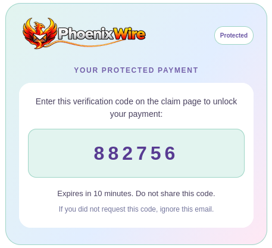

# PhoenixWire

> Email connects people. Wire aims to connect their payments.

| Field | Value |
| --- | --- |
| Category | Pay |
| Pricing | Free |
| Team name | _Not provided — optional_ |
| Team members | _Not provided — optional_ |
| X account | _Not provided — optional_ |
| Heard about it via | Nimiq community |
| Contact email | Xcoder@outlook.fr |
| GitHub login | @xcoder2088 |
| Submitted at | 2026-10-24T20:36:58.622Z |

## Links

| Link | URL |
| --- | --- |
| Repo | [https://github.com/xcoder2088/PhoenixWire](<https://github.com/xcoder2088/PhoenixWire>) |
| Demo | [https://wire.phoenixmail.ca/](<https://wire.phoenixmail.ca/>) |
| Video | [https://youtu.be/xtovIPGg1Zk](<https://youtu.be/xtovIPGg1Zk>) |
| Skool post | [https://www.skool.com/miniappscompetition/phoenixwire-send-a-payment-like-you-send-a-message?p=28eaa785](<https://www.skool.com/miniappscompetition/phoenixwire-send-a-payment-like-you-send-a-message?p=28eaa785>) |
| Social post | [https://x.com/brad04668932/status/2114093415705059539?s=20](<https://x.com/brad04668932/status/2114093415705059539?s=20>) |

## Description

PhoenixWire lets you send NIM, USDC and USDT by email as payment cards protected by an email verification code, so only the intended recipient can claim them. Built for everyday users, it supports sending and receiving NIM directly through Nimiq Pay or Nimiq Wallet.

## Builder story

PhoenixWire grew out of PhoenixMail, my email client. After integrating Nimiq Cashlinks into emails, I wondered: what if a payment link could be protected so that forwarding it wasn’t enough to claim the money?

That question became PhoenixWire: payment cards for NIM, USDC and USDT, protected by a verification code sent to the recipient’s email. It also supports sending and receiving NIM directly through Nimiq Pay or Nimiq Wallet.

My goal is to make crypto easier to discover and use, especially for people who have never tried it. Sending someone their first NIM should feel as familiar as sending them an email. What started as a small feature became a project of its own—and perhaps a slightly crazy idea worth pursuing!

## Thumbnail

## Screenshots

---

_Generated from the submission form. `submission.yaml` in this folder is the machine-readable source of truth._
