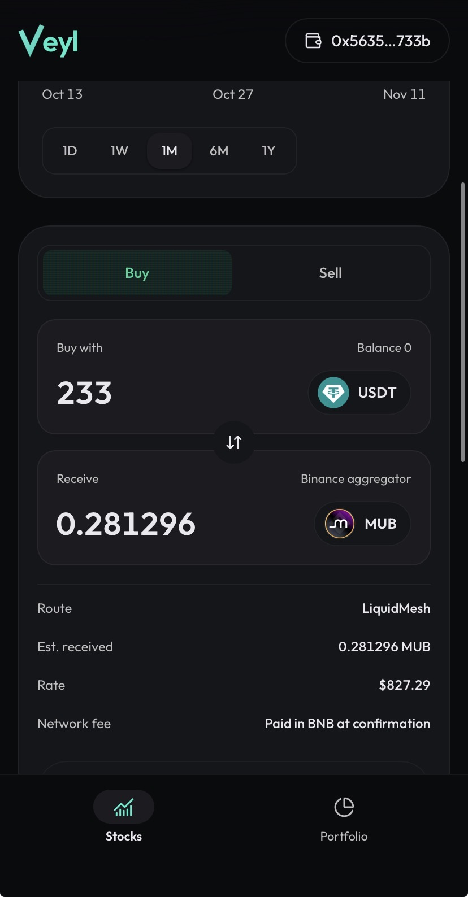
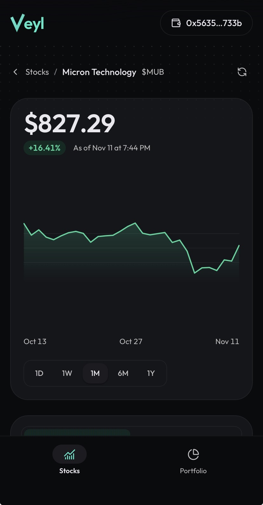
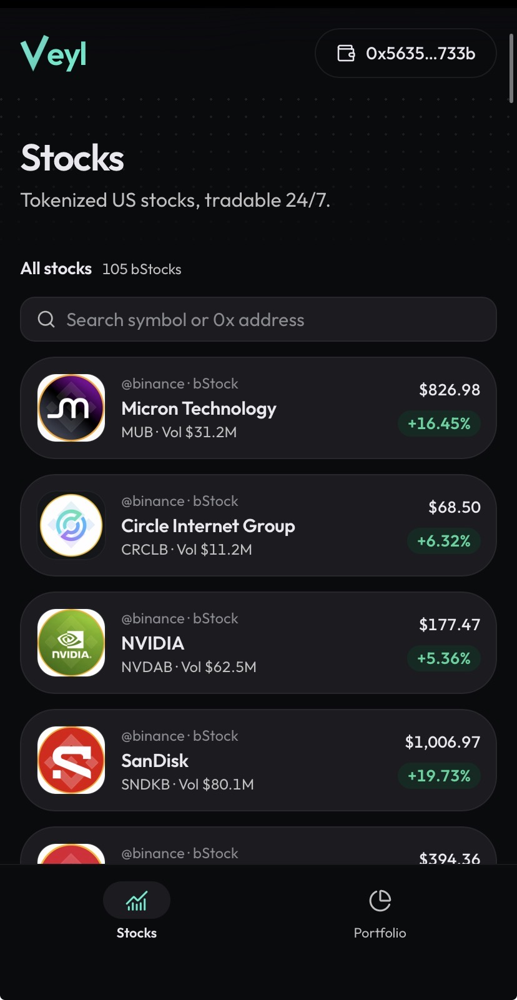
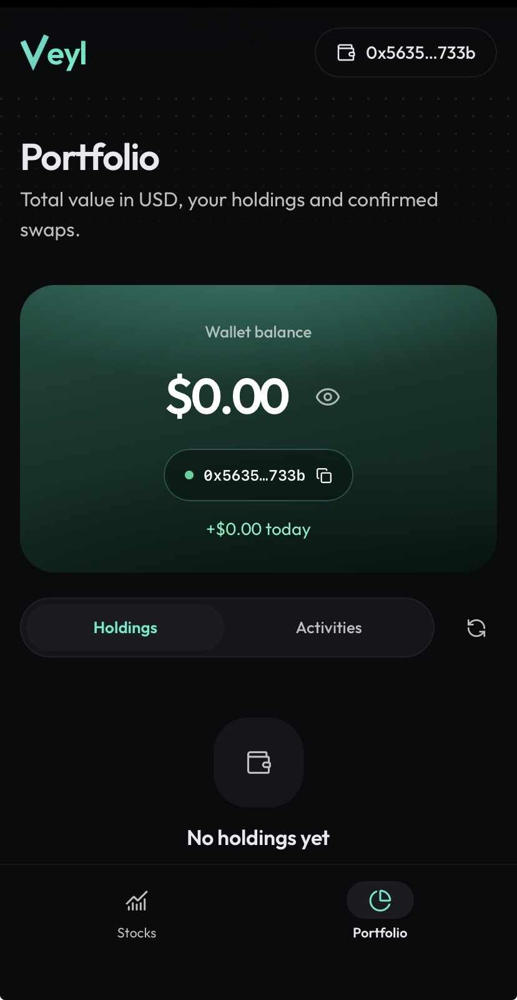

# Veyl

> Explore and trade US tokenized stocks with USDT on BNB Smart chain.

| Field | Value |
| --- | --- |
| Category | Save |
| Pricing | Free |
| Team name | _Not provided — optional_ |
| Team members | _Not provided — optional_ |
| X account | _Not provided — optional_ |
| Heard about it via | Twitter (X) |
| Contact email | emmaolatunji760@gmail.com |
| GitHub login | @zachbuilds26 |
| Submitted at | 2026-11-11T20:30:00.212Z |

## Links

| Link | URL |
| --- | --- |
| Repo | [https://github.com/zachbuilds26/veyl-io](<https://github.com/zachbuilds26/veyl-io>) |
| Demo | [https://veyl-io.vercel.app](<https://veyl-io.vercel.app>) |
| Video | [https://youtu.be/mXBOMzRZupo?si=YKZQSpnlfgvLai2t](<https://youtu.be/mXBOMzRZupo?si=YKZQSpnlfgvLai2t>) |
| Skool post | [https://www.skool.com/miniappscompetition/veyl?p=c776262d](<https://www.skool.com/miniappscompetition/veyl?p=c776262d>) |
| Social post | [https://x.com/0x_zachh/status/2120611759686136119?s=46](<https://x.com/0x_zachh/status/2120611759686136119?s=46>) |

## Description

Veyl lets you explore & trade tokenized stocks on BNB Smart Chain and track your portfolio.

## Builder story

_Not provided — optional_

## Thumbnail

## Screenshots

---

_Generated from the submission form. `submission.yaml` in this folder is the machine-readable source of truth._
